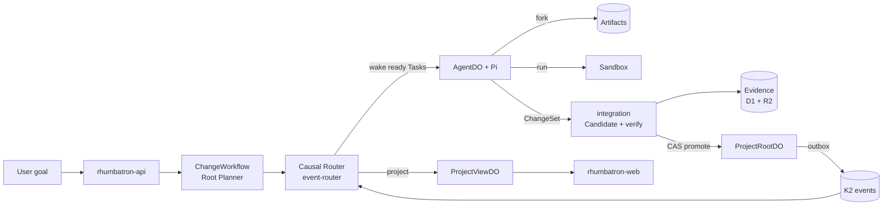
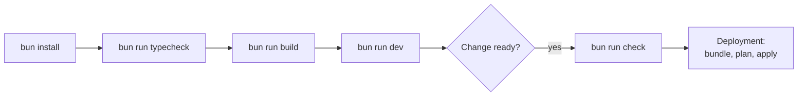

# Rhumbatron

> Rhumbatron is Git, CI, and a distributed task scheduler for autonomous software developers.

Many agents can propose many futures of one codebase. Only verified evidence can advance the canonical state.

`AGENTS.md` is the authoritative build plan. [docs/BUILD_STATUS.md](docs/BUILD_STATUS.md) states the current phase and caps. [docs/demo/runbook.md](docs/demo/runbook.md) is the demo sequence. [docs/architecture/README.md](docs/architecture/README.md) explains the architecture. [docs/operations/README.md](docs/operations/README.md) lists the runbooks. [docs/protocols/README.md](docs/protocols/README.md) lists the protocol schemas and the request API.

## Live Status

| Environment | Web | API | Sign-in |
|---|---|---|---|
| prod | `https://rhumbatron.com` (`www` redirects to the apex) | `https://api.rhumbatron.com` | Clerk production instance. |

Prod is the only remote environment. Terraform deploys it (`envs/prod`, ADR 0017). Local work uses `wrangler dev`. Each Project is a live app at `https://<slug>.rhumbatron.com` (ADR 0020).

## Architecture

[docs/architecture/README.md](docs/architecture/README.md) has the full guide.



A user submits a goal for a Project. The intake gate checks that the goal is clear and new (ADR 0025). The Root Planner then compiles it into a Work Graph of Tasks (`ChangeWorkflow`). The Causal Router wakes only the agents whose Tasks are ready.

Each agent is an `AgentDO` with the Pi harness. It calls Anthropic Claude models through AI Gateway (ADR 0021). The agent declares a typed Intent, works in an Artifacts Workspace inside a capped Sandbox, and publishes a ChangeSet.

Durable Objects hold authoritative state:
- `ProjectRootDO`: Holds Canonical Generation and compare-and-swap promotion.
- `ResourceShardDO`: Holds Claims and Intents.
- `ProjectViewDO`: Holds live read-model and socket state.

Every mutation writes a transactional outbox row, and the outbox publisher sends it to K2. The event router projects Events into the live view and archives them to R2.

A deterministic detector checks Intents on semantic resources. Sonnet reviews ambiguous overlaps. The review escalates to Opus only when `ALLOW_OPUS` is `true`. Otherwise Sonnet runs the Opus tier. Conflicting paths fork into Candidates.

The integration Worker composes each Candidate and verifies it in the Sandbox. The checks come from the risk tier and the Change: build, unit, contract, protected invariants, p95 performance, security, browser, acceptance, and the preview smoke check (`packages/evidence/src/plan.ts`). It records verification Evidence in D1 and R2.

Sibling Candidates of one Change wait for each other. Selection ranks them by Evidence (ADR 0026). If the required checks pass and the policy approvals exist, `ProjectRootDO` promotes the selected Candidate with one atomic compare-and-swap. The promotion advances the Canonical Generation.

Reliability safeguards:
- Dead-letter consumer with Retry and Dismiss.
- Section 44 limits (`workers/agents/src/limits.ts`): 8 active agents and 4 Sandboxes per Change, 2 attempts per tier.
- Runaway-billing guards (ADR 0019): capped Durable Object alarms, capped causal wakeups, and account budget alerts.
- Advisory Claims to avoid overlapping writes without rigid locking.

## UI Routes

- `/`: Projects list and invitations ("Shared with you"). The header has the notification bell.
- `/projects/<id>`: Project overview.
- `/projects/<id>/board`: Board of every request by person or by stage (Proposed, Needs answer, Building, Checking, Shipped, Not built). An owner or admin includes or declines proposed requests.
- `/changes/<id>`: Change details, acceptance criteria, invariants, candidates.
- `/changes/<id>/flight`: Flight Control (execution DAG, agent swimlanes, workspace lanes, codebase heatmap, candidate arena, preview wall, evidence explorer, decisions, events, time machine, command palette Cmd+K).
- `/candidates/<id>`: Candidate verification evidence, approval, promotion.
- `/compare/<changeId>`: Candidate comparison matrix.
- `/projects/<id>/{agents,events,verification,workspace,costs,graph,code,versions}`: Project views. The Events page has a Product | Systems toggle next to its List | Graph toggle.
- `/projects/<id>/code`: Code page. Everyone with access browses the files of any version and its history. An owner or admin can edit one file of the live tree, or use Start editing (`?edit=true`) to open an edit session: an IDE with a file tree (new file, rename, delete, changed markers), tabs, the CodeMirror editor, a resizable terminal that runs commands in the session Sandbox, and a status bar with the idle countdown, Submit as change, and Discard session. Keys: Cmd/Ctrl+S saves, Cmd/Ctrl+P opens a file by path, Ctrl+` shows or hides the terminal. The IDE loads only when a session starts.
- `/projects/<id>/settings`: Project name, people and roles, default Change budget, and member request review.

## Prerequisites

| Tool | Version | Install |
|---|---|---|
| Bun | 1.3.14 (`packageManager` in `package.json`) | `brew install oven-sh/bun/bun` |
| Terraform | >= 1.16 | `brew install hashicorp/tap/terraform` |
| tflint | latest | `brew install tflint` |
| gitleaks | latest | `brew install gitleaks` |

Wrangler is a dev dependency. Use the repository copy through `bunx wrangler` for local development and type generation only. Do not use a global install.

## Setup

```sh
bun install          # installs dependencies and Git hooks via lefthook
bun run typecheck
bun run build
bun run dev          # runs all apps and Workers locally
```

For the web app, copy `apps/web/.env.example` to `apps/web/.env.local` and add Clerk development keys.

`tf`, `smoke:models`, `cost:report`, and `e2e` read credentials from the macOS Keychain. `scripts/tf.ts` lists the items for each Terraform root. The `package.json` scripts list the rest. The scripts that sign in as the Clerk smoke user read it from the environment (see below).



## Layout

```text
apps/web                 TanStack Start UI (rhumbatron.com)
workers/<name>           One Cloudflare Worker per directory, each with its own wrangler.jsonc
packages/                Shared logic: protocol (Zod schemas), evidence, conflict, model-router, ...
containers/coding-agent  Sandbox image
fixtures/                Acme Shop source and the Wishlist designs for the demo
infrastructure/terraform Bootstrap, env roots (global, prod), modules
migrations/d1            D1 SQL migrations (applied by Terraform)
docs/                    Architecture, ADRs, protocols, operations, demo, build status (published by apps/docs)
scripts/                 Bundle, checks, smoke, cleanup, cost report
```

## Commands

| Command | Purpose |
|---|---|
| `bun run dev` | Run all apps and Workers locally. |
| `bun run build` | Build every package. |
| `bun run typecheck` | Generate Worker types and run `tsc` across workspaces. |
| `bun run lint` / `lint:fix` | Biome lint and format check. |
| `bun run test:critical` | Critical tests only: protocols, invariants, failure modes (no coverage target). |
| `bun run check` | Run all local quality gates (lint, types, guardrails, fixtures, deps, secrets, Terraform). |
| `bun run check:guardrails` | Enforce the Terraform-only and no-`wrangler deploy` policy and resource names. |
| `bun run check:bindings` | Compare the binding names in each `wrangler.jsonc` with the bindings Terraform uploads. |
| `bun run check:fixtures` | Fail when the embedded demo fixtures are stale. |
| `bun run check:deps` | Run knip and sherif monorepo hygiene checks. |
| `bun run check:secrets` | Run gitleaks scan on history and staged changes. |
| `bun run tf:check` | Run `terraform fmt`, `validate`, and tflint on all roots without remote access. |
| `bun run cf:bundle` | Build Worker bundles and `dist/bundles/manifest.json` for Terraform. |
| `bun run tf <bootstrap\|global\|prod> <args>` | Run Terraform for one root with Keychain credentials. Refuses `-auto-approve`. |
| `bun run tf:plan:prod` / `tf:apply:prod` | Plan prod to `prod.tfplan`, then apply that plan. |
| `bun run tf:drift` / `tf:drift:prod` | Post-apply plan that must show zero changes (`global` and `prod`). |
| `bun run smoke:prod` | Remote smoke check. Public checks always run; the signed-in flow runs when `CLERK_SECRET_KEY` and `CLERK_SMOKE_USER_ID` are set. |
| `bun run smoke:models` | Anthropic through AI Gateway: workspace header, one tool call per tier, one prompt cache hit (under 1 cent). |
| `bun run cleanup:projects` | Archive smoke-test Projects on prod (`--dry-run` lists them only). Needs `CLERK_SECRET_KEY` and `CLERK_SMOKE_USER_ID` for the prod Clerk instance. |
| `bun run cost:report` | Read-only report of usage, caps, and leftover resources (`--alerts-only`). |
| `bun run e2e prod` | Every public API endpoint against prod, without model spend. Reads the Clerk smoke user from the Keychain. Removes every Project it creates. |
| `bun run test:ui` | Playwright UI suite (`e2e/ui`) against prod, at 1440px and 412px. Signs in as the Clerk prod smoke user. Writes to `e2e/.results`. |
| `bun run lighthouse` | Lighthouse on every page of the UI suite, mobile and desktop, against prod (`--only=<page>`, `--form=mobile\|desktop`). Writes to `e2e/.lighthouse`. |
| `bun run journeys prod [A1,A2,...\|all]` | API journeys against prod: real builds through the public API (about $0.15 per build). Removes every Project it creates. |

`test:ui`, `lighthouse`, `journeys`, `smoke:prod`, and `cleanup:projects` sign in as the Clerk prod smoke user. They read `CLERK_SECRET_KEY` and `CLERK_SMOKE_USER_ID` from the environment. Set them from the Keychain:

```bash
CLERK_SECRET_KEY=$(security find-generic-password -s rhumbatron-clerk-secret-key-prod -w) \
CLERK_SMOKE_USER_ID=$(security find-generic-password -s rhumbatron-clerk-smoke-user-id-prod -w) \
bun run test:ui
```

## Deployment

Terraform is the only way to change Cloudflare control-plane configuration. Never run `wrangler deploy`, make manual dashboard edits, or issue direct REST writes.

Deployment sequence:

```sh
bun run cf:bundle
bun run tf:plan:prod
bun run tf:apply:prod
bun run tf:drift:prod
bun run smoke:prod
```

See [docs/operations/deploy.md](docs/operations/deploy.md) and [infrastructure/terraform/README.md](infrastructure/terraform/README.md).

Cost controls ([docs/operations/costs.md](docs/operations/costs.md)):
- Rhumbatron runs on a shared Workers Paid account within included allowances.
- Sandbox: 20 hours per month in prod.
- Browser Run: 960 seconds per day in prod.
- Claude (Anthropic): code stops model work at 100 USD per calendar month in prod (ADR 0021).
- Account budget alerts at 10, 25, and 100 USD (ADR 0019, `envs/global`).
- Pause switch: `locals.paused` in `infrastructure/terraform/envs/prod/main.tf` ([pause-resume.md](docs/operations/pause-resume.md)).
- Live apps on Dynamic Workers release every Project (ADR 0020, [release.md](docs/operations/release.md)).

## CI

`.github/workflows/ci.yml` runs on pull requests and pushes to `main`. It runs install, lint, binding drift check, typecheck, critical tests, build, Worker bundles, and Terraform `fmt -check` and `validate` with `-backend=false`. It requires no secrets and does not deploy. Deploys run locally through Terraform.

## Git hooks

`lefthook.yml` defines the hooks:

- pre-commit: Biome (auto-fix), gitleaks on staged changes, `terraform fmt -check`, guardrails.
- commit-msg: Conventional Commits through commitlint.
- pre-push: typecheck, dependency checks, Terraform checks, binding drift check.
