# Rhumbatron

**[rhumbatron.com](https://rhumbatron.com)** · [Documentation](https://docs.rhumbatron.com)

Rhumbatron lets a team of people and AI agents change one codebase at the same time. You describe an outcome in plain language. Agents do the work in parallel, Rhumbatron finds conflicts between their plans before a merge, and only a version that passes its checks ships.

Made by [Sudhanva Narayana](https://sudhanva.me) and [Maanasa Narayan](https://maanasa.dev) for the Cloudflare competition *Build the Next-Gen Git Platform on Cloudflare*.

## How it works

```mermaid
flowchart LR
  goal[Request in plain language] --> intake[Intake check<br/>clear? duplicate?]
  intake --> plan[Work Graph<br/>Tasks + dependencies]
  plan --> wake[Causal wake-up<br/>only ready Tasks]
  wake --> agents[Agents in parallel<br/>one Artifacts fork each]
  agents --> intents[Typed Intents and Claims<br/>on semantic resources]
  intents --> conflict{Semantic<br/>conflict?}
  conflict -->|no| compose[Compose one Candidate]
  conflict -->|yes| fork[Fork Candidates<br/>A and B]
  compose --> verify[Verify with evidence<br/>build, tests, contract, browser, p95]
  fork --> verify
  verify --> select[Select by evidence]
  select --> promote[Compare-and-swap promotion<br/>S41 → S42]
  promote --> live[Live app on<br/>Dynamic Workers]
```



## Key Features

- **Parallel agents.** Each agent has an isolated Git workspace and a Sandbox. Agents without ready work stay asleep.
- **Semantic conflict detection.** Rhumbatron finds conflicts between designs, for example two data models for one feature, even when the text merges cleanly.
- **Evidence-based merge.** Build, test, contract, browser, and acceptance checks decide which version ships. A skipped check never counts as a pass.
- **Safe promotion.** One compare-and-swap per version, so two merges cannot overwrite each other.
- **Teams.** Owner, admin, member, and viewer roles. A Board shows each request by person and by stage.
- **Cost control.** Budgets for each request, Project, and person. Small Tasks use less expensive models.

## Built on Cloudflare

Workers, Artifacts, Durable Objects, Sandbox, Dynamic Workers, Workflows, Queues, K2, D1, R2, KV, Vectorize, Workers AI, AI Gateway, and Browser Run. Terraform manages all resources. The agents use Claude Sonnet 5.5 and Claude Haiku 5.5.

The [architecture guide](docs/architecture/README.md) gives the details.

## Try it

1. Open [rhumbatron.com](https://rhumbatron.com) and sign in with Google.
2. Create a Project and describe an app under **New change**.
3. Look at the agents on the Change page. When the Candidate promotes, open the live app.

## Run it yourself

Requirements: [Bun](https://bun.sh) 1.3.14 and [Terraform](https://developer.hashicorp.com/terraform) 1.16 or later.

```sh
git clone https://github.com/nsudhanva/rhumbatron.git
cd rhumbatron
bun install
cp apps/web/.env.example apps/web/.env.local
bun run dev
```

Add your Clerk development keys to `apps/web/.env.local`. The web app runs on `localhost:5173` and the API on `localhost:8787`.

The local runtime simulates D1, R2, KV, Queues, Durable Objects, and Workflows. A full agent run needs Artifacts, K2, and Workers AI, so it needs a Cloudflare deployment. To deploy to your own account, follow the [deployment runbook](docs/operations/deploy.md).

## Team

| Name | Website | GitHub | LinkedIn | X |
|---|---|---|---|---|
| Sudhanva Narayana | [sudhanva.me](https://sudhanva.me) | [@nsudhanva](https://github.com/nsudhanva) | [nsudhanva](https://linkedin.com/in/nsudhanva) | [@SudhanvaN](https://x.com/SudhanvaN) |
| Maanasa Narayan | [maanasa.dev](https://maanasa.dev) | [@maanasanarayan](https://github.com/maanasanarayan) | [maanasa-narayan](https://www.linkedin.com/in/maanasa-narayan/) | [@maanasa_narayan](https://x.com/maanasa_narayan) |

## License

[MIT](LICENSE)
