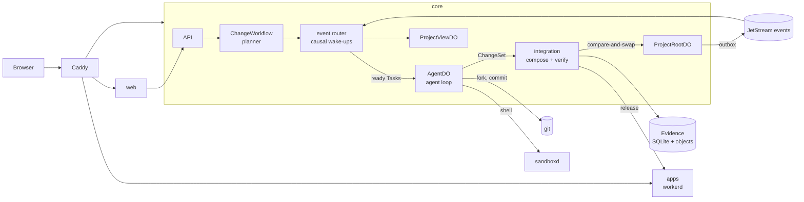

# Rhumbatron

Rhumbatron lets a team of people and AI agents change one codebase at the same time. You describe an outcome in plain language. Agents do the work in parallel. Before their work merges, Rhumbatron finds conflicts between their plans. It then builds and tests each version, and it deploys only a version that passes all of its tests.

Made by [Sudhanva Narayana](https://sudhanva.me) and [Maanasa Narayan](https://maanasa.dev) for the Cloudflare competition *Build the Next-Gen Git Platform on Cloudflare*.

## How it works

```mermaid
flowchart LR
  goal[Request in plain language] --> intake[Intake check<br/>clear? duplicate?]
  intake --> plan[Work Graph<br/>Tasks + dependencies]
  plan --> wake[Causal wake-up<br/>only ready Tasks]
  wake --> agents[Agents in parallel<br/>one Git fork each]
  agents --> intents[Typed Intents and Claims<br/>on semantic resources]
  intents --> conflict{Semantic<br/>conflict?}
  conflict -->|no| compose[Compose one Candidate]
  conflict -->|yes| fork[Fork Candidates<br/>A and B]
  compose --> verify[Verify with evidence<br/>build, tests, contract, browser, p95]
  fork --> verify
  verify --> select[Select by evidence]
  select --> promote[Compare-and-swap promotion<br/>S41 → S42]
  promote --> live[Live app on<br/>workerd]
```



## Key Features

- **Parallel agents.** Each agent has an isolated Git workspace and a Sandbox. Agents without ready work stay asleep.
- **Semantic conflict detection.** Rhumbatron finds conflicts between designs, for example two data models for one feature, even when the text merges cleanly.
- **Evidence-based merge.** Build, test, contract, browser, and acceptance checks decide which version ships. A skipped check never counts as a pass.
- **Safe promotion.** One compare-and-swap per version, so two merges cannot overwrite each other.
- **Teams.** Owner, admin, member, and viewer roles. A Board shows each request by person and by stage.
- **Cost control.** Budgets for each request, Project, and person. Small Tasks use less expensive models.

## Components

Rhumbatron runs as one Docker Compose stack behind Caddy at `https://rhumbatron.localhost` ([ADR 0034](docs/adr/0034-docker-compose-stack.md)). Every component is open source. Only the model calls to Anthropic cost money.

| Function | Component | What Rhumbatron uses it for |
|---|---|---|
| Edge, TLS, routing | Caddy 2.11 (`edge`) | Issues certificates from its own local CA. Routes `rhumbatron.localhost`, `api.`, `docs.`, and each app subdomain. Serves the docs site. |
| Web app | TanStack Start on Bun (`web`) | The UI. Server functions call the API. |
| API and back end | One Bun process (`core`) | Runs the API, the coordinator, the agents, integration, the event router, and the indexer. Calls between them are in-process calls. |
| Actors | The actor host in `packages/platform` | `ProjectRootDO` keeps the Canonical Generation and does the compare-and-swap promotion. `ResourceShardDO` keeps Claims and Intents. `ProjectViewDO` sends live updates over WebSockets. `AgentDO` keeps agent state. Each actor has its own SQLite file. |
| Workflows | The workflow engine in `packages/platform` | Runs `ChangeWorkflow` (plans a Change), `CandidateVerificationWorkflow` (runs the checks), and `ReleaseWorkflow` (deploys the live app). |
| Commands and Events | NATS JetStream 2.15 (`nats`) | One work-queue stream carries the commands: agent wake-ups, integration, verification, indexing, release, and failed commands. Eight streams keep all Events in order. Actors write each Event to an outbox first. |
| Product data | SQLite in `core` | Projects, Changes, Tasks, Candidates, check summaries, members, usage meters, the policy copies, the vectors, and the metrics. |
| Large files | versitygw 1.10 (`objects`) | An S3 bucket for check reports and logs, context packets, patches, app bundles, and the event archive. |
| Source | The git service (`git`) | One bare Git repository per Project. Each agent Task, Candidate, and code edit session works in its own fork. |
| Sandboxes | `sandboxd` with sibling containers | Runs agent shell commands, `bun install`, builds, and Candidate tests in an isolated Linux container with an egress allowlist. |
| Live apps | `workerd` with the Worker Loader (`apps`) | Loads and runs the bundle of each live app at `<slug>.rhumbatron.localhost` and each Candidate preview. Loaded apps have no network. `AppDataDO` keeps the data of each app. |
| Browser checks | Playwright 1.64 server (`browser`) | Opens Candidate previews in a headless browser and saves screenshots as Evidence. |
| Embeddings and rerank | llama.cpp (`embed`, `rerank`) | `bge-small-en-v1.5` makes embeddings. `bge-reranker-base` ranks related requests at intake. |
| Small decisions (Clef-flash) | Claude Haiku with a forced tool call | Picks the model tier for a step, decides whether an Event wakes an agent, and checks whether a request is clear and new. Rhumbatron uses a decision only when its confidence is high enough. It also writes the goal suggestions for a new Project. |
| Model calls | The Anthropic API | All Claude calls. An in-app meter reserves and settles each call and stops calls at the monthly budget. |
| Sign-in | Clerk development instance | Accepts `rhumbatron.localhost`. |

The agents use Claude Sonnet 5.5 and Claude Haiku 5.5.



The [architecture guide](docs/architecture/README.md) gives the details.

## Documentation

The stack serves this documentation at `https://docs.rhumbatron.localhost`.

| Topic | Page |
|---|---|
| How a request becomes a release | [Change lifecycle](docs/architecture/change-lifecycle.md) |
| Agents, models, and model routing | [Agents and models](docs/architecture/agents-and-models.md) |
| Git workspaces, Candidates, and checks | [Source and verification](docs/architecture/source-and-verification.md) |
| Events, commands, and the outbox | [Events and commands](docs/architecture/events-and-commands.md) |
| Roles, request review, and the Board | [Shared Projects](docs/architecture/shared-projects.md) |
| Live apps on workerd | [Live apps](docs/architecture/live-apps.md) |
| API routes and schemas | [Protocols](docs/protocols/README.md) |
| Running the stack and cost limits | [Local stack](docs/operations/local-stack.md), [Costs](docs/operations/costs.md) |
| Design decisions | [Architecture decision records](docs/adr/README.md) |

## Quick start

Requirements: [Docker Desktop](https://www.docker.com/products/docker-desktop/) and [Bun](https://bun.sh) 1.3.14.

```sh
git clone https://github.com/nsudhanva/rhumbatron.git
cd rhumbatron
cp apps/web/.env.example apps/web/.env.local   # add your Clerk development keys
bun run stack:up                               # writes .env, builds, and starts the stack
bun run stack:trust                            # trusts the local CA; asks for your password once
```

Put your Anthropic API key in the macOS Keychain item `rhumbatron-anthropic-api-key`, or set `ANTHROPIC_API_KEY` before `bun run stack:up`.

1. Open `https://rhumbatron.localhost` and sign in.
2. Create a Project and describe an app under **New change**.
3. Look at the agents on the Change page. When the Candidate promotes, open the live app at `https://<slug>.rhumbatron.localhost`.

`bun run stack:down` stops the stack and keeps the data. The [local stack runbook](docs/operations/local-stack.md) covers the settings, the logs, the data volumes, and a Linux server.

## Team

| Name | Website | GitHub | LinkedIn | X |
|---|---|---|---|---|
| Sudhanva Narayana | [sudhanva.me](https://sudhanva.me) | [@nsudhanva](https://github.com/nsudhanva) | [nsudhanva](https://linkedin.com/in/nsudhanva) | [@SudhanvaN](https://x.com/SudhanvaN) |
| Maanasa Narayan | [maanasa.dev](https://maanasa.dev) | [@maanasanarayan](https://github.com/maanasanarayan) | [maanasa-narayan](https://www.linkedin.com/in/maanasa-narayan/) | [@maanasa_narayan](https://x.com/maanasa_narayan) |

## License

[MIT](LICENSE)
