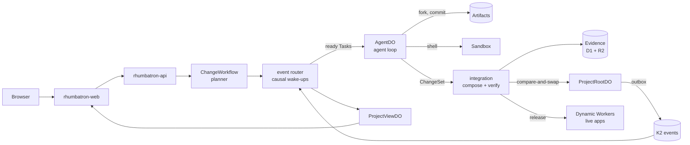

# Rhumbatron

**[rhumbatron.com](https://rhumbatron.com)** · [Documentation](https://docs.rhumbatron.com)

Rhumbatron lets a team of people and AI agents change one codebase at the same time. You describe an outcome in plain language. Agents do the work in parallel. Before their work merges, Rhumbatron finds conflicts between their plans. It then builds and tests each version, and it deploys only a version that passes all of its tests.

Made by [Sudhanva Narayana](https://sudhanva.me) and [Maanasa Narayan](https://maanasa.dev) for the Cloudflare competition *Build the Next-Gen Git Platform on Cloudflare*.

## How it works

```mermaid
flowchart LR
  goal[Request in plain language] --> intake[Intake check<br/>clear? duplicate?]
  intake --> plan[Work Graph<br/>Tasks + dependencies]
  plan --> wake[Causal wake-up<br/>only ready Tasks]
  wake --> agents[Agents in parallel<br/>one Artifacts fork each]
  agents --> intents[Typed Intents and Claims<br/>on semantic resources]
  intents --> conflict{Semantic<br/>conflict?}
  conflict -->|no| compose[Compose one Candidate]
  conflict -->|yes| fork[Fork Candidates<br/>A and B]
  compose --> verify[Verify with evidence<br/>build, tests, contract, browser, p95]
  fork --> verify
  verify --> select[Select by evidence]
  select --> promote[Compare-and-swap promotion<br/>S41 → S42]
  promote --> live[Live app on<br/>Dynamic Workers]
```



## Key Features

- **Parallel agents.** Each agent has an isolated Git workspace and a Sandbox. Agents without ready work stay asleep.
- **Semantic conflict detection.** Rhumbatron finds conflicts between designs, for example two data models for one feature, even when the text merges cleanly.
- **Evidence-based merge.** Build, test, contract, browser, and acceptance checks decide which version ships. A skipped check never counts as a pass.
- **Safe promotion.** One compare-and-swap per version, so two merges cannot overwrite each other.
- **Teams.** Owner, admin, member, and viewer roles. A Board shows each request by person and by stage.
- **Cost control.** Budgets for each request, Project, and person. Small Tasks use less expensive models.

## Built on Cloudflare

| Cloudflare product | What Rhumbatron uses it for |
|---|---|
| [Workers](https://developers.cloudflare.com/workers/) | Runs all server code in ten Workers: web, API, coordinator, agents, event router, integration, indexer, Sandbox host, live apps, and docs. |
| [Artifacts](https://developers.cloudflare.com/artifacts/) | Keeps the Git repository of each Project. Each agent Task, Candidate, and code edit session works in its own fork. |
| [Durable Objects](https://developers.cloudflare.com/durable-objects/) | `ProjectRootDO` keeps the Canonical Generation and does the compare-and-swap promotion. `ResourceShardDO` keeps Claims and Intents. `ProjectViewDO` sends live updates over WebSockets. `AgentDO` keeps agent state. `AppDataDO` keeps the data of each live app. |
| [Sandbox](https://developers.cloudflare.com/sandbox/) | Runs agent shell commands, `bun install`, builds, and Candidate tests in a Linux container. |
| [Dynamic Workers](https://developers.cloudflare.com/dynamic-workers/) | Loads and runs the bundle of each live app and Candidate preview at `<project>.rhumbatron.com`. |
| [Workflows](https://developers.cloudflare.com/workflows/) | Runs three long processes: `ChangeWorkflow` plans a Change, `CandidateVerificationWorkflow` runs the checks, and `ReleaseWorkflow` deploys the live app. |
| [Queues](https://developers.cloudflare.com/queues/) | Carries commands between Workers: agent wake-ups, integration, verification, indexing, release, and failed commands. |
| [K2](https://developers.cloudflare.com/k2/) | Keeps all Events in order in eight streams. Durable Objects write each Event to an outbox first. |
| [D1](https://developers.cloudflare.com/d1/) | Keeps the product data in SQL tables: Projects, Changes, Tasks, Candidates, check summaries, members, and usage meters. |
| [R2](https://developers.cloudflare.com/r2/) | Keeps large files: check reports and logs, context packets, patches, app bundles, and the event archive. |
| [Workers KV](https://developers.cloudflare.com/kv/) | Keeps a copy of each Project policy for fast reads. |
| [Vectorize](https://developers.cloudflare.com/vectorize/) | Keeps embeddings of the code and of previous Changes. Agents search it after the exact dependency lookup. |
| [Workers AI](https://developers.cloudflare.com/workers-ai/) | Runs `bge-small-en-v1.5` to make embeddings and `bge-reranker-base` to rank related requests at intake. |
| [Clef-flash](https://developers.cloudflare.com/workers-ai/models/clef-flash/) | Makes small decisions: the model tier for a step, whether an Event wakes an agent, and whether a request is clear and new. Rhumbatron uses a decision only when its confidence is high enough. Clef-flash also writes the goal suggestions for a new Project. |
| [AI Gateway](https://developers.cloudflare.com/ai-gateway/) | Sends all Claude calls to Anthropic, records the usage, and stops calls at the monthly spend limit. |
| [Browser Run](https://developers.cloudflare.com/browser-run/) | Opens Candidate previews in a headless browser and saves screenshots as evidence. |

Terraform manages all Cloudflare resources. The agents use Claude Sonnet 5.5 and Claude Haiku 5.5.



The [architecture guide](https://docs.rhumbatron.com/architecture/) gives the details.

## Documentation

| Topic | Page |
|---|---|
| How a request becomes a release | [Change lifecycle](https://docs.rhumbatron.com/architecture/change-lifecycle/) |
| Agents, models, and model routing | [Agents and models](https://docs.rhumbatron.com/architecture/agents-and-models/) |
| Git workspaces, Candidates, and checks | [Source and verification](https://docs.rhumbatron.com/architecture/source-and-verification/) |
| Events, Queues, and the outbox | [Events and commands](https://docs.rhumbatron.com/architecture/events-and-commands/) |
| Roles, request review, and the Board | [Shared Projects](https://docs.rhumbatron.com/architecture/shared-projects/) |
| Live apps on Dynamic Workers | [Live apps](https://docs.rhumbatron.com/architecture/live-apps/) |
| API routes and schemas | [Protocols](https://docs.rhumbatron.com/protocols/) |
| Deployment and cost limits | [Deploy](https://docs.rhumbatron.com/operations/deploy/), [Costs](https://docs.rhumbatron.com/operations/costs/) |
| Design decisions | [Architecture decision records](https://docs.rhumbatron.com/adr/) |

## Try it

1. Open [rhumbatron.com](https://rhumbatron.com) and sign in with Google.
2. Create a Project and describe an app under **New change**.
3. Look at the agents on the Change page. When the Candidate promotes, open the live app.

## Run it yourself

Requirements: [Bun](https://bun.sh) 1.3.14 and [Terraform](https://developer.hashicorp.com/terraform) 1.16 or later.

```sh
git clone https://github.com/nsudhanva/rhumbatron.git
cd rhumbatron
bun install
cp apps/web/.env.example apps/web/.env.local
bun run dev
```

Add your Clerk development keys to `apps/web/.env.local`. The web app runs on `localhost:5173` and the API on `localhost:8787`.

`bun run dev` runs the web app and the API on your computer, with no Cloudflare account. Wrangler keeps local copies of the database, the file storage, and the queues in the `.wrangler` folder. The agents cannot build apps on your computer, because they need Artifacts, K2, and Workers AI, which run only on Cloudflare. To use the agents, deploy to your own Cloudflare account with the [deployment runbook](https://docs.rhumbatron.com/operations/deploy/).

## Team

| Name | Website | GitHub | LinkedIn | X |
|---|---|---|---|---|
| Sudhanva Narayana | [sudhanva.me](https://sudhanva.me) | [@nsudhanva](https://github.com/nsudhanva) | [nsudhanva](https://linkedin.com/in/nsudhanva) | [@SudhanvaN](https://x.com/SudhanvaN) |
| Maanasa Narayan | [maanasa.dev](https://maanasa.dev) | [@maanasanarayan](https://github.com/maanasanarayan) | [maanasa-narayan](https://www.linkedin.com/in/maanasa-narayan/) | [@maanasa_narayan](https://x.com/maanasa_narayan) |

## License

[MIT](LICENSE)
