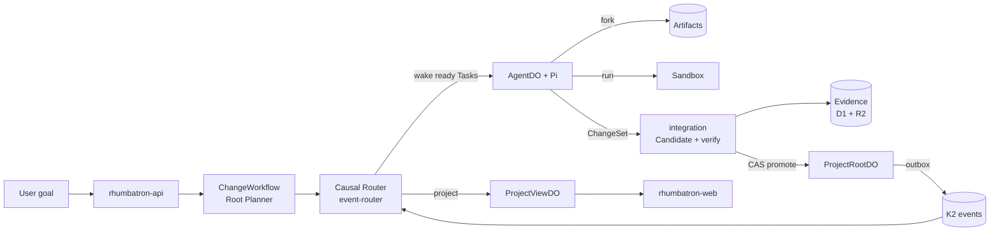
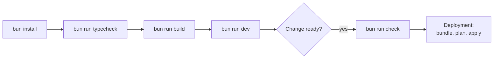

# Rhumbatron

> Rhumbatron is Git, CI, and a distributed task scheduler for autonomous software developers.

Many agents can propose many futures of one codebase. Only verified evidence can advance the canonical state.

`AGENTS.md` is the authoritative build plan. `docs/BUILD_STATUS.md` tracks progress. `docs/demo/runbook.md` is the demo sequence. [docs/architecture/README.md](docs/architecture/README.md) explains the architecture. [docs/operations/README.md](docs/operations/README.md) lists the runbooks.

## Live Status

| Environment | Web | API | Sign-in |
|---|---|---|---|
| prod | `https://rhumbatron.com` (`www` redirects to the apex) | `https://api.rhumbatron.com` | Clerk production instance. Email and password only. Google is off until an OAuth client exists. |
| dev | `https://dev.rhumbatron.com` | `https://api-dev.rhumbatron.com` | Clerk development instance. |

Terraform deploys both environments (`envs/dev`, `envs/prod`, ADR 0017).

A real model-driven Change ran end to end on dev. The Root Planner and four agents built shared wishlists on stacked workspaces. The Candidate composed automatically. It passed build, 26 unit tests, contract tests, the Cart invariant check, p95 performance, and 9 authorization security tests. A human approved it, and promotion advanced the Canonical Generation from S0 to S1. Model cost was about 0.91 USD. That run used Gemini on Vertex AI. Anthropic has replaced it (ADR 0021).

## Architecture

[docs/architecture/README.md](docs/architecture/README.md) has the full guide. This is the short version.



A user submits a goal for a Project. The Root Planner compiles it into a Work Graph of Tasks (`ChangeWorkflow`). The Causal Router wakes only the agents whose Tasks are ready.

Each agent is an `AgentDO` with the Pi harness, and it calls models through AI Gateway. The agent declares a typed Intent, works in an Artifacts Workspace inside a capped Sandbox, and publishes a ChangeSet.

Durable Objects hold authoritative state:
- `ProjectRootDO`: Holds Canonical Generation and compare-and-swap promotion.
- `ResourceShardDO`: Holds Claims and Intents.
- `ProjectViewDO`: Holds live read-model and socket state.

Every mutation writes a transactional outbox row, and the outbox publisher sends it to K2. The event router projects Events into the live view and archives them to R2.

A deterministic detector checks Intents on semantic resources. Sonnet reviews ambiguous overlaps and can escalate to Opus. Conflicting paths fork into Candidates.

The integration Worker composes each Candidate and verifies it in the Sandbox (build, unit, contract, Cart invariant, p95, security). It records verification Evidence in D1 and R2.

If the required checks pass and the policy approvals exist, `ProjectRootDO` promotes the winning Candidate with one atomic compare-and-swap. The promotion advances the Canonical Generation.

Reliability safeguards:
- Dead-letter consumer with Retry and Dismiss.
- Section 44 limits (`workers/agents/src/limits.ts`): 8 active agents and 4 Sandboxes per Change, 2 attempts per tier.
- Runaway-billing guards (ADR 0019): capped Durable Object alarms, capped causal wakeups, and account budget alerts.
- Advisory Claims to avoid overlapping writes without rigid locking.

## UI Routes

- `/`: Projects list. Header includes notification bell.
- `/projects/<id>`: Project overview.
- `/changes/<id>`: Change details, acceptance criteria, invariants, candidates.
- `/changes/<id>/flight`: Flight Control (execution DAG, agent swimlanes, workspace lanes, codebase heatmap, candidate arena, preview wall, evidence explorer, decisions, events, time machine, command palette Cmd+K).
- `/candidates/<id>`: Candidate verification evidence, approval, promotion.
- `/compare/<changeId>`: Candidate comparison matrix.
- `/projects/<id>/{agents,events,verification,workspace,costs,graph}`: Dedicated project management and monitoring views.

## Prerequisites

| Tool | Version | Install |
|---|---|---|
| Bun | 1.3.14 (`packageManager` in `package.json`) | `brew install oven-sh/bun/bun` |
| Terraform | >= 1.16 | `brew install hashicorp/tap/terraform` |
| tflint | latest | `brew install tflint` |
| gitleaks | latest | `brew install gitleaks` |

Wrangler is a dev dependency. Use the repository copy through `bunx wrangler` for local development and type generation only. Do not use a global install.

## Setup

```sh
bun install          # installs dependencies and Git hooks via lefthook
bun run typecheck
bun run build
bun run dev          # runs all apps and Workers locally
```

For the web app, copy `apps/web/.env.example` to `apps/web/.env.local` and add Clerk development keys.

Remote scripts (`tf`, `smoke:*`, `demo:*`, `inject`, `cost:report`) read credentials from the macOS Keychain. `scripts/tf.ts` lists the items for each Terraform root. The `package.json` scripts list the rest.



## Layout

```text
apps/web                 TanStack Start UI (rhumbatron.com)
workers/<name>           One Cloudflare Worker per directory, each with its own wrangler.jsonc
packages/                Shared logic: protocol (Zod schemas), evidence, conflict, model-router, ...
containers/coding-agent  Sandbox image
fixtures/                Demo Project source (Acme Shop) and its Wishlist designs
infrastructure/terraform Bootstrap, env roots (global, dev, prod), modules
migrations/d1            D1 SQL migrations (applied by Terraform)
docs/                    ADRs, protocols, operations, demo, build status
scripts/                 Bundle, checks, smoke, demo, failure injection, cost report
```

## Commands

| Command | Purpose |
|---|---|
| `bun run dev` | Run all apps and Workers locally. |
| `bun run build` | Build every package. |
| `bun run typecheck` | Generate Worker types and run `tsc` across workspaces. |
| `bun run lint` / `lint:fix` | Biome lint and format check. |
| `bun run test:critical` | Critical tests only: protocols, invariants, failure modes (no coverage target). |
| `bun run check` | Run all local quality gates (lint, types, guardrails, fixtures, deps, secrets, Terraform). |
| `bun run check:guardrails` | Enforce Terraform-only and no-`wrangler deploy` policy. |
| `bun run check:deps` | Run knip and sherif monorepo hygiene checks. |
| `bun run check:secrets` | Run gitleaks scan on history and staged changes. |
| `bun run tf:check` | Run `terraform fmt`, `validate`, and tflint on all roots without remote access. |
| `bun run cf:bundle` | Build Worker bundles and `dist/bundles/manifest.json` for Terraform. |
| `bun run tf <bootstrap\|global\|dev\|prod> <args>` | Run Terraform for one root with Keychain credentials. Refuses `-auto-approve`. |
| `bun run tf:plan:dev` / `tf:apply:dev` | Plan dev to `dev.tfplan`, then apply that plan. |
| `bun run tf:plan:prod` / `tf:apply:prod` | Plan prod to `prod.tfplan`, then apply that plan. |
| `bun run tf:drift` / `tf:drift:prod` | Post-apply plan that must show zero changes (`global` and `dev`; `prod`). |
| `bun run smoke:dev` / `smoke:prod` | Remote smoke check. Dev runs the signed-in flow; prod runs public checks only. |
| `bun run smoke:plan` | Dev smoke plus one real goal through the Root Planner (1 to 4 model calls). |
| `bun run smoke:sandbox` | Dev smoke plus Sandbox verification and promotion of the Acme Shop baseline. |
| `bun run smoke:models [dev\|prod]` | Anthropic through AI Gateway: workspace header, one tool call per tier, one prompt cache hit (under 1 cent). |
| `bun run smoke:release` | Read-only check of the latest Acme Shop Live release. |
| `bun run demo:project` | Create or reuse the Acme Shop demo Project on dev. |
| `bun run demo:wishlist` | Run the scripted Wishlist demo (Designs A vs B, conflict, verification). |
| `bun run demo:live` | Run a real model-driven Change on dev and stream progress. |
| `bun run inject` | Run failure injection against public dev APIs. |
| `bun run cleanup:projects` | Archive smoke-test Projects (`--dry-run` lists them only). |
| `bun run cost:report` | Read-only report of usage, caps, and leftover resources (`--alerts-only`). |

## Deployment

Terraform is the only way to change Cloudflare control-plane configuration. Never run `wrangler deploy`, make manual dashboard edits, or issue direct REST writes (one documented exception: ADR 0014).

Deployment sequence (dev; prod uses the `:prod` scripts):

```sh
bun run cf:bundle
bun run tf:plan:dev
bun run tf:apply:dev
bun run tf:drift
bun run smoke:dev
```

See [docs/operations/deploy.md](docs/operations/deploy.md) and [infrastructure/terraform/README.md](infrastructure/terraform/README.md).

Cost controls ([docs/operations/costs.md](docs/operations/costs.md)):
- Rhumbatron runs on a shared Workers Paid account within included allowances.
- Sandbox: 5 hours per month in dev, 15 in prod.
- Browser Run: 250 seconds per day per environment.
- Claude (Anthropic): code stops model work at 15 USD (dev) and 10 USD (prod) per calendar month (ADR 0021).
- Account budget alerts at 10, 25, and 100 USD (ADR 0019, `envs/global`).
- Pause switch: `locals.paused` in `infrastructure/terraform/envs/{dev,prod}/main.tf` ([pause-resume.md](docs/operations/pause-resume.md)).
- Application release through Workers Builds works for Acme Shop Live on dev ([release.md](docs/operations/release.md)). Live apps on Dynamic Workers replace it on prod (ADR 0020).

## CI

`.github/workflows/ci.yml` runs on pull requests and pushes to `main`. It runs install, lint, typecheck, critical tests, build, Worker bundles, and Terraform `fmt -check` and `validate` with `-backend=false`. It requires no secrets and does not deploy. The project has no other CI/CD by choice. Deploys run locally through Terraform.

## Git hooks

- pre-commit: Biome (auto-fix), gitleaks on staged changes, `terraform fmt`, guardrails.
- commit-msg: Conventional Commits via commitlint.
- pre-push: typecheck, dependency checks, Terraform checks.
