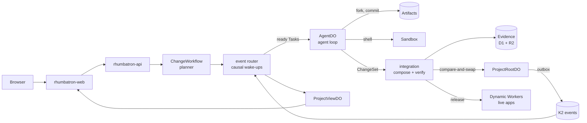

# Rhumbatron

**[rhumbatron.com](https://rhumbatron.com)** (sign in with Google) · [Documentation](https://docs.rhumbatron.com)

Rhumbatron lets a team of people and AI agents change one codebase at the same time. You describe an outcome in plain language. Rhumbatron plans the work and starts only the agents that the work needs. The agents work in parallel, and each agent has its own Git workspace. Before the work merges, Rhumbatron finds conflicts between the changes that the agents plan. It then builds, tests, and checks each possible result in a browser, and it ships the version that passes.

Sudhanva Narayana ([@nsudhanva](https://github.com/nsudhanva)) and Maanasa Narayan ([@maanasanarayan](https://github.com/maanasanarayan)) made Rhumbatron for the Cloudflare competition *Build the Next-Gen Git Platform on Cloudflare*.

---

## The problem

Repositories, branches, and pull requests suit a small number of human authors who talk to each other. This model fails when many agents change one product at the same time:

- Two changes can merge as text and still be wrong together. An example is two different data models for one feature.
- A merge queue puts the work in a line, so the agents cannot work in parallel.
- A person cannot review all the changes that many agents make.
- A model can be confident in a change that does not work.

In Rhumbatron, agents can propose several versions of a change. Only a version that passes its checks can update the main codebase.

## How it works

```mermaid
flowchart LR
  goal[Request in plain language] --> intake[Intake check<br/>clear? duplicate?]
  intake --> plan[Work Graph<br/>Tasks + dependencies]
  plan --> wake[Causal wake-up<br/>only ready Tasks]
  wake --> agents[Agents in parallel<br/>one Artifacts fork each]
  agents --> intents[Typed Intents and Claims<br/>on semantic resources]
  intents --> conflict{Semantic<br/>conflict?}
  conflict -->|no| compose[Compose one Candidate]
  conflict -->|yes| fork[Fork Candidates<br/>A and B]
  compose --> verify[Verify with evidence<br/>build, tests, contract, browser, p95]
  fork --> verify
  verify --> select[Select by evidence]
  select --> promote[Compare-and-swap promotion<br/>S41 → S42]
  promote --> live[Live app on<br/>Dynamic Workers]
```



1. **Request.** A person describes an outcome. If the request is not clear, or if it repeats an open request or a shipped feature, Rhumbatron asks the requester a question. Rhumbatron does no planning and spends no money before the request is clear.
2. **Plan.** A planner model makes a Work Graph from the request. The Work Graph has Tasks, dependencies, acceptance criteria, protected invariants, and a risk tier.
3. **Start only the agents that have work.** A causal router starts an agent only when its Task is ready and an event has an effect on that Task. Other agents stay asleep.
4. **Work in isolation.** Each agent has its own fork of the canonical repository in Cloudflare Artifacts. Each agent runs commands in a Cloudflare Sandbox.
5. **Coordinate through typed state.** Before an agent edits code, it declares an Intent. The Intent lists the resources, files, contract changes, data changes, and assumptions. The agent also takes a Claim, which is a lease on a semantic resource such as `wishlist:membership`.
6. **Find semantic conflicts.** Deterministic rules compare the Intents first. A model examines an overlap only when the rules cannot decide. Tasks that work together go into one Candidate. Two valid designs that cannot go together become two Candidates, and the check results select one.
7. **Verify with evidence.** Rhumbatron composes each Candidate in its own Artifacts fork. It then runs the build, unit, contract, invariant, security, performance, browser, and acceptance checks. The acceptance check compares the result with the original request. A check that is missing, skipped, or timed out is a gap, and a gap never counts as a pass.
8. **Select and promote.** Sibling Candidates wait for each other. Rhumbatron ranks them by evidence and never by the time they finish. One atomic compare-and-swap moves the Canonical Generation forward, for example from `S41` to `S42`. A stale Candidate cannot promote. Rhumbatron composes it again on the new state.
9. **Ship.** Rhumbatron builds the promoted version and deploys it as the live app of the Project, at `<project>.rhumbatron.com`. A smoke check runs after the deployment. If the smoke check fails, the app goes back to the previous version.

## Design choices

| Area | Rhumbatron |
|---|---|
| Unit of work | A Change: an outcome that the planner divides into the Tasks of a Work Graph |
| Concurrency | Many agents work in parallel, each in its own Artifacts fork. An agent starts only when its work is ready, so most agents stay asleep |
| Coordination | Agents share typed state: Intents, renewable Claims, and Challenges on semantic resources |
| Conflict handling | Rhumbatron finds conflicts between designs before a merge. Designs that cannot go together become competing Candidates, and evidence selects one |
| Context | Each agent gets a context packet with its Task, criteria, invariants, nearby Intents, exact dependencies, and previous failures. Exact data comes first and semantic search comes second. Rhumbatron stores each packet, so a run can be replayed |
| Review | Executable evidence decides. A model finding must cite evidence IDs, and a finding without a valid citation cannot change state. People approve when the policy requires it |
| Merge | One atomic compare-and-swap per generation, so two promotions cannot overwrite each other |
| Teams | Project roles are owner, admin, member, and viewer. A request from a member waits until an owner or admin includes or declines it. The Board shows each request by person and by stage |
| Cost | Each request has a budget, and a Project and a person can each have a monthly budget. Small Tasks go to less expensive models. A stronger model runs only after a recorded failure or for high risk |

## The product

| View | What it shows |
|---|---|
| Overview | The live app, the Canonical Generation, the execution timeline with replay, and all requests |
| Board | Requests by person and by stage: Proposed, Needs answer, Building, Checking, Shipped, Not built |
| Change | The goal, acceptance criteria, protected invariants, Work Graph, agent activity, conflicts, Candidates, and a summary of how many Intents became Candidates and which Candidate shipped |
| Flight Control | The execution DAG, agent swimlanes, workspace lanes, codebase heatmap, Candidate arena, evidence explorer, and time-machine replay |
| Candidates and Compare | The check results of competing Candidates side by side, approval, and promotion |
| Code | All versions of the source, and an editor in the browser with a terminal. The editor sends edits as a usual request |
| Agents, Events, Verification, Costs | Live views and replays of the agents, the causal event stream, the check results, and the spend by model and by Task |

## Built on Cloudflare

Rhumbatron runs on the Cloudflare developer platform. Terraform manages all of its Cloudflare resources.

| Cloudflare product | Function in Rhumbatron |
|---|---|
| Workers | Ten Workers: web (TanStack Start), API (Hono), coordinator, agents, event router, integration, indexer, Sandbox host, live apps, and docs |
| Artifacts | One canonical Git repository for each Project, and one fork for each agent workspace, each Candidate, and each code edit session |
| Durable Objects (SQLite) | `ProjectRootDO` (Canonical Generation and compare-and-swap promotion), `ResourceShardDO` (Claims and Intents), `ProjectViewDO` (live read model and WebSockets), `AgentDO` (durable agent state), `AppDataDO` (live app data) |
| Sandbox / Containers | Isolated Linux for agent commands, builds, tests, and Candidate verification |
| Dynamic Workers | Builds and hosts the live app of each Project and its Candidate previews |
| Workflows | `ChangeWorkflow`, `CandidateVerificationWorkflow`, `ReleaseWorkflow` |
| Queues | Agent wake-ups, integration, verification, indexing, release, and dead letters |
| K2 | The durable causal event log. A transactional outbox in Durable Object SQLite sends the events |
| D1 | Product metadata: Projects, Changes, Tasks, Candidates, the evidence index, and approvals |
| R2 | Evidence reports, context packets, patches, app bundles, and the event archive |
| Workers KV | Configuration that Workers read often, such as the Project policy |
| Vectorize | Semantic memory of the code and of previous Changes |
| Workers AI | Fast bounded decisions (Clef-flash), embeddings, and reranking for request intake |
| AI Gateway | The one path to the Anthropic Claude models, with spend limits and usage logs |
| Browser Run | Browser checks of Candidate previews |
| Analytics Engine, Workers Logs | Metrics for model routing, wake-ups, cost, and latency |

Rhumbatron uses three Claude models. Claude Sonnet 5.5 does most of the coding. Claude Haiku 5.5 does small and frequent work. Claude Opus 5.5 does high-risk design when it is enabled. The agent loop runs on the Cloudflare Agents SDK.

### Architecture



The [architecture guide](docs/architecture/README.md) gives the details of each part: the [change lifecycle](docs/architecture/change-lifecycle.md), [agents and models](docs/architecture/agents-and-models.md), [events and commands](docs/architecture/events-and-commands.md), [source and verification](docs/architecture/source-and-verification.md), [live apps](docs/architecture/live-apps.md), and [shared Projects](docs/architecture/shared-projects.md). The [ADRs](docs/adr/) record the design decisions.

## Try it

1. Open [rhumbatron.com](https://rhumbatron.com) and sign in with Google.
2. Create a Project. A new Project is empty.
3. Under **New change**, describe an app. For example: *Build a page that shows a counter with + and − buttons; the count persists in storage.*
4. On the Change page, look at the Work Graph, the agents, the Intents, the Candidates, and the checks.
5. When the Candidate promotes, open the live app from the Project overview.
6. Send a second request that conflicts with the first request, or invite a teammate under **Settings**. Then look at the Board and at the conflict.

## Run it yourself

### Prerequisites

| Tool | Version |
|---|---|
| [Bun](https://bun.sh) | 1.3.14 |
| [Terraform](https://developer.hashicorp.com/terraform) | 1.16 or later |
| macOS Keychain | Keeps the credentials for the Terraform and test scripts |

Wrangler is a project dependency. The scripts use the repository copy of Wrangler only for local development and bundles.

### Local development

```sh
git clone https://github.com/nsudhanva/rhumbatron.git
cd rhumbatron
bun install                      # dependencies and Git hooks
cp apps/web/.env.example apps/web/.env.local   # add Clerk development keys
bun run typecheck
bun run build
bun run dev                      # web on localhost:5173, API on localhost:8787
```

`bun run dev` runs the web app and all Workers on the local Workers runtime. D1, R2, KV, Queues, Durable Objects, and Workflows run as local simulations on disk. Artifacts, K2, Vectorize, Workers AI, AI Gateway, and Browser Run have no local simulation. A full agent run needs a Cloudflare deployment.

### Deploy to your Cloudflare account

You need these items:

- A Cloudflare account on Workers Paid, with access to Artifacts, K2, and Containers
- A zone for the app
- A Clerk application
- An Anthropic API key

Do these steps:

1. Put the credentials in the macOS Keychain. [`scripts/tf.ts`](scripts/tf.ts) lists the item names.
2. Create the Terraform state bucket one time. Refer to *Bootstrap* in [infrastructure/terraform/README.md](infrastructure/terraform/README.md).
3. In `infrastructure/terraform/envs/prod`, set `zone_name` and the Clerk variables for your domain.
4. Build, plan, apply, and check:

```sh
bun run cf:bundle        # bundle all Workers and the web app
bun run tf:plan:prod     # read the plan
bun run tf:apply:prod
bun run tf:drift:prod    # must show zero changes
bun run smoke:prod
```

The [deployment runbook](docs/operations/deploy.md) gives the details. Terraform is the only deployment path. No step uses `wrangler deploy` or the Cloudflare dashboard.

## Reliability and safety

- **Atomic promotion.** One compare-and-swap moves each Canonical Generation forward. Rhumbatron composes a stale Candidate again on the new state before the Candidate can promote.
- **Evidence gates.** A missing, skipped, or timed-out check never passes. A model finding must cite evidence, and code validates each citation.
- **Idempotency.** Events and commands have stable IDs, consumers remove duplicates, and a transactional outbox sends the events. If K2 stops, the dashboard updates later, but the canonical state stays correct.
- **Failure recovery.** Claims expire. A lost Sandbox recovers its work from Artifacts. Retries have a limit, and the dead-letter queue is visible. A rollback is a new canonical transition.
- **Isolation.** Agents never get infrastructure credentials. Each agent role has its own set of tools. Commands in an edit session run as a user without privileges and without secrets.
- **Cost limits.** Each request, Project, and person can have a budget. A monthly cap stops model spend. Sandbox time and Browser Run time have caps, and Terraform has a pause switch.

## Testing

| Command | What it checks |
|---|---|
| `bun run check` | Lint, types, guardrails, fixtures, dependencies, secrets, and Terraform |
| `bun run test:critical` | Protocol validators, compare-and-swap, idempotency, authorization, conflict rules, and cost arithmetic |
| `bun run e2e prod` | All public API endpoints on a deployment |
| `bun run journeys prod` | Real builds through the public API: conflicts, questions, approvals, rollback, and releases |
| `bun run test:ui` | The Playwright suite at desktop and phone widths |
| `bun run lighthouse` | Lighthouse on all pages, for mobile and desktop |

The tests that sign in read `CLERK_SECRET_KEY` and `CLERK_SMOKE_USER_ID` from the environment.

## Repository layout

```text
apps/web                  TanStack Start UI (rhumbatron.com)
apps/docs                 Documentation site (docs.rhumbatron.com)
workers/<name>            One Cloudflare Worker in each directory
packages/                 Shared logic: protocol schemas, evidence, conflict, model routing, causal routing
containers/coding-agent   Sandbox image
infrastructure/terraform  Bootstrap, environments, and modules
migrations/d1             D1 schema migrations
docs/                     Architecture, ADRs, protocols, operations, and demo
scripts/                  Bundles, checks, smoke tests, journeys, and the cost report
```

## Team

- Sudhanva Narayana ([@nsudhanva](https://github.com/nsudhanva))
- Maanasa Narayan ([@maanasanarayan](https://github.com/maanasanarayan))

## License

[MIT](LICENSE)
