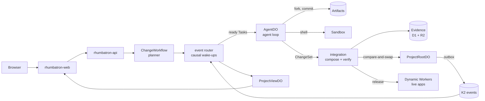

# Rhumbatron

**Many agents. Many possible futures. One verified codebase.**

Rhumbatron is a collaboration platform for teams of people and AI agents that change one codebase at the same time. You describe an outcome in plain language. Rhumbatron plans the work, wakes only the agents that the work needs, lets them build in parallel in isolated Git workspaces, detects conflicts between their *intentions* before a merge, verifies each possible result with executable evidence, and ships one verified version.

> Git detects textual conflicts. Rhumbatron detects conflicts between intentions and possible software futures.

- **Live:** [rhumbatron.com](https://rhumbatron.com). Sign in with Google.
- **Documentation:** [docs.rhumbatron.com](https://docs.rhumbatron.com)
- **Built for:** the Cloudflare competition *Build the Next-Gen Git Platform on Cloudflare*
- **Team:** Sudhanva Narayana ([@nsudhanva](https://github.com/nsudhanva)) and Maanasa Narayan ([@maanasanarayan](https://github.com/maanasanarayan))

---

## The problem

Repositories, branches, and pull requests assume a small number of human authors who coordinate by talking to each other. That model does not hold when many agents work on one product at once:

- Two agents can produce changes that merge cleanly as text but are wrong together, for example two different data models for the same feature.
- A merge queue serializes work and wastes the parallelism that agents give.
- Review by a person does not scale to the volume of changes that agents produce.
- "The model is confident" is not a release gate.

Rhumbatron replaces the pull request with a different unit of work and a different merge rule: **many agents can propose many futures, and only verified evidence can advance the canonical state.**

## How it works

```mermaid
flowchart LR
  goal[Request in plain language] --> intake[Intake check<br/>clear? duplicate?]
  intake --> plan[Work Graph<br/>Tasks + dependencies]
  plan --> wake[Causal wake-up<br/>only ready Tasks]
  wake --> agents[Agents in parallel<br/>one Artifacts fork each]
  agents --> intents[Typed Intents and Claims<br/>on semantic resources]
  intents --> conflict{Semantic<br/>conflict?}
  conflict -->|no| compose[Compose one Candidate]
  conflict -->|yes| fork[Fork Candidates<br/>A and B]
  compose --> verify[Verify with evidence<br/>build, tests, contract, browser, p95]
  fork --> verify
  verify --> select[Select by evidence]
  select --> promote[Compare-and-swap promotion<br/>S41 → S42]
  promote --> live[Live app on<br/>Dynamic Workers]
```



1. **Request.** A person describes an outcome. An intake check asks the requester a question when the request is unclear or duplicates an open request or a shipped feature. Nothing is planned or spent until the request is clear.
2. **Plan.** A planner model turns the request into a **Work Graph**: Tasks, dependencies, acceptance criteria, protected invariants, and a risk tier.
3. **Wake only what is needed.** A causal router wakes an agent only when its Task is ready and an event affects it. Many logical agents can exist; only the agents with ready work run.
4. **Build in isolation.** Each agent works in its own fork of the canonical repository in **Cloudflare Artifacts**, with a shell in a Cloudflare **Sandbox**.
5. **Coordinate through typed state, not chat.** Before an agent edits, it declares a typed **Intent** (resources, files, contract and data changes, assumptions) and takes a lease (**Claim**) on a semantic resource such as `wishlist:membership`.
6. **Detect semantic conflicts.** Deterministic rules compare Intents first. A model reviews only an ambiguous overlap. Complementary Tasks integrate. Two valid but incompatible designs **fork into separate Candidates** instead of a debate.
7. **Verify with evidence.** Each Candidate is composed in its own Artifacts fork, built, and checked: build, unit, contract, protected invariants, security, performance, browser flows, and an acceptance check against the original request. A missing, skipped, or timed-out check is a gap. It never counts as a pass.
8. **Select and promote.** Sibling Candidates wait for each other and are ranked by evidence, never by who finished first. One atomic **compare-and-swap** advances the **Canonical Generation** (for example `S41 → S42`). A stale Candidate cannot promote; it is recomposed on the new state.
9. **Ship.** The promoted version builds and deploys as the Project's live app at `<project>.rhumbatron.com`, with a smoke check and a pointer that moves back if the check fails.

## What makes it different

| Area | Rhumbatron |
|---|---|
| Unit of work | A **Change** (an outcome) compiled into a Work Graph, not a branch or a pull request |
| Concurrency | Many agents in parallel, each in its own Artifacts fork. Activation is sparse and causal: an agent wakes only when its work is ready |
| Coordination | Typed Intents, renewable Claims, and Challenges on semantic resources. Agents share structured state, not chat history |
| Conflict handling | Conflicts between designs are found before a merge. Incompatible designs become competing **Candidates** that evidence decides between |
| Context | Each agent gets a compiled context packet: its Task, criteria, invariants, nearby Intents, exact dependencies, and prior failures. Exact retrieval comes first, semantic search second. Packets are stored for replay |
| Review | Executable evidence is the gate. Model findings must cite evidence IDs, and an unsupported finding cannot change state. People approve where policy requires it |
| Merge | One atomic compare-and-swap per generation. No merge races, no force pushes, no lost updates |
| Teams | Project roles (owner, admin, member, viewer). A member's request waits for an owner or admin to include or decline it. The Board shows every request by person and by stage |
| Cost | Budgets per request, per Project per month, and per person per month. Small Tasks route to cheaper models; stronger models are used only on recorded failure or risk |

## The product

| View | What it shows |
|---|---|
| **Overview** | Live app, Canonical Generation, the execution timeline with replay, and every request |
| **Board** | Requests by person and by stage: Proposed, Needs answer, Building, Checking, Shipped, Not built |
| **Change** | The goal, acceptance criteria, protected invariants, Work Graph, agent activity, conflicts, Candidates, and the convergence view `possible changes → Candidates → verified future → canonical` |
| **Flight Control** | Execution DAG, agent swimlanes, workspace lanes, codebase heatmap, Candidate arena, evidence explorer, and time-machine replay |
| **Candidates and Compare** | Side-by-side evidence for competing futures, approval, and promotion |
| **Code** | Every version of the source, and an in-browser editor with a terminal that submits edits as a normal request |
| **Agents, Events, Verification, Costs** | Live and replayable views of agents, the causal event stream, check results, and spend by model and Task |

## Built on Cloudflare

Rhumbatron runs entirely on Cloudflare's developer platform. Terraform manages every Cloudflare resource.

| Cloudflare product | Role in Rhumbatron |
|---|---|
| **Workers** | Ten Workers: web (TanStack Start), API (Hono), coordinator, agents, event router, integration, indexer, Sandbox host, live apps, and docs |
| **Artifacts** | Canonical Git repository per Project, one fork per agent workspace, one fork per Candidate, and one per code-edit session |
| **Durable Objects (SQLite)** | `ProjectRootDO` (canonical generation, compare-and-swap promotion), `ResourceShardDO` (Claims and Intents), `ProjectViewDO` (live read model and WebSockets), `AgentDO` (durable agent state), `AppDataDO` (live app data) |
| **Sandbox / Containers** | Isolated Linux for agent shells, builds, tests, and Candidate verification |
| **Dynamic Workers** | Builds and hosts every Project's live app and its Candidate previews |
| **Workflows** | `ChangeWorkflow`, `CandidateVerificationWorkflow`, `ReleaseWorkflow` |
| **Queues** | Agent wake-ups, integration, verification, indexing, release, dead letters |
| **K2** | Durable causal event log, fed by a transactional outbox in Durable Object SQLite |
| **D1** | Product metadata: Projects, Changes, Tasks, Candidates, evidence index, approvals |
| **R2** | Evidence reports, context packets, patches, app bundles, and the event archive |
| **Workers KV** | Read-heavy configuration such as Project policy |
| **Vectorize** | Semantic memory over code and past Changes |
| **Workers AI** | Fast bounded decisions (Clef-flash), embeddings, and reranking for request intake |
| **AI Gateway** | Single path to Anthropic Claude models, with spend limits and usage logs |
| **Browser Run** | Browser checks of Candidate previews |
| **Analytics Engine, Workers Logs** | Model routing, wake-ups, cost, and latency metrics |

Models: Claude Sonnet 5.5 for normal coding, Claude Haiku 5.5 for small and high-volume work, and Claude Opus 5.5 for high-risk design when it is enabled. The agent loop runs on the Cloudflare Agents SDK.

### Architecture



The [architecture guide](docs/architecture/README.md) covers each part in depth: the [change lifecycle](docs/architecture/change-lifecycle.md), [agents and models](docs/architecture/agents-and-models.md), [events and commands](docs/architecture/events-and-commands.md), [source and verification](docs/architecture/source-and-verification.md), [live apps](docs/architecture/live-apps.md), and [shared Projects](docs/architecture/shared-projects.md). Design decisions are recorded as [ADRs](docs/adr/).

## Try it

1. Open [rhumbatron.com](https://rhumbatron.com) and sign in with Google.
2. Create a Project. It starts empty.
3. Under **New change**, describe an app, for example: *Build a page that shows a counter with + and − buttons; the count persists in storage.*
4. Watch the Change page: the Work Graph, agents waking, Intents, Candidates, and checks.
5. When the Candidate promotes, open the live app from the Project overview.
6. Send a second request that conflicts with the first, or invite a teammate under **Settings**, and watch the Board and the conflict handling.

## Run it yourself

### Prerequisites

| Tool | Version |
|---|---|
| [Bun](https://bun.sh) | 1.3.14 |
| [Terraform](https://developer.hashicorp.com/terraform) | 1.16 or later |
| macOS Keychain | Holds credentials for the Terraform and test scripts |

Wrangler is a project dependency. The scripts use the repository copy for local development and bundling only.

### Local development

```sh
git clone https://github.com/nsudhanva/rhumbatron.git
cd rhumbatron
bun install                      # dependencies and Git hooks
cp apps/web/.env.example apps/web/.env.local   # add Clerk development keys
bun run typecheck
bun run build
bun run dev                      # web on localhost:5173, API on localhost:8787
```

`bun run dev` runs the web app and every Worker on the local Workers runtime, with D1, R2, KV, Queues, Durable Objects, and Workflows simulated on disk. Artifacts, K2, Vectorize, Workers AI, AI Gateway, and Browser Run have no local simulation; an end-to-end agent run needs a Cloudflare deployment.

### Deploy to your Cloudflare account

You need a Cloudflare account on Workers Paid with access to Artifacts, K2, and Containers, a zone for the app, a Clerk application, and an Anthropic API key.

1. Store the credentials in the macOS Keychain under the item names that [`scripts/tf.ts`](scripts/tf.ts) lists.
2. Create the Terraform state bucket once: see *Bootstrap* in [infrastructure/terraform/README.md](infrastructure/terraform/README.md).
3. Set `zone_name` and the Clerk variables for your domain in `infrastructure/terraform/envs/prod`.
4. Build, plan, apply, and check:

```sh
bun run cf:bundle        # bundle every Worker and the web app
bun run tf:plan:prod     # read the plan
bun run tf:apply:prod
bun run tf:drift:prod    # must show zero changes
bun run smoke:prod
```

The [deployment runbook](docs/operations/deploy.md) has the details. Terraform is the only deployment path; no step uses `wrangler deploy` or dashboard edits.

## Reliability and safety

- **Atomic promotion.** One compare-and-swap per Canonical Generation. A stale Candidate is recomposed, never merged blindly.
- **Evidence gates.** A missing, skipped, or timed-out check never passes. Model findings must cite evidence that code validates.
- **Idempotency.** Stable event and command IDs, deduplicating consumers, and a transactional outbox: a K2 outage delays the dashboard but never forks the canonical state.
- **Failure handling.** Expiring Claims, Sandbox loss recovery from Artifacts, bounded retries, a visible dead-letter queue, and rollback as a new canonical transition.
- **Isolation.** Agents never hold infrastructure credentials. Tools are granted by role. Edit-session commands run as an unprivileged user without secrets.
- **Cost limits.** Budgets per request, Project, and person; a monthly model-spend cap; capped Sandbox and Browser Run time; and a pause switch in Terraform.

## Testing

| Command | What it checks |
|---|---|
| `bun run check` | Lint, types, guardrails, fixtures, dependencies, secrets, and Terraform |
| `bun run test:critical` | Protocol validators, compare-and-swap, idempotency, authorization, conflict rules, cost arithmetic |
| `bun run e2e prod` | Every public API endpoint against a deployment |
| `bun run journeys prod` | Real builds through the public API: conflicts, questions, approvals, rollback, releases |
| `bun run test:ui` | Playwright suite at desktop and phone widths |
| `bun run lighthouse` | Lighthouse on every page, mobile and desktop |

Tests that sign in read `CLERK_SECRET_KEY` and `CLERK_SMOKE_USER_ID` from the environment.

## Repository layout

```text
apps/web                  TanStack Start UI (rhumbatron.com)
apps/docs                 Documentation site (docs.rhumbatron.com)
workers/<name>            One Cloudflare Worker per directory
packages/                 Shared logic: protocol schemas, evidence, conflict, model routing, causal routing
containers/coding-agent   Sandbox image
infrastructure/terraform  Bootstrap, environments, and modules
migrations/d1             D1 schema migrations
docs/                     Architecture, ADRs, protocols, operations, and demo
scripts/                  Bundling, checks, smoke tests, journeys, cost report
```

## Team

| | |
|---|---|
| **Sudhanva Narayana** | [@nsudhanva](https://github.com/nsudhanva) |
| **Maanasa Narayan** | [@maanasanarayan](https://github.com/maanasanarayan) |

## License

[MIT](LICENSE)
