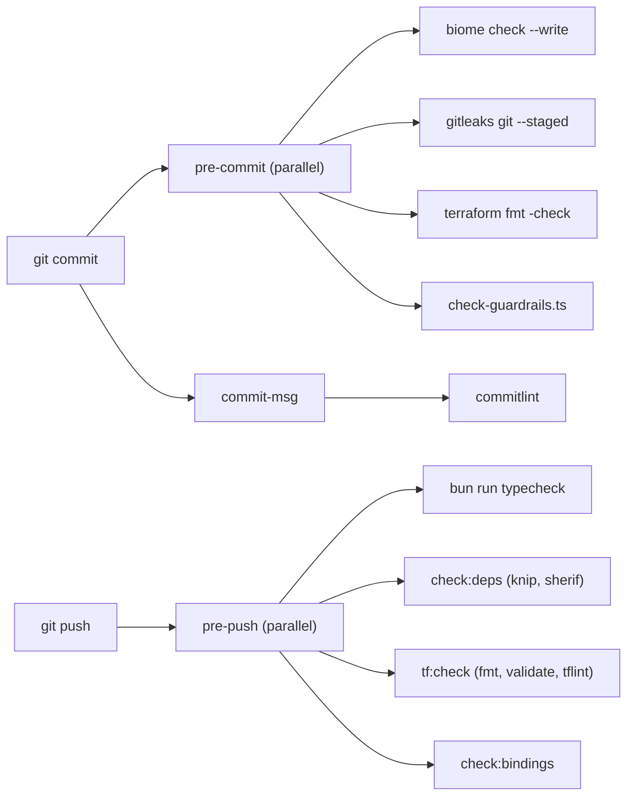

# ADR 0001: Repository tooling

## Context

The frozen stack fixes Bun, Turborepo, TypeScript, Biome, Zod, Vitest, Terraform, and Wrangler.
The repository also needs secret scanning, Git hooks, dependency hygiene, and a check of the
Terraform-only rule. These are developer tools. They do not change the runtime stack.

## Decision

| Concern | Tool | Reason |
|---|---|---|
| Lint and format (TS, JSON, CSS) | Biome | Frozen choice. |
| Type checking | TypeScript (`tsc`) through Turborepo | Frozen choice. |
| Cloudflare runtime types | `wrangler types` (`bun run cf:types`) | Wrangler generates them per Worker from `wrangler.jsonc`. Git ignores `worker-configuration.d.ts`. |
| Secret scanning | gitleaks (system binary) | Default rules plus Cloudflare, R2, and Anthropic rules in `.gitleaks.toml`. |
| Git hooks | lefthook (dev dependency) | One binary, parallel jobs, no shell scripts. |
| Commit messages | commitlint, conventional config | One commit format. |
| Unused code and dependencies | knip | Fails on undeclared and unused dependencies. |
| Monorepo package hygiene | sherif | Finds version mismatches across workspaces. |
| Terraform | `terraform fmt`, `terraform validate`, tflint (`scripts/terraform-check.ts`) | Static checks with no backend access. |
| Project policy | `scripts/check-guardrails.ts` | Blocks `wrangler deploy`, remote Wrangler mutations, `-auto-approve`, direct API writes, credential literals in Terraform, and resource names outside `rhumbatron-<component>-<prod\|global>`. |
| Binding drift | `scripts/check-binding-drift.ts` | Compares each `wrangler.jsonc` with the bindings that Terraform uploads in `envs/prod`. It never contacts Cloudflare. |
| Installs | Bun isolated linker, exact versions (`bunfig.toml`) | A package cannot import a dependency that it does not declare. |
| Checks against prod | `bun run smoke:prod`, `bun run e2e`, `bun run test:ui` (Playwright, `e2e/ui`), `bun run lighthouse` | They run on a developer machine against `rhumbatron.com`. |

## Consequences

- Contributors need `gitleaks`, `terraform`, and `tflint` on `PATH`.
- `bun run check` runs lint, typecheck, guardrails, the fixture check
  (`scripts/build-fixtures.ts --check`), knip, sherif, gitleaks, and the Terraform checks.
- `bun install` installs the Git hooks through the `prepare` script.
- `.github/workflows/ci.yml` runs on pull requests and on pushes to `main`. It runs lint, binding
  drift, typecheck, critical tests, build, bundle, `terraform fmt -check`, and `terraform validate`
  with `-backend=false`. It has no credentials, no remote state, and no deploy step.
- Guardrails, the fixture check, knip, sherif, gitleaks, tflint, and the checks against prod run
  only on a developer machine.
- Remote changes go through `terraform plan` and `terraform apply` on a developer machine.

## Diagram

`lefthook.yml` defines the local gates.

