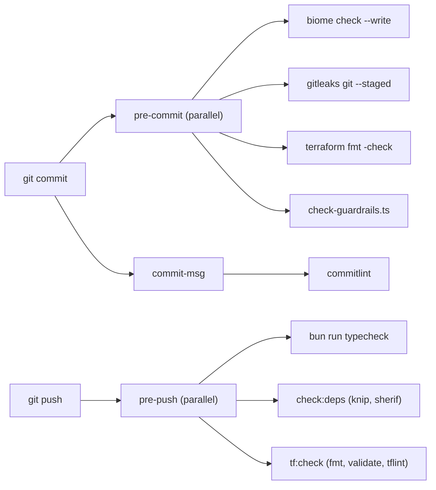

# ADR 0001: Repository tooling

- Status: Accepted. Updated 2026-10-10: CI scope (see Update).
- Date: 2026-10-08
- Decider: Opus 5.5 (Phase 0)

## Context

The frozen stack fixes Bun, Turborepo, TypeScript, Biome, Zod, Vitest, Terraform, and Wrangler.
Phase 0 also needs secret scanning, Git hooks, dependency hygiene, and enforcement of the
Terraform-only rule. These are developer tools. They do not change the runtime stack.

## Decision

| Concern | Tool | Reason |
|---|---|---|
| Lint and format (TS, JSON, CSS) | Biome | Frozen choice. |
| Type checking | TypeScript 7 (`tsc`) through Turborepo | Frozen choice. Latest stable. |
| Cloudflare runtime types | `wrangler types` | Generated per Worker from `wrangler.jsonc`. Not committed. |
| Secret scanning | gitleaks (system binary) | Mature default rules plus Cloudflare, R2, and Anthropic rules in `.gitleaks.toml`. |
| Git hooks | lefthook (dev dependency) | Single binary, parallel jobs, no shell glue. |
| Commit messages | commitlint, conventional config | Readable history for later release automation. |
| Unused code and dependencies | knip | Stops undeclared and unused dependencies. |
| Monorepo package hygiene | sherif | Catches version mismatches across workspaces. |
| Terraform | `terraform fmt`, `terraform validate`, tflint (all-rules preset) | Static checks with no backend access. |
| Project policy | `scripts/check-guardrails.ts` | Blocks `wrangler deploy`, remote Wrangler mutations, `-auto-approve`, direct API writes, and credential literals in Terraform. |
| Installs | Bun isolated linker, exact versions | A package cannot import a dependency it does not declare. |

## Consequences

- Contributors need `gitleaks`, `terraform`, and `tflint` on `PATH`.
- CI (Phase 14) runs the same `bun run check` command.
- Unused-dependency failures mean a dependency is added only by the change that first imports it.

## Diagram

Local gates in `lefthook.yml`. `bun install` runs `lefthook install` through the `prepare` script.

## Update (2026-10-10)

- CI exists before Phase 14: `.github/workflows/ci.yml` runs on pull requests and on pushes to
  `main`. It does not run `bun run check`.
- CI runs `lint`, `typecheck`, `test:critical`, `build`, `cf:bundle`, `terraform fmt -check`, and
  `terraform validate` with `-backend=false` (no credentials, no remote state, no deploy step).
- These checks run only locally (lefthook and `bun run check`): guardrails, the fixture check,
  knip, sherif, gitleaks, and tflint.
- `bun run check` also runs `check:fixtures` (`scripts/build-fixtures.ts --check`). The table above
  does not list it.
