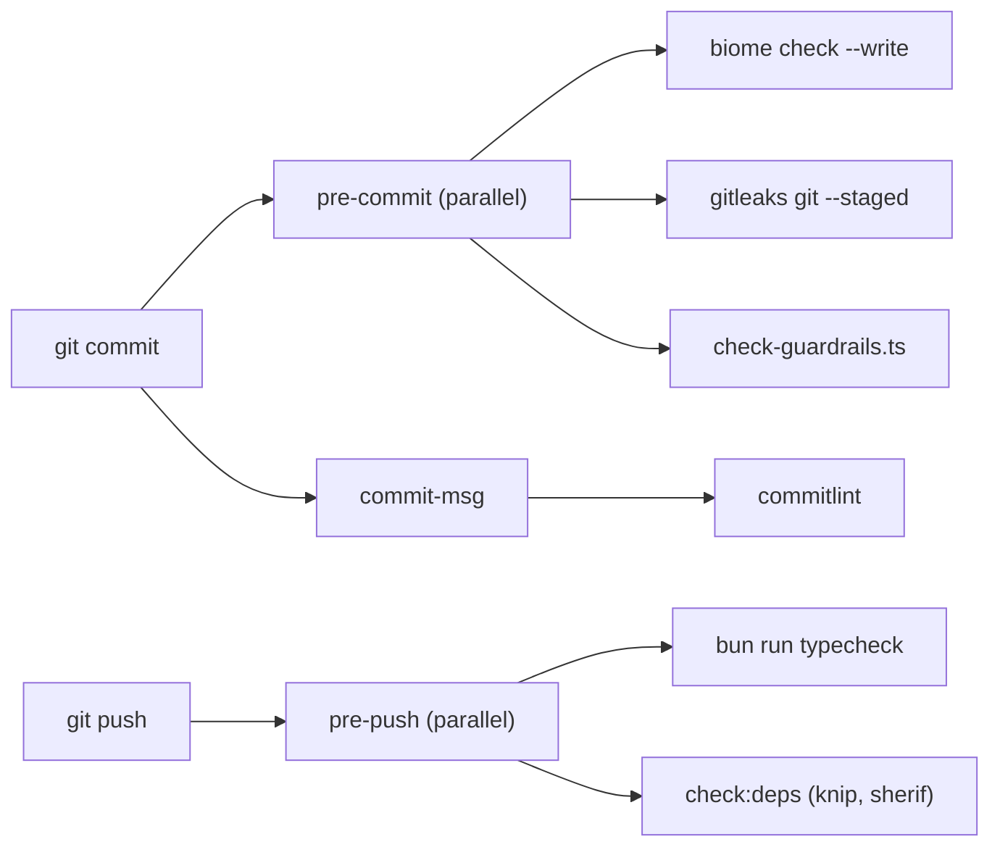

# ADR 0001: Repository tooling

## Context

The stack of Rhumbatron contains Bun 1.3.14, Turborepo, TypeScript, Biome, Zod, and Vitest. The
repository also needs secret scanning, Git hooks, dependency hygiene, and a check of project
policy. These are developer tools. They do not change the runtime stack.

## Decision

Rhumbatron uses these developer tools.

| Concern | Tool | Reason |
|---|---|---|
| Lint and format (TS, JSON, CSS) | Biome | Frozen choice. |
| Type checking | TypeScript (`tsc`) through Turborepo | Frozen choice. |
| Secret scanning | gitleaks (system binary) | Default rules plus the custom rules in `.gitleaks.toml`. |
| Git hooks | lefthook (dev dependency) | One binary, parallel jobs, no shell scripts. |
| Commit messages | commitlint, conventional config, `scope-enum` in `commitlint.config.ts` | One commit format. A scope names a module or a Compose service. |
| Unused code and dependencies | knip | Fails on undeclared and unused dependencies. |
| Monorepo package hygiene | sherif | Finds version mismatches across workspaces. |
| Project policy | `scripts/check-guardrails.ts` | Fails when a local secret file is tracked, or when a service other than the socket proxy mounts the Docker socket. |
| Migrations | `scripts/check-migrations.ts` | Migrations in `migrations/d1` are append-only and safe. |
| Installs | Bun isolated linker, exact versions (`bunfig.toml`) | A package cannot import a dependency that it does not declare. |
| Checks against the stack | `bun run smoke local`, `bun run e2e local`, `bun run journeys local <ids>`, `bun run test:ui` (Playwright, `e2e/ui`), `bun run lighthouse` | They run on a developer machine against the Compose stack at `https://rhumbatron.localhost`. |

## Consequences

- Contributors need `gitleaks` on `PATH`, and Docker for the checks against the stack.
- `bun run check` runs lint, typecheck, guardrails, the migration guard, knip, sherif, and
  gitleaks.
- `bun install` installs the Git hooks through the `prepare` script.
- `.github/workflows/ci.yml` runs the checks on each pull request and each push to `main`. It
  also validates `compose.yaml` with `docker compose config`. It uses no secrets and deploys
  nothing.
- The commit scopes are `repo`, `web`, `api`, `coordinator`, `agents`, `event-router`,
  `integration`, `indexer`, `protocol`, `model-router`, `sandbox`, `apps`, `core`, `platform`,
  `git`, `sandboxd`, `edge`, `stack`, `migrations`, `containers`, `docs`, `docs-site`, and
  `scripts`. A commit with another scope gets a warning.
- The checks against the stack (`smoke`, `e2e`, `journeys`, `test:ui`, `lighthouse`) run on a
  developer machine.
- `bun scripts/journeys.ts local <ids>` runs the named journeys, for example `A1,A2`, or `all`.
- `playwright.config.ts` targets `https://rhumbatron.localhost` with `ignoreHTTPSErrors`.
  `e2e/ui/build-app.spec.ts` starts from a blank Project, sends one instruction, and waits for a
  working live app.

## Diagram

`lefthook.yml` defines the local gates.

