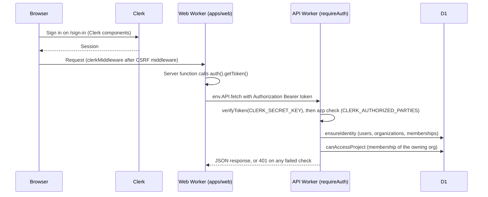

# ADR 0002: Clerk for user authentication

- Status: Accepted. Updated 2026-10-10: the production Clerk instance is live for prod (ADR 0017).
- Date: 2026-10-08
- Decider: Project owner

## Context

Rhumbatron needs user sign-in for `rhumbatron.com`. Cloudflare Access protects internal operator
pages. It has no product sign-up flow for end users.

## Decision

Use Clerk (application `Rhumbatron`, `app_3KOhGuEyKohDT9Lzrb2NvUVQZP4`) with
`@clerk/tanstack-react-start` in `apps/web`.

- `src/start.ts` runs `clerkMiddleware()` after the server-function CSRF middleware.
- `ClerkProvider` wraps the body contents in `src/routes/__root.tsx`.
- `/sign-in` and `/sign-up` host the Clerk components.

## Secrets

- Local: `apps/web/.env.local`, written by `clerk init`, ignored by Git.
- Remote: Terraform makes `CLERK_SECRET_KEY` a Worker `secret_text` binding. A `TF_VAR_`
  environment variable supplies the value, so it never appears in Terraform source.
- `VITE_CLERK_PUBLISHABLE_KEY` is public. The build inlines it.

## Consequences

- Authorization stays in Rhumbatron code (AGENTS.md section 40). Clerk only proves identity.
- The production Clerk instance is not configured yet. Configure it before the prod environment.

## Diagram

One API call from a page. The browser never calls the API Worker directly. Server functions use
the `API` service binding.

## Update (2026-10-10)

- The last Consequence is resolved. Prod uses the Clerk production instance on `rhumbatron.com`.
  `scripts/tf.ts` loads `rhumbatron-clerk-secret-key-prod` and
  `rhumbatron-clerk-publishable-key-prod` from the Keychain. Dev keeps the development instance.
- Prod sign-in is email and password only. Google sign-in is disabled on the production instance.
- `envs/prod` manages the Clerk DNS records (`var.clerk_dns_records`, DNS only). The
  `clerk_production_instance` check warns when the prod key is not `pk_live_`.
- The build inlines the publishable key, and prod also sets it as the `plain_text`
  binding `VITE_CLERK_PUBLISHABLE_KEY` on the web Worker, so one bundle serves both environments
  (ADR 0017).
- The API Worker verifies tokens with `@clerk/backend` `verifyToken` and checks `azp` against
  `CLERK_AUTHORIZED_PARTIES`. A token without `azp` passes only when
  `CLERK_ALLOW_MISSING_AZP = "true"`. Dev sets it for smoke tokens. Prod sets `"false"`.
