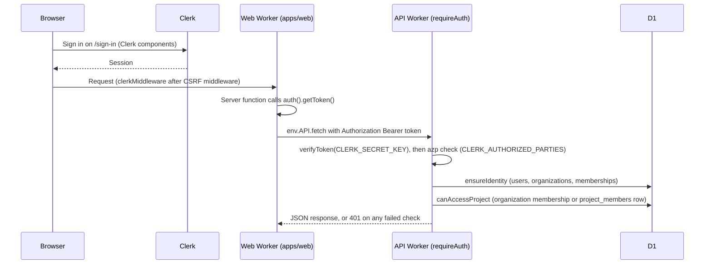

# ADR 0002: Clerk for user authentication

## Context

Rhumbatron needs user sign-in for `rhumbatron.com`. Cloudflare Access protects internal operator
pages. It has no product sign-up flow for end users.

## Decision

Use Clerk (application `Rhumbatron`) with `@clerk/tanstack-react-start` in `apps/web`. Prod uses
the Clerk production instance on `rhumbatron.com`.

- `src/start.ts` runs `clerkMiddleware()` after the server-function CSRF middleware.
- `ClerkProvider` wraps the body contents in `src/routes/__root.tsx`.
- `/sign-in` and `/sign-up` host the Clerk components.
- The API Worker verifies tokens with `@clerk/backend` `verifyToken`. It checks `azp` against
  `CLERK_AUTHORIZED_PARTIES` (prod: `https://rhumbatron.com`). A token without `azp` passes only
  when `CLERK_ALLOW_MISSING_AZP` is `"true"`. Prod sets `"false"`.
- `envs/prod` manages the Clerk DNS records as DNS-only CNAMEs (`var.clerk_dns_records`). The
  `clerk_production_instance` check warns when the publishable key is not `pk_live_`.

## Secrets

- Local: `apps/web/.env.local`, written by `clerk init`. Git ignores it.
- Remote: Terraform sets `CLERK_SECRET_KEY` as a Worker `secret_text` binding. `scripts/tf.ts`
  loads the value from the Keychain item `rhumbatron-clerk-secret-key-prod` into a `TF_VAR_`
  variable, so it never appears in Terraform source.
- The publishable key is public. The Keychain item `rhumbatron-clerk-publishable-key-prod` holds it.
  The build inlines it. The prod web Worker also binds it as the `plain_text` binding
  `VITE_CLERK_PUBLISHABLE_KEY`, because Clerk reads `process.env` first and `nodejs_compat` fills
  `process.env` from bindings.

## Consequences

- Authorization stays in Rhumbatron code (AGENTS.md section 40). Clerk only proves identity.
- The API Worker never accepts a call that skips the token checks.

## Diagram

One API call from a page. The browser never calls the API Worker directly. Server functions use
the `API` service binding.

