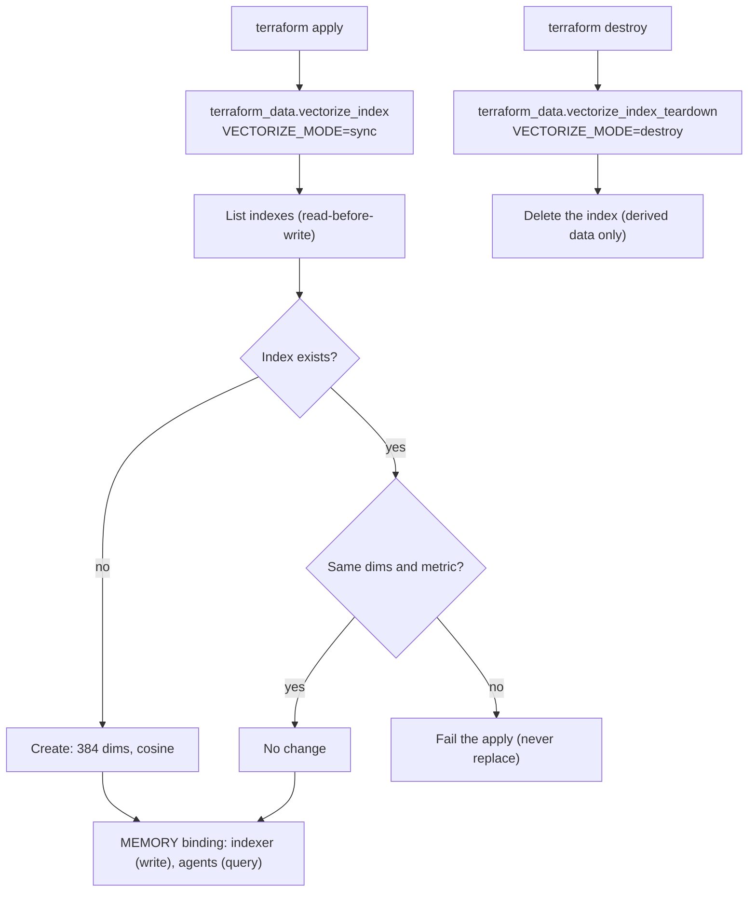

# ADR 0003: Defer the Vectorize index until first-party Terraform support

- Status: Accepted; superseded in part by the Phase 7 decision below (2026-10-09). Updated
  2026-10-10: prod has its own index, and the code caps apply per environment.
- Date: 2026-10-08
- Decider: Project owner

## Context

P1-10 asks for the `rhumbatron-memory-<env>` Vectorize index. Cloudflare Terraform provider 5.27
has no Vectorize resource. AGENTS.md section 11.4 forbids dashboard, Wrangler, or direct API
creation, and prefers waiting when the feature is not needed for the current milestone.

Nothing reads Vectorize before Phase 7 (P7-05).

## Decision

Do not create the index in Phase 1. Re-check provider coverage at the start of Phase 7.

If no first-party resource exists then, build the temporary `terraform_data` adapter that section
11.4 describes (idempotent, read-before-write, delete support, invoked only by `terraform apply`).

## Planned shape

- Name: `rhumbatron-memory-dev`, `rhumbatron-memory-prod`.
- Dimensions: 768, metric cosine (matches Workers AI `bge-base-en-v1.5`). Changing either later
  replaces the index.
- Binding name: `MEMORY`.

## Consequences

- Phase 1 completes without P1-10. `docs/BUILD_STATUS.md` lists it as deferred.
- Phase 7 owns the creation work.

## Phase 7 decision (2026-10-09)

Provider 5.27.0 still has no Vectorize index resource (checked with `terraform providers schema`;
only the `vectorize` Worker binding type exists). Phase 7 needs the index, so the temporary adapter
is built as planned:

- `scripts/vectorize-sync.ts`, invoked only by `terraform_data.vectorize_index` (create when
  missing, fail on a dimension or metric mismatch, never replace on its own) and
  `terraform_data.vectorize_index_teardown` (delete on a real destroy; the index holds derived
  data that the indexer rebuilds).
- Shape changed from the plan above: 384 dimensions, cosine, for Workers AI `bge-small-en-v1.5`.
  The vectors embed short file summaries (path, exports, local imports, first doc line), where the
  small model is enough, and 384 dimensions double the vectors that fit the free 5M stored
  dimensions (13,020 instead of 6,510).
- One namespace per Project (namespace = Project ID). Queries always pass the namespace, and the
  Context Compiler also refuses matches whose metadata names another Project or a path the
  canonical tree does not have.
- Bindings: `MEMORY` on `rhumbatron-indexer` (write) and `rhumbatron-agents` (query).

Free-limit math (Workers Free numbers; the account plan includes more):

| Item | Cap in code | Worst case | Free allowance |
|---|---|---|---|
| Stored vectors | 10,000 per account (`VECTOR_ACCOUNT_CAP`), 500 files per build | 3.84M dims | 5M dims |
| Queries | 1,000 per day (`context-embed` counter) | (30,000 + 10,000) x 384 = 15.4M dims/month | 30M dims/month |
| Embeddings | 2,000 texts per day (`index-embed`) + 1,000 queries | about 0.9k Neurons/day | 10k Neurons/day |

Remove the adapter when the provider ships a Vectorize index resource: import the index, delete
both `terraform_data` resources with `terraform state rm`, and delete the script.

## Diagram

The temporary adapter (`scripts/vectorize-sync.ts`), as both roots (`envs/dev`, `envs/prod`) call it.

## Update (2026-10-10)

- Prod has its own index, `rhumbatron-memory-prod`, through the same adapter. The prod indexer and
  agents Workers bind `MEMORY`. ADR 0017 says prod omits the indexer and Vectorize; that is no
  longer true.
- The caps in code count rows in each environment's own D1 (`project_vectors`, `usage_counters`).
  `VECTOR_ACCOUNT_CAP` is therefore a cap per environment, not per account.
- Dev plus prod allow up to 20,000 stored vectors (7.68M dimensions), 2,000 queries per day, and
  4,000 embedded texts per day. The stored worst case is above the 5M Workers Free figure in the
  table. The account is on Workers Paid (ADR 0017). Check its included Vectorize storage before
  both environments approach their caps.
