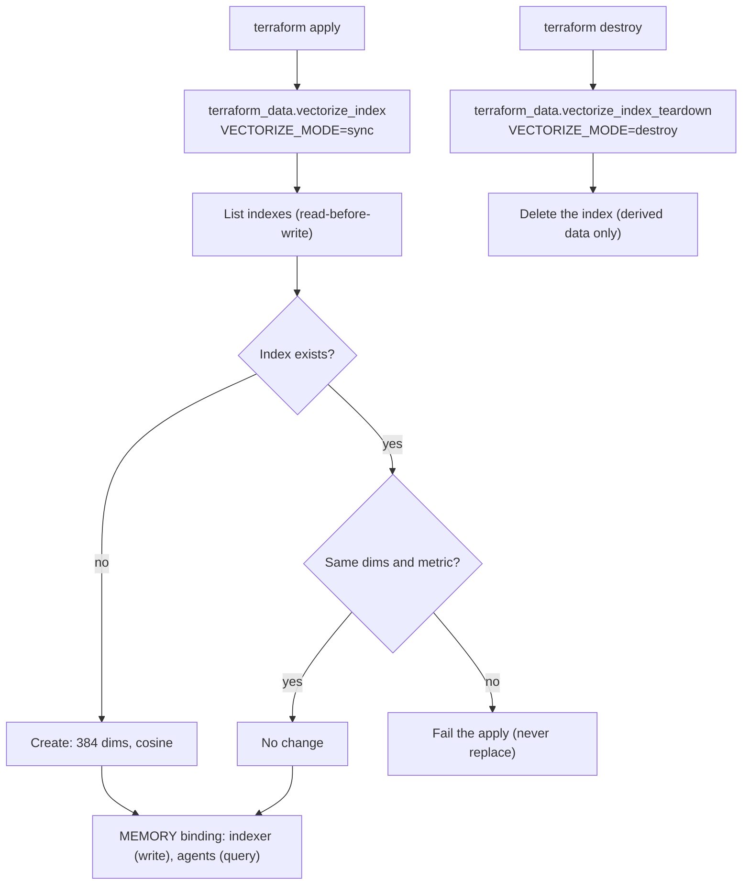

# ADR 0003: Vectorize index through a Terraform adapter

## Context

Cloudflare Terraform provider 5.27 has no Vectorize index resource. `terraform providers schema`
lists only the `vectorize` Worker binding type. Rhumbatron does not create Cloudflare resources
through the dashboard, Wrangler, or a direct API call. Semantic retrieval needs the index.

## Decision

A Terraform adapter creates the index. The adapter script `scripts/vectorize-sync.ts` is
idempotent and reads before it writes. It supports delete. Only `terraform apply` runs it.

- `terraform_data.vectorize_index` creates the index when it does not exist. It fails the apply on
  a dimension or metric mismatch. It never replaces the index.
- `terraform_data.vectorize_index_teardown` deletes the index on a real destroy. The index holds
  derived data that the indexer builds again.
- Name: `rhumbatron-memory-prod`. Dimensions: 384. Metric: cosine. The model is Workers AI
  `@cf/baai/bge-small-en-v1.5`. Each vector embeds a short file summary (path, exports, local
  imports, first doc line). At 384 dimensions, 13,020 vectors fit in 5M stored dimensions.
- One namespace per Project (namespace = Project ID). Each query sends the namespace. The Context
  Compiler refuses a match whose metadata names another Project or a path that is not in the
  canonical tree (`packages/context-compiler/src/retrieval.ts`).
- The `MEMORY` binding is on `rhumbatron-indexer` (write) and `rhumbatron-agents` (query).
- Vectorize gives semantic retrieval only. Exact indexes hold the dependency graph.

## Limits in code

| Item | Cap in code | Worst case | Free allowance |
|---|---|---|---|
| Stored vectors | 10,000 in the account (`VECTOR_ACCOUNT_CAP`), 500 files per build (`MAX_INDEXED_FILES`) | 3.84M dimensions | 5M dimensions |
| Queries | 1,000 per UTC day (`context-embed` counter) | (30,000 queries + 10,000 stored vectors) x 384 = 15.4M dimensions per month | 30M dimensions per month |
| Embeddings | 2,000 texts per UTC day (`index-embed` counter) plus 1,000 query texts | about 900 Neurons per day | 10,000 Neurons per day |

The code counts in the prod D1 tables `project_vectors` and `usage_counters`.

## Consequences

- One apply creates the index and the Workers that bind it.
- The adapter exists because the provider has no index resource. When the provider has one,
  import the index, run `terraform state rm` on both `terraform_data` resources, and delete the
  script.

## Diagram

