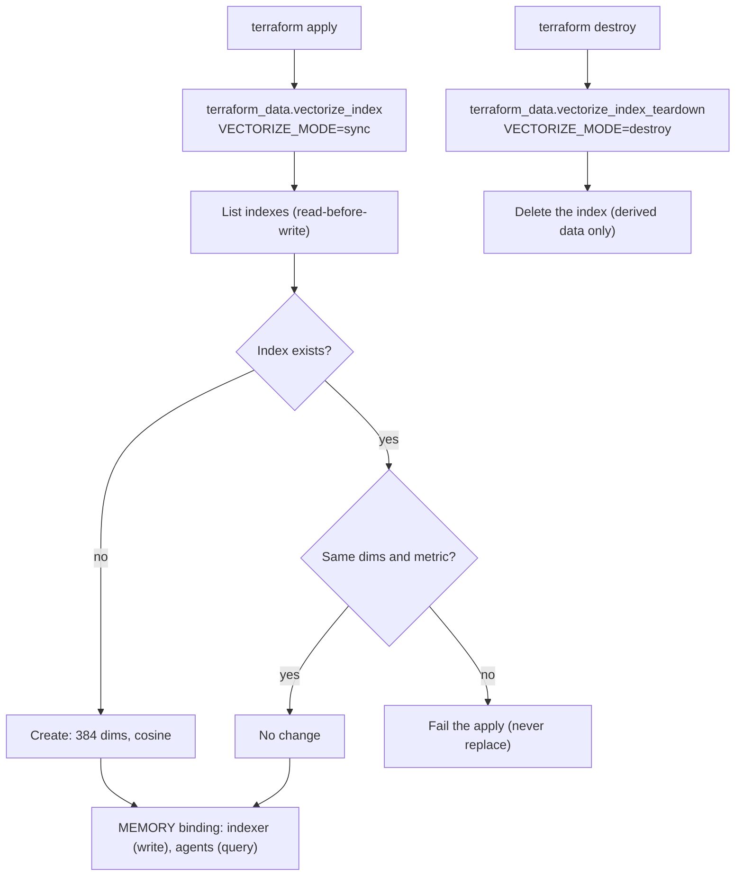

# ADR 0003: Vectorize index through a Terraform adapter

## Context

Cloudflare Terraform provider 5.27 has no Vectorize index resource. `terraform providers schema`
lists only the `vectorize` Worker binding type. AGENTS.md section 11.4 forbids creation through
the dashboard, Wrangler, or a direct API call. Semantic retrieval needs the index.

## Decision

An adapter creates the index. `scripts/vectorize-sync.ts` follows section 11.4 (idempotent,
read-before-write, delete support, invoked only by `terraform apply`).

- `terraform_data.vectorize_index` creates the index when it is missing. It fails the apply on a
  dimension or metric mismatch. It never replaces the index on its own.
- `terraform_data.vectorize_index_teardown` deletes the index on a real destroy. The index holds
  derived data that the indexer rebuilds.
- Name: `rhumbatron-memory-prod`. Dimensions: 384. Metric: cosine. The model is Workers AI
  `bge-small-en-v1.5`. The vectors embed short file summaries (path, exports, local imports, first
  doc line). At 384 dimensions, 13,020 vectors fit in 5M stored dimensions.
- One namespace per Project (namespace = Project ID). Queries always pass the namespace. The
  Context Compiler refuses a match whose metadata names another Project or a path that is not in
  the canonical tree.
- Binding `MEMORY` on `rhumbatron-indexer` (write) and `rhumbatron-agents` (query).
- Vectorize supports semantic retrieval only. Exact indexes hold the dependency graph.

## Limits in code

| Item | Cap in code | Worst case | Free allowance |
|---|---|---|---|
| Stored vectors | 10,000 (`VECTOR_ACCOUNT_CAP`), 500 files per build | 3.84M dims | 5M dims |
| Queries | 1,000 per day (`context-embed` counter) | (30,000 + 10,000) x 384 = 15.4M dims/month | 30M dims/month |
| Embeddings | 2,000 texts per day (`index-embed`) + 1,000 queries | about 0.9k Neurons/day | 10k Neurons/day |

The code counts rows in the prod D1 (`project_vectors`, `usage_counters`).

## Consequences

- One apply creates the index and the Workers that bind it.
- The adapter exists because the provider has no resource. A first-party resource would replace it:
  import the index, run `terraform state rm` on both `terraform_data` resources, and delete the script.

## Diagram

