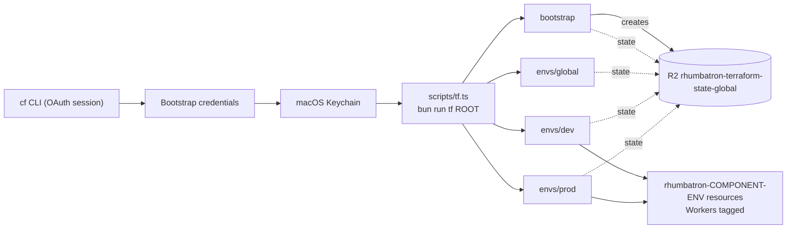

# ADR 0004: Resource organization and bootstrap credentials

- Status: Accepted. Updated 2026-10-10: prod reuses these credentials (ADR 0017); naming exceptions.
- Date: 2026-10-08
- Decider: Project owner

## Context

1. Cloudflare resources must show which project, environment, and component they belong to.
   Cloudflare Resource Tagging supports key-value tags on D1, KV, R2, Queues, Workers, AI
   Gateway, Vectorize, and Durable Object namespaces. Provider 5.27 manages tags only on
   `cloudflare_worker`.
2. Terraform needs an API token before it can run, and the state backend needs an R2 key. The
   `cf` CLI OAuth session can create account tokens, but it cannot grant "Account API Tokens
   Write". A Terraform token that the CLI creates therefore cannot create the backend key inside
   Terraform.

## Decision

### Organization

- Name every resource `rhumbatron-<component>-<env>`, with `env` in `dev`, `prod`, `global`.
  The guardrail script enforces this for Terraform names.
- Tag Workers with `project:rhumbatron`, `env:<env>`, `component:<component>`,
  `managed-by:terraform`.
- Apply the same tags to other resource types when the provider adds a first-party tagging
  resource. Do not build a `terraform_data` adapter for tags.

### Bootstrap credentials

These credentials are the only Cloudflare objects that the project creates outside Terraform.
The `cf` CLI creates all of them. The macOS Keychain stores them, never Git or Terraform files.

| Token | Scope | Keychain service |
|---|---|---|
| `rhumbatron-terraform-global` | Account: R2, D1, KV, Queues, Vectorize, Workers Scripts, AI Gateway, K2 Config, K2 Consume, Workers Containers (write), Account Settings (read). Zone `rhumbatron.com`: Zone (read), Zone Settings, DNS, Workers Routes (write). | `rhumbatron-cloudflare-api-token` |
| `rhumbatron-k2-consumer-dev` | K2 Consume only. Terraform passes it to the event router as a Worker secret. | `rhumbatron-k2-consumer-token-dev` |
| `rhumbatron-terraform-state-backend-global` | R2 object read/write on `rhumbatron-terraform-state-global` only. | `rhumbatron-r2-state-access-key-id`, `rhumbatron-r2-state-secret-access-key` |

## Rotation and changes

- 2026-10-08: added K2 Config Write and K2 Consume to `rhumbatron-terraform-global` for the K2
  adapter (ADR 0006). Token value unchanged.

## Consequences

- Rotating any of these credentials is a manual `cf` CLI step. Record each rotation in this ADR.
- Non-Worker resources are grouped by name only until provider support exists.

## Diagram

How credentials reach Terraform, and where each root keeps its state.

`scripts/tf.ts` sets `CLOUDFLARE_API_TOKEN`, `TF_VAR_account_id`, and the `AWS_*` backend keys for
every root, plus per-root `TF_VAR_*` values. State keys are `<root>/terraform.tfstate`.

## Update (2026-10-10)

- Prod (ADR 0017) reuses these credentials. The `rhumbatron-k2-consumer-dev` token serves both
  environments.
- Later ADRs add other Keychain items: ADR 0007 (model providers), ADR 0002 and ADR 0017
  (Clerk), ADR 0018 (Builds API), and ADR 0019 (alert address).
- Naming exceptions to `rhumbatron-<component>-<env>`: K2 streams (`rhumbatron_events_NN_<env>`,
  ADR 0006) and the Analytics Engine dataset (`rhumbatron_metrics_<env>`) use underscores.
