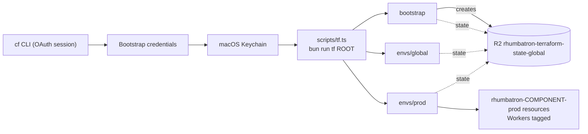

# ADR 0004: Resource organization and bootstrap credentials

## Context

1. Cloudflare resources must show which project, environment, and component they belong to.
   Cloudflare Resource Tagging supports key-value tags on D1, KV, R2, Queues, Workers, AI
   Gateway, Vectorize, and Durable Object namespaces. Provider 5.27 manages tags only on
   `cloudflare_worker`.
2. Terraform needs an API token before it can run, and the state backend needs an R2 key. The
   `cf` CLI OAuth session can create account tokens, but it cannot grant "Account API Tokens
   Write". A Terraform token that the CLI creates cannot create the backend key inside Terraform.

## Decision

### Organization

- Name every resource `rhumbatron-<component>-<env>`, with `env` in `prod` and `global`.
  The guardrail script enforces this for Terraform names.
- Tag `cloudflare_worker` resources with `project:rhumbatron`, `env:<env>`, `component:<component>`,
  `managed-by:terraform`. Workers that deploy through `cloudflare_workers_script` have no tags
  attribute, so their names group them.
- Other resource types receive the same tags when the provider adds a first-party tagging resource.
  No `terraform_data` adapter manages tags.
- Naming exceptions: K2 streams (`rhumbatron_events_NN_prod`, ADR 0006) and the Analytics Engine
  dataset (`rhumbatron_metrics_prod`) use underscores.

### Bootstrap credentials

These credentials are the only Cloudflare objects that exist outside Terraform. The `cf` CLI
creates them. The macOS Keychain stores them. Git and Terraform files never hold them.

| Credential | Scope | Keychain service |
|---|---|---|
| Terraform API token | Account: R2, D1, KV, Queues, Vectorize, Workers Scripts, AI Gateway, K2 Config, K2 Consume, Workers Containers (write), Account Settings (read). Zone `rhumbatron.com`: Zone (read), Zone Settings, DNS, Workers Routes (write). | `rhumbatron-cloudflare-api-token` |
| K2 consumer token | K2 Consume only. Terraform passes it to the event router as a Worker secret. | `rhumbatron-k2-consumer-token-dev` |
| Terraform state backend key | R2 object read/write on `rhumbatron-terraform-state-global` only. | `rhumbatron-r2-state-access-key-id`, `rhumbatron-r2-state-secret-access-key` |

Other Keychain items: `rhumbatron-cloudflare-account-id`; the Clerk keys (ADR 0002); the Anthropic
key and workspace ID (ADR 0021); the Builds API token (ADR 0018); the budget alert address (ADR 0019).

## Consequences

- Rotating a bootstrap credential is a manual `cf` CLI step. The next `bun run tf` call reads the
  new Keychain value. Apply `envs/prod` after a rotation of a value that Workers use.
- Non-Worker resources have name grouping only.

## Diagram

How credentials reach Terraform, and where each root keeps its state.

`scripts/tf.ts` sets `CLOUDFLARE_API_TOKEN`, `TF_VAR_account_id`, and the `AWS_*` backend keys for
every root, plus per-root `TF_VAR_*` values. State keys are `<root>/terraform.tfstate`.
