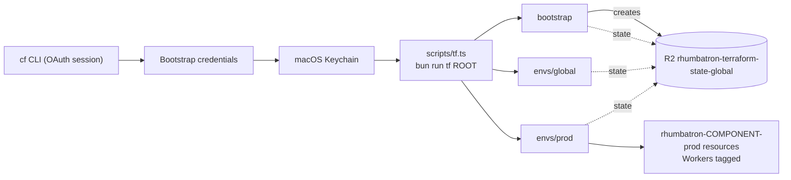

# ADR 0004: Resource organization and bootstrap credentials

## Context

1. Each Cloudflare resource must show its project, environment, and component. Cloudflare Resource
   Tagging supports key-value tags on D1, KV, R2, Queues, Workers, AI Gateway, Vectorize, and
   Durable Object namespaces. Provider 5.27 manages tags only on `cloudflare_worker`.
2. Terraform needs an API token before it can run, and the state backend needs an R2 key. The
   `cf` CLI OAuth session can create account tokens, but it cannot grant "Account API Tokens
   Write". So a Terraform token that the CLI creates cannot create the backend key in Terraform.

## Decision

### Organization

- Name each resource `rhumbatron-<component>-<env>`, with `env` in `prod` and `global`.
  `scripts/check-guardrails.ts` enforces this for Terraform names.
- Tag each `cloudflare_worker` resource with `project:rhumbatron`, `env:<env>`,
  `component:<component>`, and `managed-by:terraform` (`modules/worker` and `envs/prod/docs.tf`).
  The Durable Object Workers (`cloudflare_workers_script`) and the adapter-deployed Sandbox and
  apps Workers have no tags attribute. Their names group them.
- Other resource types get the same tags when the provider has a first-party tagging resource.
  No `terraform_data` adapter manages tags.
- Two names use underscores: the K2 streams (`rhumbatron_events_NN_prod`, ADR 0006) and the
  Analytics Engine dataset (`rhumbatron_metrics_prod`).

### Bootstrap credentials

These credentials are the only Cloudflare objects outside Terraform. The `cf` CLI creates them.
The macOS Keychain stores them. Git and Terraform files never hold them.

| Credential | Scope | Keychain service |
|---|---|---|
| Terraform API token | Account: R2, D1, KV, Queues, Vectorize, Workers Scripts, AI Gateway, K2 Config, K2 Consume, Workers Containers (write), Account Settings (read). Zone `rhumbatron.com`: Zone (read), Zone Settings, DNS, Workers Routes (write). | `rhumbatron-cloudflare-api-token` |
| K2 consumer token | K2 Consume only. Terraform gives it to the event router as the `K2_CONSUMER_TOKEN` secret. | `rhumbatron-k2-consumer-token-dev` |
| Terraform state backend key | R2 object read and write on `rhumbatron-terraform-state-global` only. | `rhumbatron-r2-state-access-key-id`, `rhumbatron-r2-state-secret-access-key` |
| Monitor token | Read only. `bun run cost:report` uses it. | `rhumbatron-cloudflare-monitor-token` |

### Keychain items that `scripts/tf.ts` loads

| Variable | Keychain service | Root |
|---|---|---|
| `CLOUDFLARE_API_TOKEN` | `rhumbatron-cloudflare-api-token` | all |
| `TF_VAR_account_id` | `rhumbatron-cloudflare-account-id` | all |
| `AWS_ACCESS_KEY_ID`, `AWS_SECRET_ACCESS_KEY` | `rhumbatron-r2-state-access-key-id`, `rhumbatron-r2-state-secret-access-key` | all |
| `TF_VAR_alert_email` | `rhumbatron-alert-email` (ADR 0019) | `global` |
| `TF_VAR_clerk_secret_key` | `rhumbatron-clerk-secret-key-prod` (ADR 0002) | `prod` |
| `TF_VAR_clerk_publishable_key` | `rhumbatron-clerk-publishable-key-prod` (ADR 0002) | `prod` |
| `TF_VAR_k2_consumer_token` | `rhumbatron-k2-consumer-token-dev` | `prod` |
| `TF_VAR_anthropic_api_key` | `rhumbatron-anthropic-api-key` (ADR 0021) | `prod` |
| `TF_VAR_anthropic_workspace_id` | `rhumbatron-anthropic-workspace-id` (ADR 0021) | `prod` |

A value that is already set in the environment takes precedence over the Keychain.

## Consequences

- To rotate a bootstrap credential, use the `cf` CLI and write the new value to the Keychain. The
  next `bun run tf` call reads it. If a Worker uses the value, apply `envs/prod`.
- Resources other than Workers have name grouping only.

## Diagram

How credentials reach Terraform, and where each root keeps its state.

State keys are `<root>/terraform.tfstate`.
