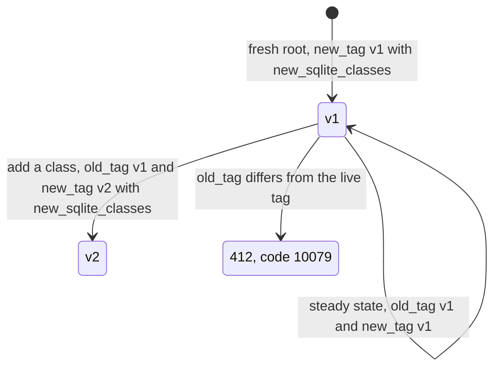
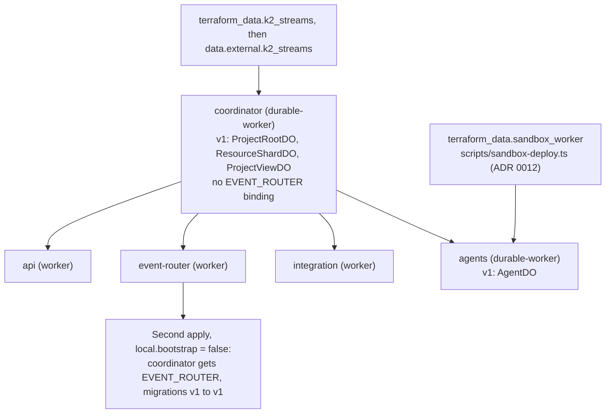

# ADR 0005: Deploy Durable Object Workers with cloudflare_workers_script

## Context

For Worker deploys, Rhumbatron prefers `cloudflare_worker` + `cloudflare_worker_version` +
`cloudflare_workers_deployment`. Cloudflare rejects Durable Object class migrations
(`new_sqlite_classes`, renames, deletes) in version uploads. They need a full script deploy.

## Decision

- Workers that host Durable Object classes use `modules/durable-worker`, built on
  `cloudflare_workers_script` (full deploy, supports `migrations`). These are `rhumbatron-coordinator`
  (`ProjectRootDO`, `ResourceShardDO`, `ProjectViewDO`) and `rhumbatron-agents` (`AgentDO`).
- The api, web, event-router, integration, and indexer Workers use `modules/worker` (version and
  deployment). The docs Worker uses the same three resources in `envs/prod/docs.tf`, because it
  has no main module.
- Two Workers deploy through adapters that do full uploads: `rhumbatron-sandbox-prod` (ADR 0012)
  and `rhumbatron-apps-prod` (ADR 0020).
- Each migration is a transition from the live tag to the target tag. `old_tag` must equal the live
  tag, or Cloudflare rejects the upload (412, code 10079). The steady state is
  `old_tag = new_tag = v1` with no class changes. An applied tag never changes.
- `local.bootstrap` in `envs/prod` is `false`. When it is `true`, the coordinator has no
  `EVENT_ROUTER` binding (the event router binds the coordinator classes, so the binding makes a
  cycle), and the first upload uses `new_tag = "v1"` with the classes. A fresh root needs two
  applies.

## Consequences

- `cloudflare_workers_script` has no tags attribute. Durable Object Workers have name grouping only.
- Gradual rollout does not apply to Durable Object Workers. Each release is a full deploy.
- The module declares observability and compatibility flags in full, so the post-apply plan is
  clean.

## Diagram

Migration tags on a Durable Object Worker (`old_tag`, `new_tag`):

First apply of a fresh root (`local.bootstrap = true`), then the second apply:

