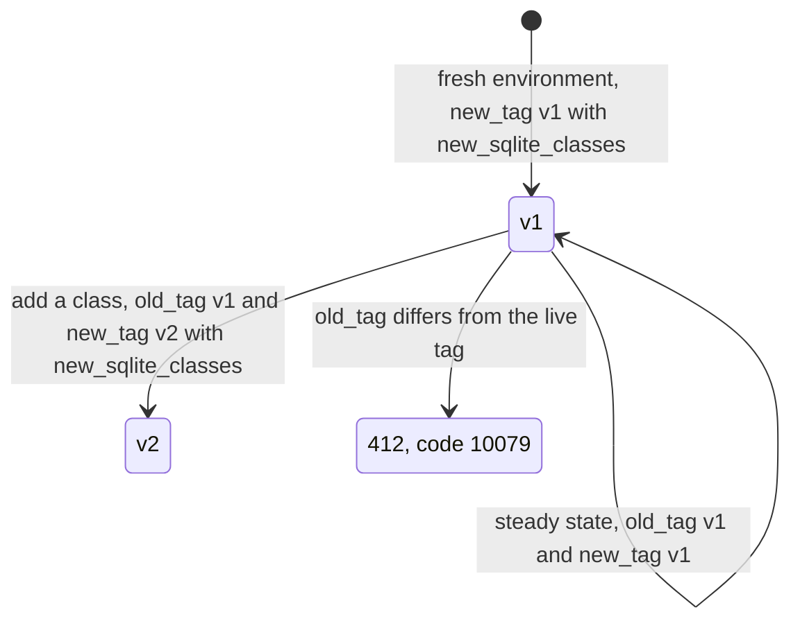
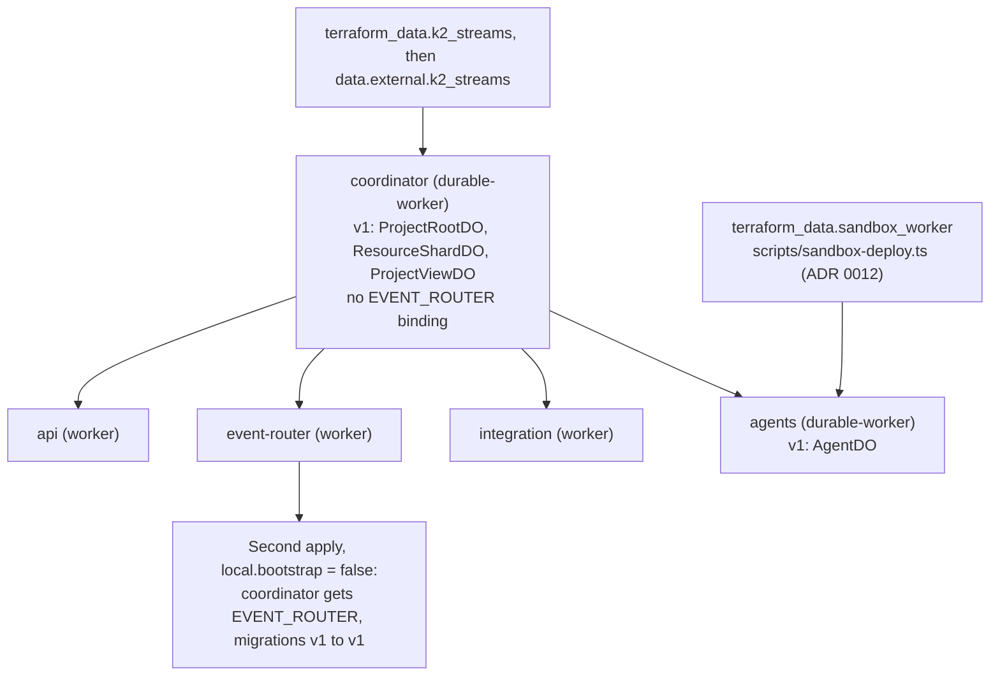

# ADR 0005: Deploy Durable Object Workers with cloudflare_workers_script

- Status: Accepted. Amended by ADR 0012 (the Sandbox Worker deploys through an adapter, not this
  module). Updated 2026-10-10.
- Date: 2026-10-08
- Decider: Project owner

## Context

AGENTS.md section 11.5 prefers `cloudflare_worker` + `cloudflare_worker_version` +
`cloudflare_workers_deployment`. Cloudflare rejects Durable Object class migrations
(`new_sqlite_classes`, renames, deletes) in version uploads; they need a full script deploy.

## Decision

- Workers that host Durable Object classes use `modules/durable-worker`, built on
  `cloudflare_workers_script` (full deploy, supports `migrations`). Today: `rhumbatron-coordinator`.
  Later: `rhumbatron-agents`.
- All other Workers keep `modules/worker` (version + deployment), which canary rollout needs later.
- Migrations are expressed as a transition from the live tag to the target tag. `old_tag` must
  equal the live tag, or Cloudflare rejects the upload (412, code 10079). Steady state is
  `old_tag = new_tag = <live tag>` with no class changes. Never edit an applied tag.

## Consequences

- `cloudflare_workers_script` has no tags attribute, so Durable Object Workers are grouped by name only.
- Gradual rollout does not apply to Durable Object Workers. Each release is a full deploy.
- The module declares observability and compatibility flags in full to keep the post-apply plan clean.

## Diagram

Migration tags on a Durable Object Worker (`old_tag`, `new_tag`):

First apply of a fresh root (`envs/prod`, `local.bootstrap = true`), then the second apply:

## Update (2026-10-10)

- `rhumbatron-agents` now deploys through `modules/durable-worker` (ADR 0009), with migration v1
  for `AgentDO`. Both Durable Object Workers are in steady state `v1 -> v1` in dev and prod.
- The `Sandbox` class is in its own Worker, `rhumbatron-sandbox-<env>`. It is deployed by
  `scripts/sandbox-deploy.ts` (`terraform_data.sandbox_worker`) in one full upload, not by this
  module (ADR 0012).
- A fresh root needs two applies. `local.bootstrap = true` omits the coordinator's
  `EVENT_ROUTER` binding (a cycle) and, in `envs/prod`, uploads the first migrations with
  `new_tag = "v1"` and the classes (ADR 0012, ADR 0017).
