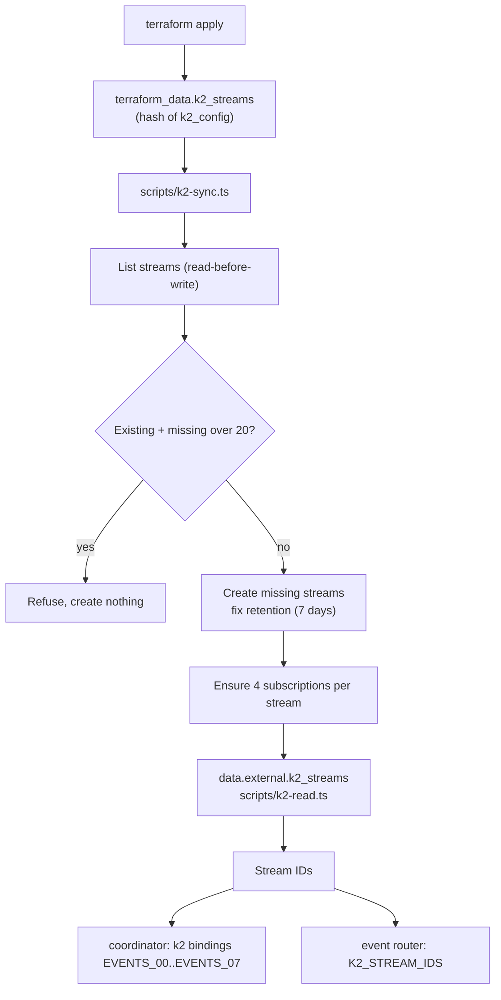
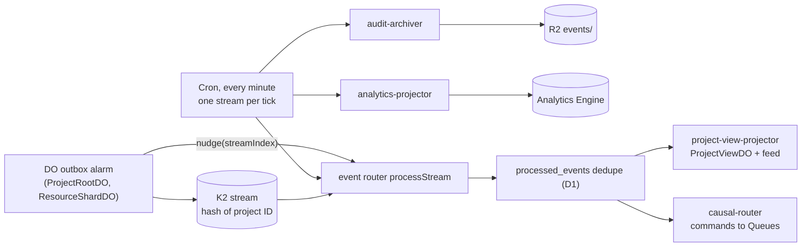

# ADR 0006: Terraform adapter for K2 streams

## Context

K2 streams and subscriptions carry the event log (AGENTS.md section 19). Provider 5.27 has no K2
resource. AGENTS.md section 11.4 steps 6 to 10 apply. K2 billing is not enabled during the beta.
Rhumbatron stays within free limits (rule 50).

## Decision

- `terraform_data.k2_streams` runs `scripts/k2-sync.ts`, keyed by a hash of the desired config.
  It lists streams first (read-before-write), creates missing streams and subscriptions, and
  fixes retention. It refuses to run outside `terraform apply`.
- `data.external.k2_streams` runs the read-only `scripts/k2-read.ts` to return stream IDs. Its
  `depends_on` defers the read to apply time, so a fresh root works in one apply.
- Stream IDs feed `k2` bindings (`EVENTS_00`..`EVENTS_07`) on the coordinator Worker and the
  `K2_STREAM_IDS` binding on the event router.
- Prod has 8 streams `rhumbatron_events_NN_prod` with 7-day retention. Each stream has the
  subscriptions `causal-router`, `project-view-projector`, `audit-archiver`, and `analytics-projector`.
- K2 names allow only letters, digits, and underscores. K2 is the one exception to the hyphenated
  naming pattern.
- The account allows 20 streams. Other projects share them. A plan-time precondition
  (`data.external.k2_inventory`, read-only `scripts/k2-read.ts` in inventory mode) fails the plan when
  the other streams plus 8 exceed 20. `k2-sync.ts` applies the same check at apply time.

## Consumers

K2 has no push delivery to Workers. Consumers pull over HTTP with leases and acknowledgements.

- `rhumbatron-event-router` consumes all four subscriptions:
  - `project-view-projector` updates ProjectViewDO and the event feed rows in D1.
  - `causal-router` runs the Causal Router and sends commands to Queues.
  - `audit-archiver` writes NDJSON batches to R2 `events/` (AGENTS.md section 19.1).
  - `analytics-projector` writes Analytics Engine data points.
- Fast path: after a successful publish, the coordinator calls the router's `nudge(streamIndex)` RPC
  through a service binding, so the UI sees events within seconds. The nudge path does not archive.
- Safety net: a 1-minute Cron Trigger sweeps one stream per tick (all 8 every 8 minutes). The
  sweep also runs the archive consumer, and the analytics consumer on ticks without housekeeping.
  `local.paused = true` removes the cron schedule. The nudge path still runs.
- Delivery is at least once. Consumers dedupe on `(consumer, event_id)` in D1 (`processed_events`).
- The router dead-letters and skips a batch after 5 failed deliveries (`MAX_BATCH_FAILURES`,
  `poison-batch.ts`, table `k2_batch_failures`).
- Each invocation stays under the 50-subrequest limit. The worst case is 46.

## Deletion

The adapter never deletes prod streams. A config change replaces `terraform_data`, and a
destroy-time delete would drop retained events. `k2-sync.ts` refuses its destroy mode for prod.
Removing a stream is a deliberate manual step.

## Limits and cost

- Account beta limits: 20 streams, 10 GB storage. Prod uses 8 streams.
- Billing is disabled in beta. Cloudflare gives at least 30 days' notice before it starts.
  Listed prices: $0.04/GB produced, $0.04/GB consumed, $0.02/GB-month retained.
  Recheck them before a production cost decision.

## Replacement

A first-party K2 resource would replace the adapter. Then delete both scripts and the
`hashicorp/external` provider.

## Diagram

Adapter at apply time:

Events at run time:

