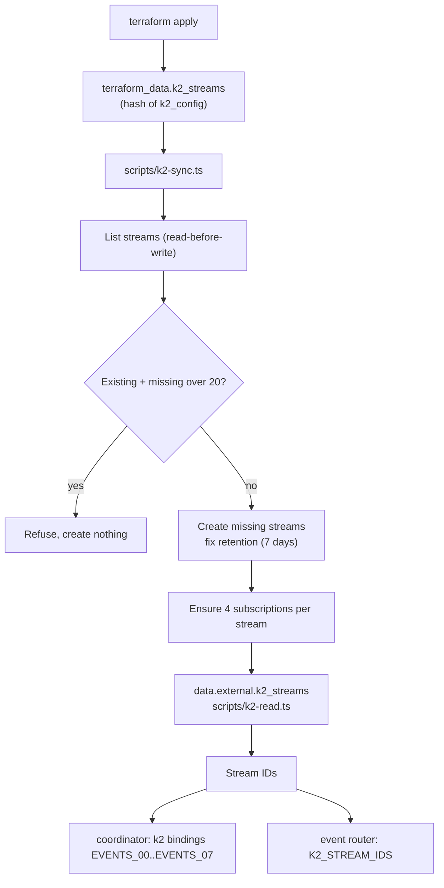
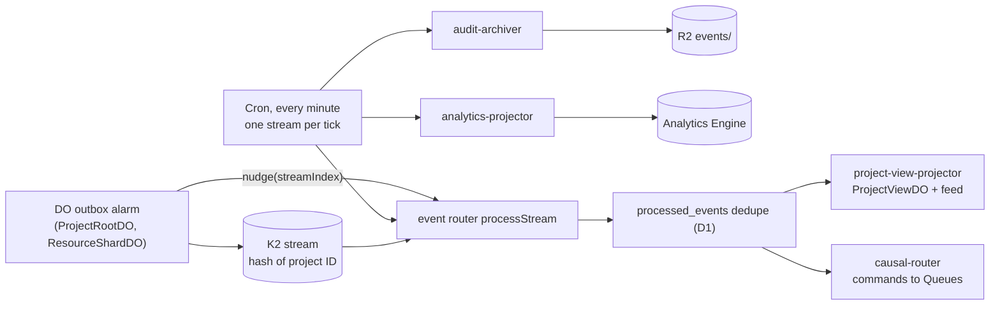

# ADR 0006: Terraform adapter for K2 streams

## Context

K2 streams and subscriptions carry the event log (AGENTS.md section 19). Provider 5.27 has no K2
resource. AGENTS.md section 11.4 steps 6 to 10 apply. K2 billing is not enabled in the beta.
Rhumbatron stays within free limits (rule 50).

## Decision

- `terraform_data.k2_streams` runs `scripts/k2-sync.ts`, keyed by a hash of `local.k2_config`.
  The script lists streams first (read-before-write), creates missing streams and subscriptions,
  and fixes retention. It refuses to run outside `terraform apply`.
- `data.external.k2_streams` runs the read-only `scripts/k2-read.ts` to return the stream IDs. Its
  `depends_on` moves the read to apply time, so a fresh root works in one apply.
- The stream IDs feed the `k2` bindings `EVENTS_00` to `EVENTS_07` on the coordinator Worker and
  the `K2_STREAM_IDS` binding on the event router.
- Prod has 8 streams `rhumbatron_events_NN_prod` with 7-day retention. Each stream has the
  subscriptions `causal-router`, `project-view-projector`, `audit-archiver`, and
  `analytics-projector`.
- K2 names allow only letters, digits, and underscores. So K2 streams do not use the hyphenated
  naming pattern (ADR 0004).
- The account allows 20 streams, and other projects share them. A plan-time precondition
  (`data.external.k2_inventory`, `scripts/k2-read.ts` in inventory mode) fails the plan when the
  other streams plus 8 are more than 20. `k2-sync.ts` applies the same check at apply time.

## Consumers

K2 has no push delivery to Workers. Consumers pull over HTTP with leases and acknowledgements.

- `rhumbatron-event-router` consumes all four subscriptions:
  - `project-view-projector` updates ProjectViewDO and the event feed rows in D1.
  - `causal-router` runs the Causal Router and sends commands to Queues.
  - `audit-archiver` writes NDJSON batches to R2 `events/` (AGENTS.md section 19.1).
  - `analytics-projector` writes Analytics Engine data points.
- Fast path: after a successful publish, the coordinator calls the router RPC `nudge(streamIndex)`
  through the `EVENT_ROUTER` service binding. The UI then shows events within seconds. The nudge
  path does not archive.
- Sweep: a Cron Trigger runs every minute and processes one stream per tick (all 8 in 8 minutes).
  Each sweep also runs the archive consumer. A tick without housekeeping also runs the analytics
  consumer. `local.paused = true` removes the cron schedule. The nudge path still runs.
- Delivery is at least once. Consumers dedupe on `(consumer, event_id)` in the D1 table
  `processed_events`.
- After 5 failed deliveries of one batch (`MAX_BATCH_FAILURES`, `poison-batch.ts`, table
  `k2_batch_failures`), the router dead-letters the batch and skips it.
- Each invocation stays under the 50-subrequest limit. The worst case is 46.

## Deletion

The adapter never deletes a prod stream. A config change replaces `terraform_data`, so a
destroy-time delete on that resource drops retained events. `terraform_data.k2_streams` has no
destroy provisioner, and `k2-sync.ts` refuses its destroy mode for streams whose names end in
`_prod`.

## Limits and cost

- Account beta limits: 20 streams, 10 GB storage. Prod uses 8 streams.
- Billing is not enabled in the beta. Check the K2 pricing page before a production cost decision.

## Replacement

When the provider has a first-party K2 resource, import the streams, delete both scripts, and
remove the `hashicorp/external` provider.

## Diagram

Adapter at apply time:

Events at run time:

