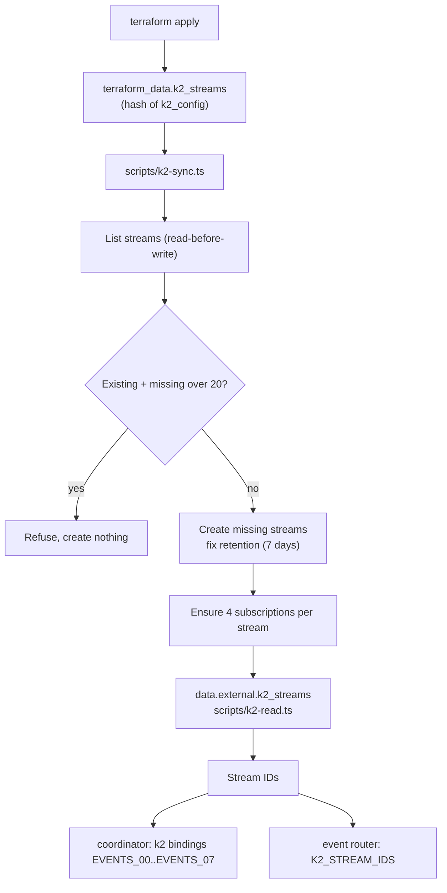
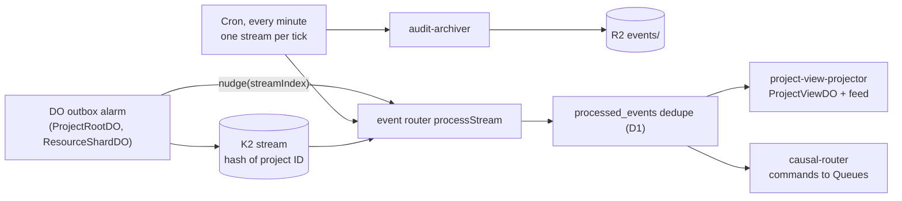

# ADR 0006: Temporary Terraform adapter for K2 streams

- Status: Accepted. Updated 2026-10-10: prod stream set, archive consumer, poison batches.
- Date: 2026-10-08
- Decider: Project owner

## Context

Phase 4 needs K2 streams and subscriptions (AGENTS.md section 19). Provider 5.27 has no K2 resource.
K2 is required for the current milestone, so section 11.4 steps 6 to 10 apply. K2 billing is not
enabled during the beta. Rhumbatron must still stay within free limits (rule 50).

## Decision

- `terraform_data.k2_streams` runs `scripts/k2-sync.ts`, keyed by a hash of the desired config.
  It lists streams first (read-before-write), creates missing streams and subscriptions, and
  fixes retention. It refuses to run outside `terraform apply`.
- `data.external.k2_streams` runs the read-only `scripts/k2-read.ts` to return stream IDs. Its
  `depends_on` defers the read to apply time, so a fresh environment works in one apply.
- Stream IDs feed `k2` bindings (`EVENTS_00`..`EVENTS_07`) on the coordinator Worker.
- Dev: 8 streams `rhumbatron_events_NN_dev`, 7-day retention, subscriptions `causal-router`,
  `project-view-projector`, `audit-archiver`, `analytics-projector`.
- K2 names allow only letters, digits, and underscores, so K2 is the one exception to the
  hyphenated naming pattern.

## Consumers

K2 has no push delivery to Workers. Consumers pull over HTTP with leases and acknowledgements.

- `rhumbatron-event-router` consumes `project-view-projector` and `causal-router`.
- Fast path: after a successful publish, the coordinator calls the router's `nudge(streamIndex)`
  RPC through a service binding, so the UI sees events within seconds.
- Safety net: a 1-minute Cron Trigger sweeps one stream per tick (all 8 every 8 minutes).
- Delivery is at least once. Consumers dedupe on `(consumer, event_id)` in D1
  (`processed_events`).
- Free-tier budget: about 1,440 cron runs per day plus one nudge per publish. Each invocation
  stays under the 50-subrequest limit.

## Deletion

The adapter never deletes streams. A config change replaces `terraform_data`, and a destroy-time
delete would then drop retained events. To remove a stream, do it as a deliberate manual step
and record it here. Automation is not safe for this step.

## Limits and cost

- Account beta limits: 20 streams, 10 GB storage. Dev uses 8 streams. Prod will need its own set
  (16 of 20 total). Other projects on the account share these limits.
- Billing is disabled in beta. Cloudflare gives at least 30 days' notice before it starts.
  Listed prices: $0.04/GB produced, $0.04/GB consumed, $0.02/GB-month retained.

## Replacement

Replace the adapter with the first-party resource when the provider adds one, then delete both
scripts and the `hashicorp/external` provider.

## Diagram

Adapter at apply time:

Events at run time:

## Update (2026-10-10)

- Prod has its own 8 streams, `rhumbatron_events_NN_prod`, with the same retention and
  subscriptions (ADR 0017). Dev plus prod use 16 of the 20 account streams. A prod plan-time
  precondition (`data.external.k2_inventory`) and the apply-time check in `k2-sync.ts` both refuse
  more than 20.
- The cron sweep also drains `audit-archiver` for its stream and writes NDJSON batches to R2
  (AGENTS.md section 19.1). The nudge path does not archive.
- `analytics-projector` exists as a subscription, but no Worker consumes it yet.
- The event router dead-letters and skips a batch that fails 5 deliveries
  (`MAX_BATCH_FAILURES`, `poison-batch.ts`, migration `0016_k2_batch_failures.sql`).
- Terraform removes the cron sweep while `local.paused = true`. The nudge path still runs.
- The K2 prices above come from the beta listing. They were not re-checked on this date.
