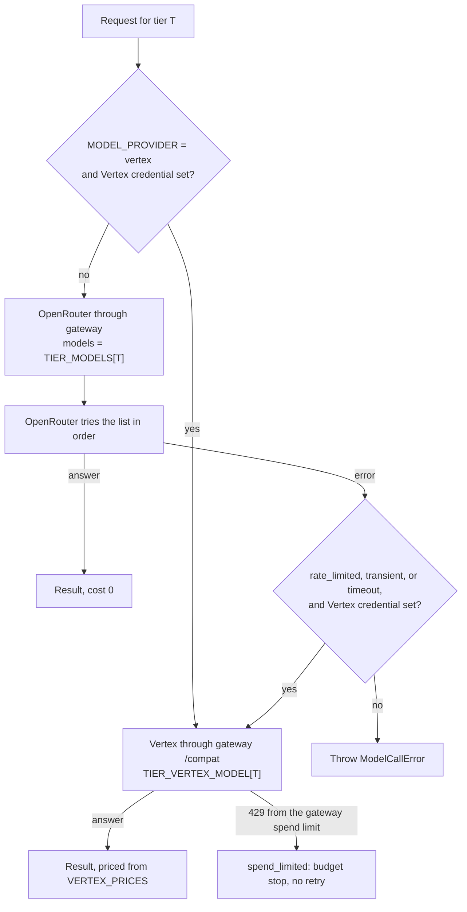

# ADR 0007: OpenRouter free models through AI Gateway, Gemini as a capped backup

- Status: Accepted. Amended by ADR 0016 (agents use Vertex as daily overflow) and ADR 0017
  (spend caps per environment). Updated 2026-10-10.
- Date: 2026-10-08
- Decider: Project owner

## Context

AGENTS.md section 5.4 freezes Claude 5.5 through AI Gateway. The project has no Anthropic API
key, and Claude subscriptions do not cover hosted product use. The owner chose OpenRouter with
its free models and kept the original architecture: AgentDO, Pi behind `AgentRuntime`, and
AI Gateway as the model proxy.

## Decision

- Model provider: OpenRouter, called through the AI Gateway `rhumbatron-models-<env>`
  (Terraform `modules/ai`). The gateway uses the OpenRouter provider endpoint.
- Only `:free` model variants. Model spend is $0, and OpenRouter reports `cost: 0`.
- The tier names stay `haiku`, `sonnet`, and `opus`, so the routing rules in section 23 do not
  change. `packages/model-router/src/models.ts` maps each tier to an ordered fallback list that
  OpenRouter applies on rate limits or outages:

  | Tier | Primary | Fallbacks |
  |---|---|---|
  | haiku | `poolside/laguna-xs-2.1:free` | `nvidia/nemotron-3.5-lightning:free`, `cohere/north-mini-code:free` |
  | sonnet | `poolside/laguna-s-2.1:free` (Terminal-Bench 2.1: 70.2%) | `cohere/north-mini-code:free`, `nvidia/nemotron-3-super-120b-a12b:free` |
  | opus | `nvidia/nemotron-3-ultra-550b-a55b:free` | `poolside/laguna-s-2.1:free` |

- All tiers passed a live tool-calling check on 2026-10-08 (`bun run smoke:models`).
- The OpenRouter key is in the Keychain (`rhumbatron-openrouter-api-key`) and reaches Workers
  as a `secret_text` binding only. The gateway stores no provider key (`byok_only = true`), so
  Unified Billing cannot charge the account.

## Paid backup: Gemini on Vertex AI

- When every free model in a tier fails with a rate limit, outage, or timeout, the client retries
  once on Vertex AI through the gateway's compat endpoint. Haiku uses
  `google/gemini-3.5-flash-lite`. Sonnet and opus use `google/gemini-3.8-flash`.
- Billing: GCP project `sudhanva-personal`, billing account with $10 of credit. Spend beyond the
  credit would reach a card, so the gateway enforces a hard cap. The cap is `spend_limits` in
  `modules/ai`: $9 per 2,592,000-second window, filtered to the `google-vertex-ai` provider.
  Requests over the cap get HTTP 429. The gateway's cost estimate is eventually consistent, so a
  burst can pass the cap slightly. The $1 margin covers that.
- Credential: service account `vertex-express@sudhanva-personal` (roles `aiplatform.expressUser`,
  `aiplatform.user`). Its JSON key, with `region: global` added and base64-encoded, is in the
  Keychain as `rhumbatron-vertex-sa-dev` and reaches Workers only as a `secret_text` binding. Vertex
  serves the newest Gemini models only from `global`. Rotate the key if it is exposed.
- The client prices Vertex calls itself, because Vertex reports no cost. The prices match the
  gateway's estimate. The client charges an unpriced model at the highest known rate, never $0.

## Gateway settings (free tier)

- Rate limit 20 requests per minute, sliding, which matches the OpenRouter free-model limit.
- Logs kept, capped at 10,000 with oldest deleted. No Logpush, guardrails, or DLP (billable).
- Cache off. Two exponential retries for transient upstream errors.
- Authentication off. A caller still needs an OpenRouter key, and the rate limit caps log volume.

## Limits and risks

- OpenRouter free limits: 20 requests per minute; 50 requests per day for accounts with under
  $10 of lifetime credit purchases, 1,000 per day after that. Free-model calls do not spend
  credits. At 50 per day a full demo Change does not fit, so the project needs either the
  one-time $10 purchase or tight call budgets.
- Free capacity is a shared upstream pool. Expect 429s. The fallback lists and the retry policy
  in section 42.8 absorb them.
- Free providers can log or train on prompts. Send only demo fixture code. Do not send customer
  source or secrets through free models.
- The free roster changes. Re-check https://openrouter.ai/collections/free-models before
  changing a tier, and rerun `bun run smoke:models`.

## Consequences

- Section 5.4 model names now mean tiers, not vendors. Decision Receipts record the model that
  answered.
- Switching back to Claude needs only a new tier map and a key, because the gateway and the
  router stay the same.

## Diagram

`complete()` in `packages/model-router/src/gateway-client.ts`, which the Root Planner uses
(ChangeWorkflow). Agent runs choose a provider once per run instead (ADR 0016).

## Update (2026-10-10)

- The $9 cap is replaced by one cap per gateway: dev $40 and prod $10 per 30 days
  (`vertex_spend_limit_usd`, ADR 0017). The agents and API Workers read it from
  `VERTEX_SPEND_LIMIT_USD` for budget-stop and Costs page text. The code fallback is still $9.
  The "$1 margin over $10 of credit" reasoning above no longer matches these caps.
- Dev sets `model_provider = "vertex"`. Root Planner and Agent calls go to Gemini instead of OpenRouter.
  Prod keeps `openrouter`, with Vertex as fallback and overflow.
- Agents now use Vertex too, as daily overflow (ADR 0016). The agent caps are 45 OpenRouter calls
  and 400 calls on all providers per day.
