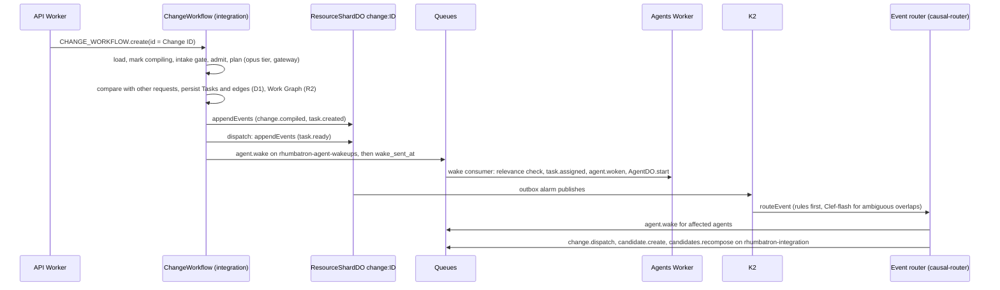

# ADR 0008: ChangeWorkflow, Work Graph persistence, and causal routing

## Context

One Change becomes a Work Graph, and only causally affected Agents wake (AGENTS.md sections 21.1
and 31). Task state needs idempotent transitions and durable events. ProjectRootDO stays cold
(section 13.1).

## Decision

- `POST /v1/projects/:id/changes` starts `ChangeWorkflow` (Cloudflare Workflows, integration
  Worker) with instance ID = Change ID. `startPlanning: false` does not start it (smoke checks).
- Steps (`workers/integration/src/change-workflow.ts`):
  1. Load the Change. Mark it `compiling`.
  2. Run the intake gate (ADR 0025). A question makes the Change `needs_input`, and the workflow
     waits for the answer.
  3. Admit the request on ProjectRootDO.
  4. Plan the Work Graph (Root Planner).
  5. Compare the plan with the other open requests of the Project (ADR 0023, ADR 0025).
  6. Persist the Work Graph. Record the events. Dispatch the ready Tasks.
- The Root Planner uses the opus tier through the AI Gateway. It makes one tool call that Zod and
  an acyclicity check validate. It gets one repair turn and one step retry. The opus tier runs on
  Sonnet while `ALLOW_OPUS` is not `"true"` (ADR 0021).
- Plan rules in code (`workers/integration/src/root-planner.ts`):
  - For an empty repository, t1 is an implement bootstrap Task, and every other Task depends on it
    (ADR 0022). A plan that breaks this rule gets the repair turn.
  - A UI Task and an API Task of the same area with no dependency path between them get the edge
    UI -> API. No model call adds it. The UI agent then reads the real API routes.
- Each step is idempotent: deterministic Task IDs, `INSERT OR IGNORE`, conditional status updates,
  and stable event and command IDs.
- Tasks and dependency edges are in D1. R2 stores the Work Graph JSON under
  `work-graphs/<project>/<change>.json`, with the planner model, tokens, and cost.
- Change and Task events go to the outbox of the ResourceShardDO that owns `change:<id>`
  (`appendEvents`, idempotent on event ID). Its alarm publishes them to K2.
- Dispatch marks the ready Tasks, records `task.ready`, sends `agent.wake` commands on
  `rhumbatron-agent-wakeups`, and then sets `wake_sent_at` (at least once).
- The agents Worker consumes wakes. It drops a stale wake and writes an Analytics Engine
  false-wakeup point. For a valid wake, it assigns the Task, records `task.assigned` and
  `agent.woken`, and starts a run on the `AgentDO` of the Task (ADR 0009).
- The `causal-router` subscription of the event router runs `routeEvent`
  (`packages/causal-router`). It sends these commands on `rhumbatron-integration`:
  `change.dispatch` (newly ready Tasks), `candidate.create` (the Work Graph is complete), and
  `candidates.recompose` (after `canonical.advanced`, ADR 0013). The router uses a Queue, because
  a service binding makes the dependency cycle coordinator, router, integration, coordinator.
- The Causal Router allows at most 1,000 wake, dispatch, and compose commands per Change per UTC
  day (`CHANGE_DAILY_COMMAND_CAP`, ADR 0019).
- Ambiguous resource overlaps go to Clef-flash (`@cf/cloudflare/clef-flash`, Workers AI) with an
  abstain threshold of 0.7. When Clef-flash abstains or the cap is reached, the router wakes the
  Agent. The `clef-flash` counter in `usage_counters` allows 200 calls per UTC day. The intake gate
  uses the same counter.

## Budget

Per Change: about 11 Workflow steps, plus 3 steps for each earlier open request of the Project.
Per woken Task: 1 to 4 model calls and about 3 Queue operations. Analytics Engine has no billing.
Code caps Workers AI calls. Model calls count against the monthly Anthropic budget (ADR 0021).

## Diagram

