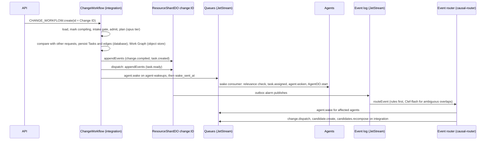

# ADR 0008: ChangeWorkflow, Work Graph persistence, and causal routing

## Context

Rhumbatron compiles one Change into a Work Graph. Only causally affected Agents wake. Task state
needs idempotent transitions and durable events. ProjectRootDO holds only cold project-wide state.

## Decision

- `POST /v1/projects/:id/changes` starts `ChangeWorkflow` with instance ID = Change ID. The
  workflow engine in `packages/platform` runs it, and the integration code defines it. A request
  with `startPlanning: false` does not start it. Smoke checks use this option.
- Steps (`workers/integration/src/change-workflow.ts`):
  1. Load the Change. Mark it `compiling`.
  2. Run the intake gate (ADR 0025). A question makes the Change `needs_input`, and the workflow
     waits for the answer.
  3. Admit the request on ProjectRootDO.
  4. Plan the Work Graph (Root Planner).
  5. Compare the plan with the other open requests of the Project (ADR 0023, ADR 0025).
  6. Persist the Work Graph. Record the events. Dispatch the ready Tasks.
- The Root Planner uses the opus tier on the Anthropic API. It makes one tool call that Zod and
  an acyclicity check validate. It gets one repair turn and one step retry. The opus tier runs on
  Sonnet while `ALLOW_OPUS` is not `"true"` (ADR 0021).
- Plan rules in code (`workers/integration/src/root-planner.ts`):
  - For an empty repository, t1 is an implement bootstrap Task, and every other Task depends on it
    (ADR 0022). A plan that breaks this rule gets the repair turn.
  - A UI Task and an API Task of the same area with no dependency path between them get the edge
    UI -> API. No model call adds it. The UI agent then reads the real API routes.
- Each step is idempotent. The steps use deterministic Task IDs, `INSERT OR IGNORE`, conditional
  status updates, and stable event and command IDs.
- Tasks and dependency edges are in the product database. The object store keeps the Work
  Graph JSON under `work-graphs/<project>/<change>.json`, with the planner model, tokens, and cost.
- Change and Task events go to the outbox of the ResourceShardDO that owns `change:<id>`
  (`appendEvents`, idempotent on event ID). Its alarm publishes them to the event log (NATS
  JetStream streams `EVENTS_00` to `EVENTS_07`).
- Dispatch marks the ready Tasks, records `task.ready`, sends `agent.wake` commands on the
  `agent-wakeups` queue, and then sets `wake_sent_at` (at least once).
- The agents code consumes wakes. It drops a stale wake and writes a false-wakeup point to the
  metrics table. For a valid wake, it assigns the Task, records `task.assigned` and
  `agent.woken`, and starts a run on the `AgentDO` of the Task (ADR 0009).
- The `causal-router` subscription of the event router runs `routeEvent`
  (`packages/causal-router`). It sends these commands on the `integration` queue:
  `change.dispatch` (Tasks that became ready), `candidate.create` (the Work Graph is complete),
  and `candidates.recompose` (after `canonical.advanced`, ADR 0013). The router sends commands on
  a queue, so the coordinator, the router, and integration have no call cycle.
- The Causal Router allows at most 1,000 wake, dispatch, and compose commands per Change per UTC
  day (`CHANGE_DAILY_COMMAND_CAP`).
- Ambiguous resource overlaps go to Clef-flash (model ID `@cf/cloudflare/clef-flash`). Claude
  Haiku answers it through a forced tool call. The router abstains below a probability of 0.7.
  When Clef-flash abstains or the cap is reached, the router wakes the Agent. The `clef-flash`
  counter in `usage_counters` allows 200 calls per UTC day. The intake gate uses the same counter.

## Budget

Per Change: about 11 workflow steps, plus 3 steps for each earlier open request of the Project.
Per woken Task: 1 to 4 model calls and about 3 queue operations. Code caps Clef-flash calls with
the daily `clef-flash` counter. Agent model calls count against the monthly Anthropic budget
(ADR 0021).

## Diagram

