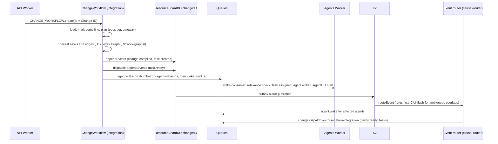

# ADR 0008: ChangeWorkflow, Work Graph persistence, and causal routing

## Context

One Change becomes a Work Graph, and only causally affected Agents wake (AGENTS.md sections 21.1
and 31). Task state needs idempotent transitions and durable events. ProjectRootDO stays cold
(section 13.1).

## Decision

- `POST /v1/projects/:id/changes` starts `ChangeWorkflow` (Cloudflare Workflows, integration
  Worker) with instance ID = Change ID. `startPlanning: false` skips it (smoke checks).
- Steps: load, admit the request, mark compiling, plan, compare with other requests of the Project
  (ADR 0023), persist, record events, dispatch. The Root Planner uses the opus tier through the AI
  Gateway. It makes one tool call that Zod and an acyclicity check validate. It gets one repair
  turn and one step retry. The opus tier runs on Sonnet while `ALLOW_OPUS` is not `"true"` (ADR 0021).
- Every step is idempotent: deterministic Task IDs, `INSERT OR IGNORE`, conditional status
  updates, stable event and command IDs.
- Tasks and dependency edges live in D1. R2 stores the Work Graph JSON, including planner model,
  tokens, and cost, under `work-graphs/`.
- Change and Task events go to the outbox of the ResourceShardDO that owns `change:<id>`
  (`appendEvents`, idempotent on event ID). Its alarm publishes to K2.
- Dispatch marks ready Tasks, records `task.ready`, sends `agent.wake` commands on
  `rhumbatron-agent-wakeups`, then sets `wake_sent_at` (at least once).
- The agents Worker consumes wakes and drops stale ones (Analytics Engine false-wakeup point). It
  assigns the Task, records `task.assigned` and `agent.woken`, and starts a run on the Task's
  `AgentDO` for a `task_ready` wake (ADR 0009).
- The event router's `causal-router` subscription runs `routeEvent` (`packages/causal-router`).
  Newly ready Tasks become a `change.dispatch` command on `rhumbatron-integration`. A service
  binding would create a coordinator, router, integration, coordinator dependency cycle.
- The Causal Router caps wake, dispatch, and compose commands at 1,000 per Change per UTC day
  (`CHANGE_DAILY_COMMAND_CAP`, ADR 0019).
- Ambiguous resource overlaps go to Clef-flash (`@cf/cloudflare/clef-flash`, Workers AI) with an
  abstain threshold of 0.7. If Clef-flash abstains or the cap is reached, the router wakes the Agent
  (the safe side). The cap is 200 calls per day in `usage_counters`, far inside the Workers AI
  free daily allowance.

## Budget

About 7 Workflow steps, 1 to 4 model calls, and 3 Queue operations per woken Task per Change.
Analytics Engine has no billing. Workers AI is capped in code. Model calls count against the
monthly Anthropic budget (ADR 0021).

## Diagram

