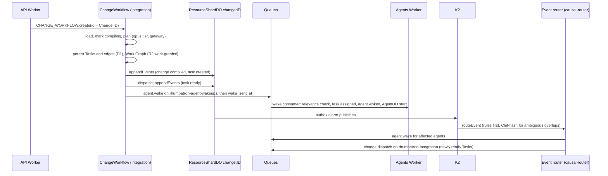

# ADR 0008: ChangeWorkflow, Work Graph persistence, and causal routing

- Status: Accepted. Updated 2026-10-10: the wake consumer now starts AgentDO runs (ADR 0009);
  command cap (ADR 0019).
- Date: 2026-10-08
- Decider: Project owner

## Context

Phase 5 turns one Change into a Work Graph and wakes only causally affected agents (AGENTS.md
sections 21.1, 31). Task state needs idempotent transitions and durable events, and
ProjectRootDO must stay cold (section 13.1).

## Decision

- `POST /v1/projects/:id/changes` starts `ChangeWorkflow` (Cloudflare Workflows, integration
  Worker) with instance ID = Change ID. `startPlanning: false` skips it (smoke checks).
- Steps: load, mark compiling, plan (Root Planner on the opus tier through the AI Gateway, one
  tool call validated by Zod and an acyclicity check, one repair turn, one step retry), persist,
  record events, dispatch. Every step is idempotent: deterministic Task IDs, `INSERT OR IGNORE`,
  conditional status updates, stable event and command IDs.
- Tasks and dependency edges live in D1 (`0003_work_graph.sql`). The Work Graph JSON, including
  planner model, tokens, and cost, is stored in R2 under `work-graphs/`.
- Change and Task events go to the outbox of the ResourceShardDO that owns `change:<id>`
  (`appendEvents`, idempotent on event ID). Its alarm publishes to K2 as before.
- Dispatch marks ready Tasks, records `task.ready`, sends `agent.wake` commands on
  `rhumbatron-agent-wakeups`, then sets `wake_sent_at` (at least once).
- The agents Worker consumes wakes, drops stale ones (Analytics Engine false-wakeup point),
  assigns the Task, and records `task.assigned` and `agent.woken`. The Agent Runtime is Phase 6.
- The event router's `causal-router` subscription runs `routeEvent` (packages/causal-router).
  Newly ready Tasks become a `change.dispatch` command on `rhumbatron-integration`; a service
  binding would create a coordinator → router → integration → coordinator dependency cycle.
- Ambiguous resource overlaps go to Clef-flash (`@cf/cloudflare/clef-flash`, Workers AI) with
  an abstain threshold of 0.7. Abstain or cap reached: wake (safe side). Cap: 200 calls per day
  in `usage_counters`, far inside the Workers AI free daily allowance.

## Free-tier budget

About 7 Workflow steps, 1 to 4 model calls (free models), and 3 Queue operations per woken Task
per Change. Analytics Engine has no billing. Workers AI is capped in code.

## Diagram

## Update (2026-10-10)

- The wake consumer now starts a run on the Task's `AgentDO` for a `task_ready` wake (ADR 0009).
- The causal router caps wake, dispatch, and compose commands at 1,000 per Change per UTC day
  (`CHANGE_DAILY_COMMAND_CAP`, ADR 0019).
- The Root Planner call follows the environment's provider mode: Gemini on Vertex in dev, free
  OpenRouter models first in prod (ADR 0007 update, ADR 0016). Dev planner calls are not free.
