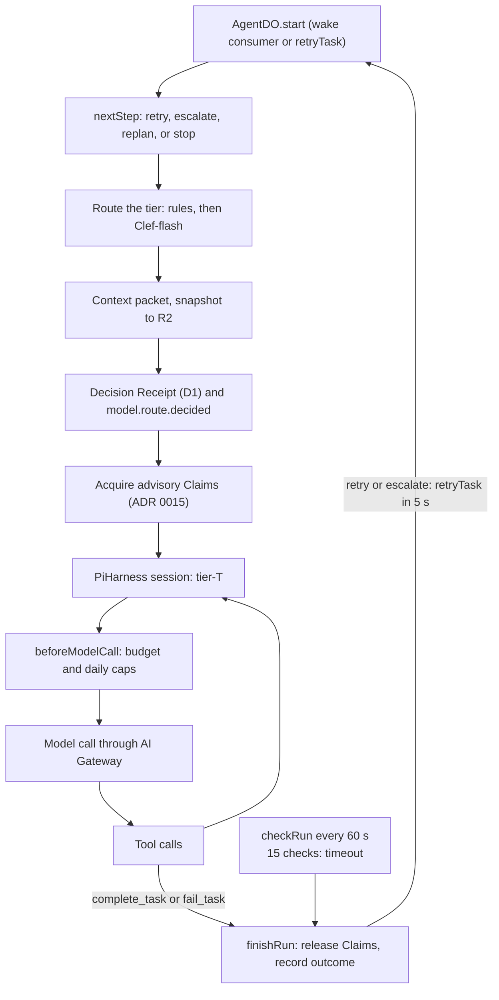

# ADR 0009: AgentDO on the Agents SDK with the Pi Durable harness

## Context

A durable agent needs a model and tool loop (AGENTS.md sections 13.4 and 25). The Cloudflare
Agents SDK (`agents` 0.27.0) gives `PiHarness` with `@earendil-works/pi-durable` 1.1.0 (beta).
With it, Pi runs inside a Durable Object, keeps transcripts in its SQLite, and resumes after
eviction.

## Decision

- `AgentDO` (agents Worker) extends the Agents SDK `Agent` and runs `PiHarness`. It implements
  `AgentRuntime`. No Pi type crosses that boundary. One instance exists per logical agent ID.
- Models: one pi-ai provider, `rhumbatron`, with the models `tier-haiku`, `tier-sonnet`, and
  `tier-opus`. Requests go to Anthropic through the AI Gateway (ADR 0021). The opus tier runs on
  Sonnet while `ALLOW_OPUS` is not `"true"`.
- Tools (`workers/agents/src/task-tools.ts`): every run gets `list_files`, `read_file`,
  `write_file`, `delete_file`, `run_command`, `complete_task`, and `fail_task`.
  - `complete_task` (with a typed Intent, section 26.1) and `fail_task` end a run. Both are
    idempotent.
  - Only `implement`, `migrate`, and `test` Tasks open a workspace (ADR 0011). For other Tasks,
    `list_files` and `read_file` read the canonical commit, and the write and command tools answer
    "This Task has no workspace".
- Routing: deterministic rules first, then Clef-flash only for the generic case (the rule floors
  still apply). Each attempt has a Decision Receipt in D1 and the Event `model.route.decided`.
- Escalation: two intelligence failures at one tier escalate one tier. Two failures at the top
  tier (Sonnet while Opus is off) send the Task to re-planning. A transport failure retries once at
  the same tier. Each attempt starts a fresh Pi session.
- Budgets: a gate before each model request caps calls per run (`MAX_CALLS_PER_RUN`: 16 haiku,
  32 sonnet, 32 opus) and agent calls per UTC day (`AGENT_DAILY_CALL_CAP`: 400). The monthly
  Anthropic budget also applies (ADR 0021). A budget stop blocks the Task and its dependents, and
  marks the Change `budget_blocked`.
- Claims: a run takes advisory Claims (ADR 0015).
- Liveness: while a run is active, AgentDO checks it every 60 s (`scheduleEvery(60)`). It sets no
  timers when idle. Each check goes through the daily alarm cap (ADR 0019). A run that ends without
  a terminal tool counts as `no_outcome`. After 15 checks, AgentDO stops the run (`timeout`).
- The agents Worker deploys through `modules/durable-worker` (ADR 0005). Migration `v1` adds
  `AgentDO` as a SQLite class.

## Risks

`PiHarness` and Pi Durable are beta APIs and can change. Only `agent-do.ts`, `models.ts`, and
`task-tools.ts` import them.

## Diagram

One run, as `AgentDO.start` and its callbacks implement it.

