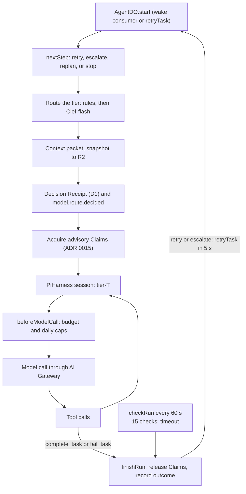

# ADR 0009: AgentDO on the Agents SDK with the Pi Durable harness

## Context

A durable agent needs a model and tool loop (AGENTS.md sections 13.4 and 25). Cloudflare's Agents
SDK provides `PiHarness` with `@earendil-works/pi-durable` (beta). With it, Pi runs inside a
Durable Object, persists transcripts in its SQLite, and resumes after eviction.

## Decision

- `AgentDO` (agents Worker) extends the Agents SDK `Agent` and runs `PiHarness`. It implements
  `AgentRuntime`. No Pi type crosses that boundary. One instance exists per logical agent ID.
- Models: one pi-ai provider, `rhumbatron`, with models `tier-haiku`, `tier-sonnet`, and `tier-opus`.
  Requests go to Anthropic through the AI Gateway (ADR 0021). The opus tier runs on Sonnet while
  `ALLOW_OPUS` is not `"true"`.
- Tools: `complete_task` (a typed Intent, section 26.1) and `fail_task` end a run. Workspace Tasks
  also get `list_files`, `read_file`, `write_file`, `delete_file`, and `run_command` (ADR 0011).
  Both terminal tools are idempotent.
- Routing: deterministic rules, Clef-flash only for the generic case (floors still apply), and a
  Decision Receipt per attempt in D1 plus `model.route.decided`.
- Escalation: two intelligence failures at a tier escalate one tier. Two failures at the top tier
  (Sonnet while Opus is off) send the Task to re-planning. Transport failures retry once at the same
  tier. Each attempt resets the Pi session (fresh context).
- Budgets: a gate before every model request caps calls per run (16, 32, and 32 by tier,
  `MAX_CALLS_PER_RUN`) and agent calls per day (400, `AGENT_DAILY_CALL_CAP`). The monthly Anthropic
  budget also applies (ADR 0021). A budget stop blocks the Task and its dependents, and marks the
  Change `budget_blocked`.
- Claims: a run takes advisory Claims (ADR 0015).
- Liveness: AgentDO checks the run every 60 seconds while it is active (`scheduleEvery(60)`) and sets
  no timers when idle. Each fire goes through the daily alarm cap (ADR 0019). A run that ends without
  a terminal tool counts as `no_outcome`. After 15 checks, AgentDO aborts the run (`timeout`).
- The agents Worker deploys through `modules/durable-worker` (ADR 0005). Migration v1 adds `AgentDO`
  as a SQLite class.

## Risks

`PiHarness` and Pi Durable are beta APIs and may change. Only `agent-do.ts`, `models.ts`, and
`task-tools.ts` import them.

## Diagram

One run, as `AgentDO.start` and its callbacks implement it.

