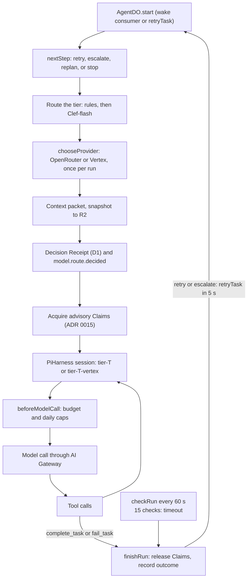

# ADR 0009: AgentDO on the Agents SDK with the Pi Durable harness

- Status: Accepted. Superseded in part by ADR 0016 (Vertex overflow, caps) and ADR 0011 (workspace
  tools). Updated 2026-10-10.
- Date: 2026-10-08
- Decider: Project owner

## Context

Phase 6 needs a durable agent with a model and tool loop (AGENTS.md sections 13.4, 25). On
2026-10-02 Cloudflare released `PiHarness` in the Agents SDK with `@earendil-works/pi-durable`
(beta): Pi runs inside a Durable Object, persists transcripts in its SQLite, and resumes after
eviction.

## Decision

- `AgentDO` (agents Worker) extends the Agents SDK `Agent` and runs `PiHarness`. It implements
  `AgentRuntime`; no Pi type crosses that boundary. One instance per logical agent ID.
- Models: one pi-ai provider, `rhumbatron`, with models `tier-haiku`, `tier-sonnet`, `tier-opus`.
  Requests go to OpenRouter through the AI Gateway; a payload hook sends the tier's free-model
  fallback list (ADR 0007). The Vertex backup is not used by agents yet.
- Tools: `complete_task` (a typed Intent, section 26.1) and `fail_task`. Until Workspaces exist
  (Phase 8), completing a Task means declaring its Intent. Both tools are idempotent.
- Routing: deterministic rules, Clef-flash only for the generic case (floors still apply), a
  Decision Receipt per attempt in D1 plus `model.route.decided`.
- Escalation: two intelligence failures at a tier escalate one tier; two at opus stop the Task
  (re-planning is later work); transport failures retry once at the same tier. Each attempt
  resets the Pi session (fresh context).
- Budgets: a gate before every model request caps calls per run (6, 10, 10 by tier) and agent
  calls per day (40, below the OpenRouter free limit). A budget stop blocks the Task, blocks its
  dependents, and marks the Change `budget_blocked`.
- Liveness: a check every 60 seconds while a run is active; no timers when idle. A run that ends
  without a terminal tool counts as `no_outcome`; after 15 checks the run is aborted (`timeout`).
- The agents Worker deploys through `modules/durable-worker` (ADR 0005), migration v1 adds
  `AgentDO` as a SQLite class.

## Risks

`PiHarness` and Pi Durable are beta APIs and may change. Only `agent-do.ts`, `models.ts`, and
`task-tools.ts` import them.

## Diagram

One run, as `AgentDO.start` and its callbacks implement it today.

## Update (2026-10-10)

- Agents now use Gemini on Vertex. The provider is chosen once per run: OpenRouter first, Vertex
  when OpenRouter is used up for the day, or Vertex always when `MODEL_PROVIDER = "vertex"` (dev).
  Each tier has a second Pi model, `tier-<t>-vertex` (ADR 0016).
- The budget numbers changed. Calls per run are 16, 32, and 32 by tier (`MAX_CALLS_PER_RUN`). The
  daily caps are 400 agent calls on all providers and 45 OpenRouter calls (ADR 0016).
- Tools now include `list_files`, `read_file`, `write_file`, and `run_command` for Workspaces
  (ADR 0011), in addition to `complete_task` and `fail_task`.
- Runs take advisory Claims (ADR 0015). Self-scheduled callbacks go through the daily alarm cap
  (ADR 0019).
