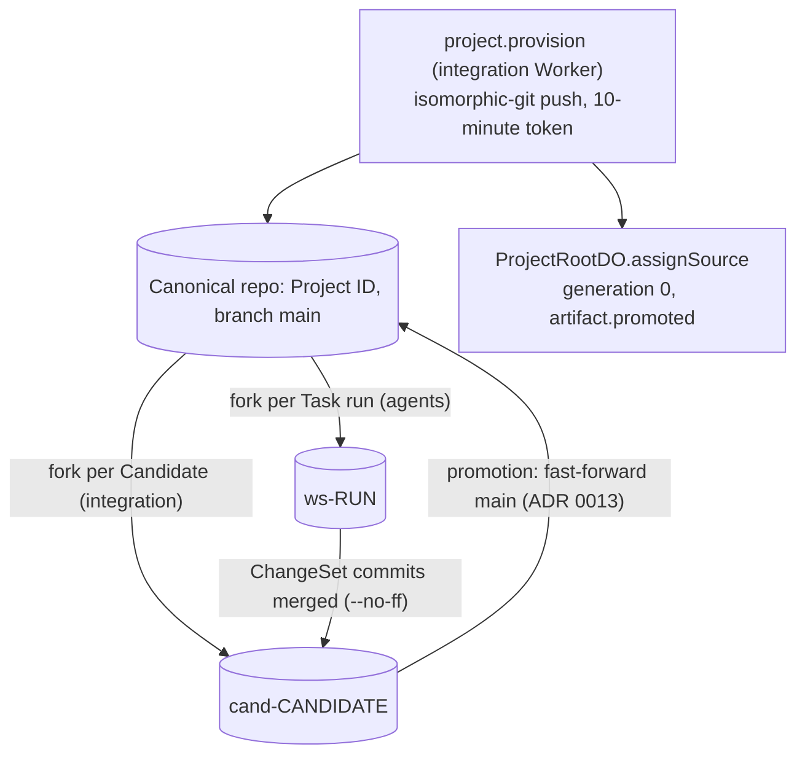

# ADR 0010: Artifacts as Project source

## Context

Agents need a real codebase (AGENTS.md section 29). Artifacts is Workers Paid only and in open
beta. It includes 10,000 operations and 1 GB-month each month. Rhumbatron stays within that allowance.

## Decision

- Terraform binds `ARTIFACTS` (namespace `rhumbatron-projects-prod`) on the integration, agents, and
  indexer Workers. Provider 5.27 has no namespace resource. Artifacts creates a namespace on first
  use, so no adapter exists. Repos are runtime data (section 2.1): one per Project, named by Project ID.
- Creating a Project queues `project.provision` on `rhumbatron-integration`. The integration Worker
  creates the repo and pushes the first commit with isomorphic-git over an in-memory file system
  (the binding has no write API, but Artifacts accepts git push protocol v1). The commit content is
  defined in ADR 0022. Then the Worker calls `ProjectRootDO.assignSource`. That method sets the
  canonical ref and tree for generation 0 once and records `artifact.promoted` in the same transaction.
- Fork names: `ws-<run>` for a Task run and `cand-<candidate>` for a Candidate. Cleanup derives names
  from D1 row IDs and never lists the namespace.
- Promotion fast-forwards the canonical repo's `main` after the compare-and-swap (ADR 0013).
- The integration Worker mints push and read tokens per call with a 600-second TTL. It never stores
  or logs them.
- The Acme Shop fixture exists in `fixtures/` for internal smoke scripts. `scripts/build-fixtures.ts`
  embeds it into `*.fixture.gen.ts`. The fixture routes answer only where `FIXTURES_ENABLED` is
  `"true"` or the environment is local.
- Artifacts import accepts only public URLs, so a private GitHub repo cannot seed a Project.

## Cost

A seed is a handful of operations. Forks, clones, and pushes per Change are tens of operations.
The allowance stays far from exhausted. Any automation that clones per wake needs a new review.

## Diagram

Repos in the namespace `rhumbatron-projects-prod` (names from `workers/integration/src/repo-names.ts`).

