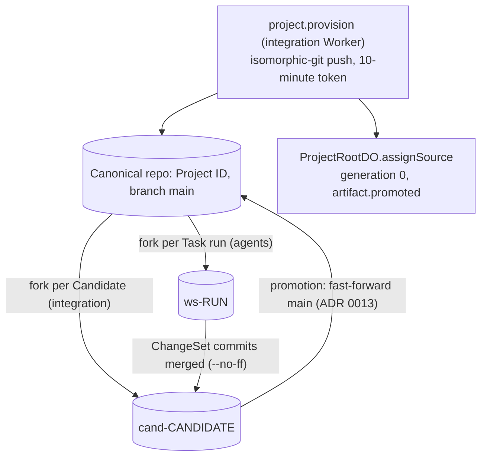

# ADR 0010: Artifacts as Project source

## Context

Agents need a real codebase (AGENTS.md section 29). Artifacts is Workers Paid only and in open
beta. Each month includes 10,000 operations and 1 GB-month. Rhumbatron stays within that
allowance.

## Decision

- Terraform binds `ARTIFACTS` (namespace `rhumbatron-projects-prod`) on the integration, agents, and
  indexer Workers. Provider 5.27 has no namespace resource. Artifacts creates a namespace on first
  use, so no adapter exists. Repositories are runtime data (section 2.1): one per Project, named
  by the Project ID.
- Project creation queues `project.provision` on `rhumbatron-integration`. The integration Worker
  creates the repository and pushes the first commit with isomorphic-git over an in-memory file
  system. The binding has no write API, but Artifacts accepts the git push protocol v1. ADR 0022
  defines the content of the first commit. Then the Worker calls `ProjectRootDO.assignSource`.
  That method sets the canonical ref and tree for Generation 0 once, and records
  `artifact.promoted` in the same transaction.
- Fork names (`workers/integration/src/repo-names.ts`): `ws-<run>` for a Task run and
  `cand-<candidate>` for a Candidate. Cleanup derives names from D1 row IDs and never lists the
  namespace.
- Promotion fast-forwards `main` of the canonical repository after the compare-and-swap (ADR 0013).
- The integration Worker creates push and read tokens per call with a 600-second TTL. It never
  stores or logs them.
- The Acme Shop fixture in `fixtures/` serves internal smoke scripts. `scripts/build-fixtures.ts`
  embeds it into `*.fixture.gen.ts`. The fixture routes answer only where `FIXTURES_ENABLED` is
  `"true"` or the environment is local.
- Artifacts import accepts only public URLs. A private GitHub repository cannot seed a Project.

## Cost

A seed costs a few operations. Forks, clones, and pushes cost tens of operations per Change.
The allowance stays far from its limit. Review the cost again before any code clones per wake.

## Diagram

Repositories in the namespace `rhumbatron-projects-prod`.

