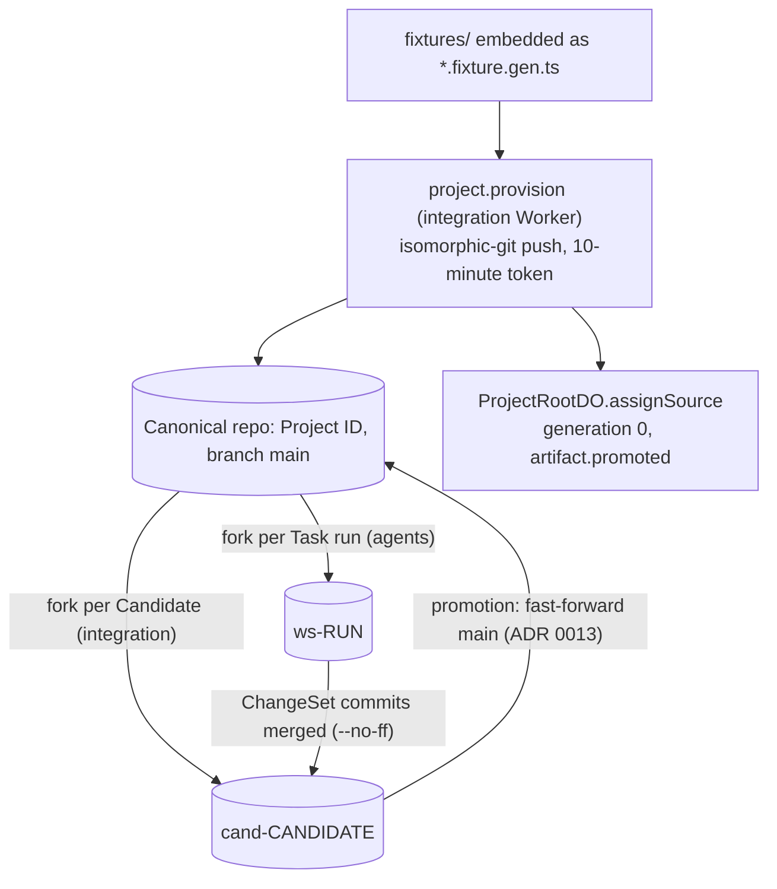

# ADR 0010: Artifacts as Project source, seeded from fixtures

- Status: Accepted. Updated 2026-10-10: more Workers bind `ARTIFACTS`; fork names; promotion
  moves `main` (ADR 0013).
- Date: 2026-10-08
- Decider: Project owner (cost cap: Linear HOM-192)

## Context

Agents need a real codebase (AGENTS.md sections 29 and 54). Artifacts is Workers Paid only and
in open beta. Billing starts 2026-10-14 with 10,000 operations and 1 GB-month included. The owner
approved Artifacts within the included allowance.

## Decision

- Terraform binds `ARTIFACTS` (namespace `rhumbatron-projects-<env>`) on the integration Worker.
  Provider 5.27 has no namespace resource. Artifacts creates a namespace on first use, so no
  adapter is needed. Repos are runtime data (section 2.1): one per Project, named by Project ID.
- Creating a Project queues `project.provision` on `rhumbatron-integration`. The integration
  Worker creates the repo and seeds a template commit with isomorphic-git over an in-memory file
  system (the binding has no write API, but Artifacts accepts git push protocol v1). Then it calls
  `ProjectRootDO.assignSource`. That method sets the canonical ref and tree for generation 0 once
  and records `artifact.promoted` in the same transaction.
- Templates live in `fixtures/`. `scripts/build-fixtures.ts` embeds them into
  `*.fixture.gen.ts`. The project cannot import its private GitHub repo, because Artifacts import
  accepts only public URLs. `POST /v1/projects/:id/provision` seeds an existing Project without
  source.
- The integration Worker mints push tokens per call with a 10-minute TTL. It never stores or
  logs them.

## Cost

A seed is a handful of operations. Forks, clones, and pushes per Change are tens of operations.
Stay far below 10,000 operations per month. Revisit before any automation that clones per wake.

## Diagram

Repos in the namespace `rhumbatron-projects-<env>` (names from `workers/integration/src/repo-names.ts`).

## Update (2026-10-10)

- `ARTIFACTS` is now bound on three Workers: integration (provision, Candidates, promotion), agents
  (Task Workspaces, ADR 0011), and indexer (reads canonical trees).
- Fork names: `ws-<run>` for a Task run and `cand-<candidate>` for a Candidate. Cleanup derives
  names from D1 row IDs and never lists the namespace.
- Promotion fast-forwards the canonical repo's `main` after the compare-and-swap (ADR 0013).
- Read and write tokens are minted per call with a 600-second TTL.
- Prod has its own namespace, `rhumbatron-projects-prod`. Dev and prod share the 10,000 included
  operations per month (ADR 0017).
