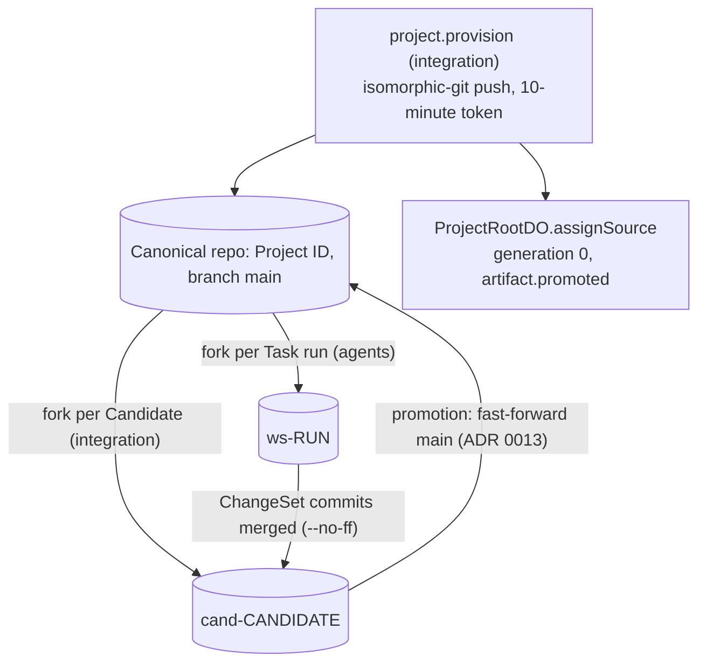

# ADR 0010: The git service as Project source

## Context

Agents need a real codebase with forks, commits, and short-lived access for clones and pushes.
The `git` service (`services/git`) stores Project source as bare Git repositories on the
`git-data` volume. Its client gives the `ARTIFACTS` binding that the application code uses.

## Decision

- The core service gives `ARTIFACTS` (`GitServiceClient`, namespace `rhumbatron`) to the
  integration, agents, and indexer code. Repositories are runtime data. Each Project has one
  repository, named by the Project ID.
- Project creation queues `project.provision` on the `integration` queue. The integration code
  creates the repository and pushes the first commit with isomorphic-git over an in-memory file
  system, through Git smart HTTP. ADR 0022 defines the content of the first commit. Then the code
  calls `ProjectRootDO.assignSource`. That method sets the canonical ref and tree for Generation 0
  once, and records `artifact.promoted` in the same transaction.
- Fork names (`workers/integration/src/repo-names.ts`): `ws-<run>` for a Task run and
  `cand-<candidate>` for a Candidate. A fork is `git clone --bare --shared`: it borrows the source
  objects through alternates and keeps its own `main`. Cleanup derives names from database row IDs
  and never lists the namespace.
- Promotion fast-forwards `main` of the canonical repository after the compare-and-swap (ADR 0013).
- The integration code creates push and read tokens per call with a 600-second TTL. A token is an
  HMAC signature over one repository, one scope, and an expiry. The code never stores or logs it.
- Import accepts only HTTPS URLs without credentials. A private GitHub repository cannot seed a
  Project.

## Cost

The git service runs on the local host and has no usage charge. A fork shares objects with its
source, so a fork costs disk only for its own new objects. Review the disk use again before any
code clones per wake.

## Diagram

Repositories in the namespace `rhumbatron`.

