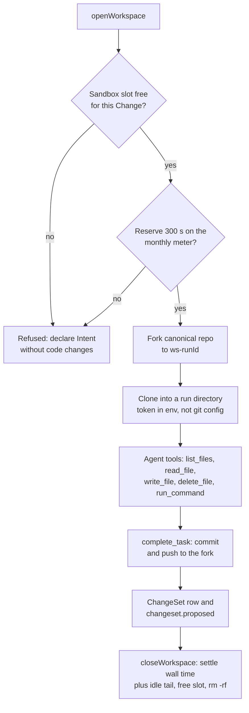

# ADR 0011: Sandbox workspaces with a prebuilt image

## Context

Implementation Tasks must change and test real code (AGENTS.md sections 29.2 and 30). Cloudflare
Sandboxes run on Containers. Rule 5 forbids a container deploy through Wrangler
(`wrangler deploy`, `wrangler containers push`), and that deploy needs Docker. Provider 5.27 has
no container application resource. ADR 0012 describes the Terraform adapter that deploys the
Sandbox.

## Decision

- Image: the prebuilt public `docker.io/cloudflare/sandbox:0.12.6` (Bun, git), which matches
  `@cloudflare/sandbox` 0.12.6. Containers pull public Docker Hub images under the `default`
  scheduling policy. Rhumbatron builds no image and runs no `wrangler containers push`.
- The container application `rhumbatron-sandbox-prod` has instance type `basic` (1/4 vCPU, 1 GiB)
  and `max_instances = 1`. `local.paused = true` sets `max_instances = 0`.
- Workspace (`workers/agents/src/workspace.ts`): one Sandbox per Project, one directory per Task
  run. Only `implement`, `migrate`, and `test` Tasks open a workspace. Each run forks the canonical
  Artifacts repository and clones the fork. The clone reads a short-lived token from an
  environment variable, never from git config. On `complete_task`, the run commits and pushes to
  its fork. The result is a ChangeSet row (`changesets`) and a `changeset.proposed` event.
- `run_command` accepts only these commands: `bun install` (also with `--frozen-lockfile`),
  `bun test`, `bun run typecheck|test|bench|contract|build`, `bun run <name>` for a script in the
  workspace `package.json`, `bunx tsc --noEmit`, `git status|diff|log`, and `ls`. It rejects shell
  metacharacters. A workspace build does not keep its output; Candidate composition builds it.
- A Change can have at most 4 open coding Sandboxes (`maxActiveSandboxesPerChange`, section 44).
  The workspace refuses an open above that limit before any fork. It also refuses an open when the
  monthly meter has no room. The agent then declares its Intent without code changes.

## Cost controls

- Agent workspaces use `sleepAfter` 120 s and delete their directory when the run ends. During a
  model call longer than 2 minutes, the Sandbox can sleep. The next tool call restores the checkout
  from the fork. Edits that are not committed are lost.
- Candidate checks in the integration Worker that run in the Sandbox use `sleepAfter: "2m"`,
  reserve 900 s, and settle a 120 s idle tail. The `build`, `unit`, and `contract` checks run in a
  Dynamic Worker when it supports them (ADR 0020).
- One monthly meter in D1 `usage_counters` (counter `sandbox-seconds`, keyed by month) serves both.
  A workspace session reserves 300 s before it opens. When it closes, it settles its wall time plus
  a 120 s idle tail. The `SANDBOX_MONTHLY_SECONDS` binding sets the cap: 72,000 s (20 hours) in
  prod. Without the binding, the code uses 36,000 s. Above the cap, the meter refuses new sessions.
- 20 hours of `basic` is 20 GiB-hours. That is 80 % of the 25 GiB-hours of memory that Workers Paid
  includes.

## Diagram

Task workspace lifecycle (`workers/agents/src/workspace.ts`).

