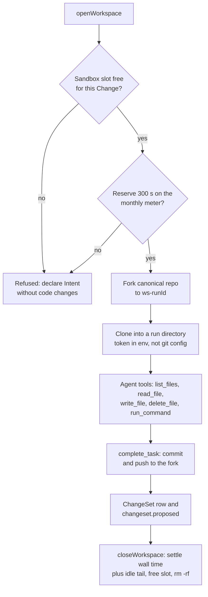

# ADR 0011: Sandbox workspaces with a prebuilt image

## Context

Implementation Tasks must change and test real code (AGENTS.md sections 29.2 and 30). Cloudflare
Sandboxes run on Containers. A container deploy through Wrangler (`wrangler deploy`,
`wrangler containers push`) is forbidden by rule 5, and it needs Docker. Provider 5.27 has no
container application resource. ADR 0012 describes the Terraform adapter that deploys the Sandbox.

## Decision

- Image: the prebuilt public `docker.io/cloudflare/sandbox:0.12.6` (Bun, git), matched to
  `@cloudflare/sandbox@0.12.6`. Containers pull public Docker Hub images under the `default`
  scheduling policy. Rhumbatron builds no image and runs no `wrangler containers push`.
- The container application `rhumbatron-sandbox-prod` has instance type `basic` (1/4 vCPU, 1 GiB)
  and `max_instances = 1`. `local.paused = true` sets `max_instances = 0`.
- Workspace: one Sandbox per Project, a directory per Task run. Each run forks the canonical
  Artifacts repo and clones it. The clone uses a short-lived token in an environment variable (never
  in git config). On `complete_task`, the run commits and pushes to its fork. The result is a
  ChangeSet row (`changesets`) and a `changeset.proposed` event. Design, review, and document Tasks
  never open a workspace.
- Tools: `list_files`, `read_file`, `write_file`, `delete_file`, `run_command`, `complete_task`, and
  `fail_task`. `run_command` accepts only an allow-list: `bun install` (also with
  `--frozen-lockfile`), `bun test`, `bun run typecheck|test|bench|contract`, `bunx tsc --noEmit`,
  `git status|diff|log`, and `ls`. It rejects shell metacharacters.
- A Change can hold at most 4 open coding Sandboxes (section 44). The workspace refuses an open over
  that limit before any fork. It refuses an open over the monthly meter the same way. The agent then
  declares its Intent without code changes.

## Cost controls

- Agent workspaces use `sleepAfter` 120 s and remove their directory when the run ends. A model call
  longer than 2 minutes lets the Sandbox sleep. The next tool call restores the checkout from the
  fork. Edits that are not committed are lost.
- Candidate checks in the integration Worker use `sleepAfter: "2m"`, reserve 900 s, and settle a
  120 s idle tail.
- One monthly meter in D1 `usage_counters` (`sandbox-seconds`, keyed by month) serves both. A
  workspace session reserves 300 s before it opens. When it closes, it settles its wall time plus a
  120 s idle tail. The `SANDBOX_MONTHLY_SECONDS` binding sets the cap: 54,000 s (15 hours) in prod.
  The code fallback without the binding is 36,000 s. Past the cap, the meter refuses new sessions.
- 15 hours of `basic` is about 15 GiB-hours of the 25 GiB-hours of memory that Workers Paid includes.

## Diagram

Task workspace lifecycle (`workers/agents/src/workspace.ts`).

