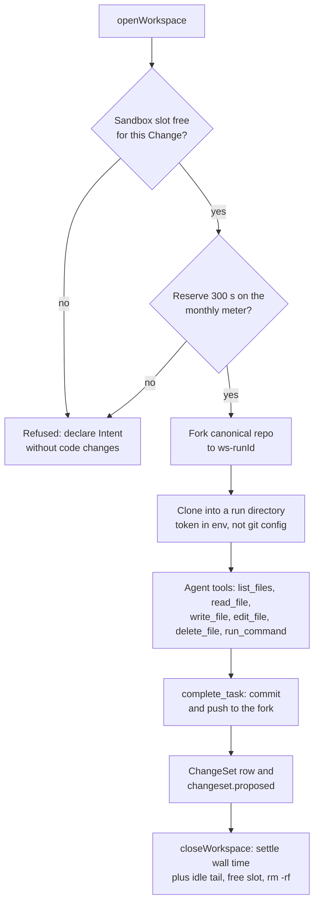

# ADR 0011: Sandbox workspaces with a prebuilt image

## Context

Implementation Tasks must change and test real code in an isolated Linux environment. `sandboxd`
(`services/sandboxd`) runs one sibling container per sandbox ID through the Docker Engine API,
behind a socket proxy. Its client gives the sandbox interface that the application code imports.

## Decision

- Image: `rhumbatron/sandbox:local`, built from `containers/sandbox` (`oven/bun:1.3.14-debian`,
  git, `jq`, `curl`) by the `sandbox-image` service at `bun run stack:up`. sandboxd starts only
  this image.
- sandboxd sets every container setting itself: 2 CPUs (`SANDBOX_CPUS`), 2 GiB memory with no
  swap (`SANDBOX_MEMORY_MB`), 512 processes, a reduced capability set, no binds, no published ports, and the runtime
  `SANDBOX_RUNTIME` (`runc` on the Mac, `runsc` on a Linux server). At most `SANDBOX_MAX` (4)
  sandboxes are live. Sandboxes sit on the internal `rhumbatron_sbx` network. They reach the git
  service directly and package registries through the `egress` allowlist proxy.
- Workspace (`workers/agents/src/workspace.ts`): one Sandbox per Project, one directory per Task
  run. The sandbox ID is `proj-<uuid>`. Only `implement`, `migrate`, and `test` Tasks open a
  workspace. Each run forks the canonical repository in the git service and clones the fork. The
  clone reads a short-lived token from an environment variable, never from git config. On
  `complete_task`, the run commits and pushes to its fork. The result is a ChangeSet row
  (`changesets`) and a `changeset.proposed` event.
- `run_command` accepts only these commands: `bun install` (also with `--frozen-lockfile`),
  `bun test`, `bun run typecheck|test|bench|contract|build`, `bun run <name>` for a script in the
  workspace `package.json`, `bunx tsc --noEmit`, `git status|diff|log`, and `ls`. It rejects shell
  metacharacters. A workspace build does not keep its output. Candidate composition builds it.
- A Change can have at most 4 open coding Sandboxes (`maxActiveSandboxesPerChange`).
  The workspace refuses an open above that limit before any fork. It also refuses an open when the
  monthly meter has no room. The agent then declares its Intent without code changes.

## Cost controls

- Agent workspaces use `sleepAfter` 120 s and delete their directory when the run ends. sandboxd
  removes a sandbox and its disk after 2 minutes idle (`SANDBOX_IDLE_MS`). During a model call
  longer than 2 minutes, the Sandbox can go away. The next tool call starts a fresh one and
  restores the checkout from the fork. Edits that are not committed are lost.
- Candidate checks in the integration code that run in the Sandbox use `sleepAfter: "2m"`,
  reserve 900 s, and settle a 120 s idle tail. The `build`, `unit`, and `contract` checks run in
  the apps service (`env.APPS.check`, workerd) when it supports them (ADR 0020).
- One monthly meter serves both: the product database table `usage_counters`, counter
  `sandbox-seconds`, keyed by month. A workspace session reserves 300 s before it opens. When it closes, it settles its wall time plus
  a 120 s idle tail. The `SANDBOX_MONTHLY_SECONDS` setting sets the cap: the core service default is
  72,000 s (20 hours). Without the setting, the code uses 36,000 s. Above the cap, the meter
  refuses further sessions.
- Sandboxes run on the local host and have no usage charge. The cap limits the host time that an
  autonomous loop can take.

## Diagram

Task workspace lifecycle (`workers/agents/src/workspace.ts`).

