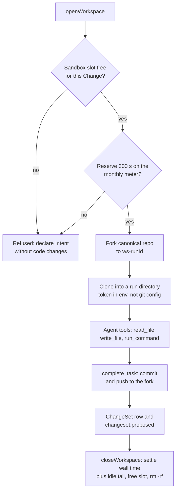

# ADR 0011: Sandbox workspaces with a prebuilt image and a Terraform-run adapter

- Status: Accepted; the container attach mechanism is superseded by ADR 0012, and the cost caps
  are updated by ADR 0017 (see Update below)
- Date: 2026-10-08
- Decider: Project owner (HOM-192 cap; option A of the Sandbox deploy question)

## Context

Implementation Tasks must change and test real code (AGENTS.md sections 29.2, 30). Cloudflare
Sandboxes run on Containers. A container deploy normally needs `wrangler deploy` or
`wrangler containers push`, which rule 5 forbids. It also needs Docker, which this machine does not
have. Provider 5.27 has no container application resource.

## Decision

- Image: the prebuilt public `docker.io/cloudflare/sandbox:0.12.6` (Bun, git), matched to
  `@cloudflare/sandbox@0.12.6`. Containers pull public Docker Hub images under the `default`
  scheduling policy, so Rhumbatron needs no local build and no `wrangler containers push`. The
  owner approved a `wrangler containers push` exception in case a custom image becomes necessary.
  Rhumbatron does not use it.
- The agents Worker exports the SDK's `Sandbox` class (Durable Object migration v2, applied). A
  temporary adapter (`scripts/containers-sync.ts`, `terraform_data.sandbox_container`) runs after
  the agents Worker upload. It reads before it writes and never deletes. The Terraform token has
  Workers Containers Write.
- Container wiring (verified against Wrangler 4.149.0 `wrangler-dist/cli.js` and live reads): a
  Durable Object class runs a container only when the deployed Worker version carries upload
  metadata `containers: [{ name, class_name }]` (cli.js ~169029, `getContainerMetadata` ~168173).
  Without it, the application create fails with `DURABLE_OBJECT_NOT_CONTAINER_ENABLED`. Wrangler
  sends it in the script `PUT ?bindings_inherit=strict` (~180918), then resolves the namespace ID
  (~146070) and creates the application with `durable_objects: { namespace_id }` (~146321). The list
  is per version (`resources.script_runtime.containers`) and is not inherited (~168204).
  `cloudflare_workers_script` (provider 5.27) has no `containers` attribute; `cloudflare_worker_version`
  has one, but ADR 0005 keeps Durable Object Workers on the script resource.
- The adapter therefore does two things:
  1. It always re-uploads the same bundle with the live settings, every binding as
     `{ type = "inherit" }`, the `containers` entry, and no migrations. It never reads secrets. It
     does not check the deployments list first, because that read can lag and report the previous,
     attached version.
  2. It creates or patches the application `rhumbatron-sandbox-<env>` (`basic`,
     `max_instances = 1`), bound by namespace ID.

  The API returns sizes, not `instance_type`, so the adapter compares drift with Wrangler's size
  table. A real change patches the application and starts a rollout. Wrangler's first deploy does
  the same (upload, then create, no rollout). Cloudflare says that containers can return errors for
  several minutes after it.
- Drift: Terraform cannot see `containers`, so plans stay clean. But every Terraform upload of the
  agents script drops it. The triggers hash every input that makes Terraform re-upload (bundle
  hash, compatibility, secret, gateway, D1 and R2 bindings), so the adapter re-attaches in the same
  apply. Add each new agents binding input to that hash, or run
  `terraform apply -replace=terraform_data.sandbox_container`. Between the Terraform upload and the
  adapter upload (about 15 s), the class has no container. Provisioning can take minutes after
  re-attachment. A move of the agents Worker to `cloudflare_worker_version` (`containers`
  attribute) would remove this window.
- Workspace: one Sandbox per Project, a directory per Task run. Each run forks the canonical
  Artifacts repo and clones it. The clone uses a short-lived token in an environment variable
  (never in git config). On `complete_task`, the run commits and pushes to its fork. The result is
  a ChangeSet row (`changesets`) and a `changeset.proposed` event. Design, review, and document
  Tasks never open a workspace.
- Tools: `write_file`, `run_command` (allow-list: `bun install`, `bun test`, `bun run
  typecheck|test|bench`, `bunx tsc --noEmit`, `git status|diff|log`, `ls`; no shell
  metacharacters), and workspace `read_file`.

## Cost controls (HOM-192)

- `sleepAfter: "2m"`. The run removes its directory when it ends.
- Monthly meter in D1 `usage_counters` (`sandbox-seconds`, keyed by month): a session reserves
  300 s before it opens. When it closes, it settles its wall time plus a 120 s idle tail. At
  36,000 s (10 hours), the meter refuses new sessions, and agents declare Intents without code
  changes.
- `basic` (1/4 vCPU, 1 GiB): 10 hours is about 10 GiB-hours of the 25 included. The account had
  no other container applications when this ADR was written.

## Replacement

Use the first-party resources when the provider adds a container application resource and a
`containers` attribute on `cloudflare_workers_script` (or the agents Worker moves to
`cloudflare_worker_version`, which has one). Then delete the adapter.

## Update (2026-10-10)

- The attach adapter (`scripts/containers-sync.ts`, `terraform_data.sandbox_container`) no longer
  exists. The `Sandbox` class lives in the `rhumbatron-sandbox-<env>` Worker (ADR 0012). The agents
  Worker binds it cross-script, and its own migrations hold only `AgentDO` (v1).
- The monthly cap is per environment: `SANDBOX_MONTHLY_SECONDS = 18000` (5 hours) in dev and in
  prod, which is the approved 10 hours in total (ADR 0017). The code fallback is still 36,000 s.
- Agent workspaces now use `sleepAfter` 600 s and settle a 600 s idle tail, so the checkout
  survives a slow model call. Candidate checks in the integration Worker keep `sleepAfter: "2m"`,
  reserve 900 s, and settle a 120 s tail. Both use the same `sandbox-seconds` meter.
- A Change can hold only a limited number of open coding Sandboxes (section 44). The workspace
  refuses an open over that limit before any fork, as it does for an open over the meter.
- The workspace tools are now `list_files`, `read_file`, `write_file`, `run_command`,
  `complete_task`, and `fail_task`. `run_command` also allows `bun install --frozen-lockfile`.

## Diagram

Task workspace lifecycle (`workers/agents/src/workspace.ts`).

