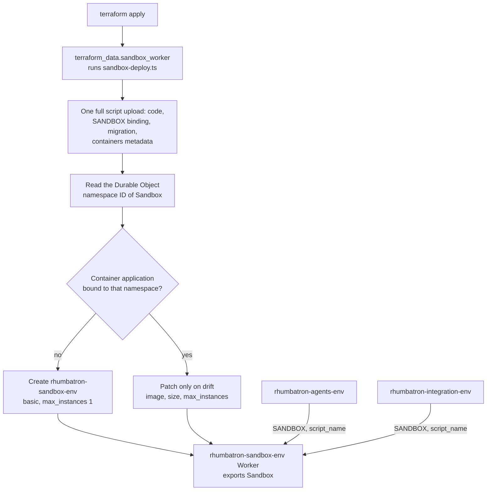

# ADR 0012: Host the Sandbox class in its own Worker, deployed in one upload

- Status: Accepted (supersedes the attach step of ADR 0011)
- Date: 2026-10-09
- Decider: Project owner

## Context

ADR 0011 added the `Sandbox` class to the agents Worker by migration, then re-uploaded the
agents script with `containers` metadata and created the container application. Every API read
looked right (version metadata, namespace `use_containers: true`, healthy application), yet at
runtime `ctx.container` stayed undefined in the class. A Durable Object class gets a container
only when it is created by the same upload that carries the container metadata, which is what
Wrangler does on a first deploy. Version uploads (cloudflare_worker_version) cannot carry
migrations (ADR 0005), so the agents Worker cannot do both.

## Decision

- `rhumbatron-sandbox-<env>` is a separate Worker (`workers/sandbox`) that only exports the
  SDK's `Sandbox` class. A temporary adapter (`scripts/sandbox-deploy.ts`,
  `terraform_data.sandbox_worker`) deploys it with one full upload: code, the `SANDBOX` binding,
  the class migration, and `containers: [{ name, class_name }]`. It then creates the container
  application bound by Durable Object namespace ID, and on destroy deletes both.
- The agents Worker binds `SANDBOX` cross-script (`script_name`). Agents deploys never touch the
  container, so the re-attach step and its detach window are gone.
- Verified on dev: `bun run smoke:sandbox` forks the Acme Shop repo, clones it, and runs
  `bun install`, `bun test` (13 passing, including the Cart invariant), and `bun run typecheck`.

## Bootstrap note

A fresh environment has a coordinator <-> event router binding cycle. `local.bootstrap = true`
omits the coordinator's `EVENT_ROUTER` nudge binding for the first apply; set it to false and
apply again. Migrations start from `{ new_tag = "v1", new_sqlite_classes = [...] }` and then move
to the steady `v1 -> v1`.

## Update (2026-10-10)

- Dev and prod both run this layout. The integration Worker also binds `SANDBOX` cross-script, for
  Candidate composition and checks in the same Project Sandbox.
- A teardown resource (`terraform_data.sandbox_worker_teardown`) runs the destroy mode. It is keyed
  by the Worker and application names only, so a bundle or size change never deletes the live
  Worker.
- The adapter reads the live migration tag. A first upload creates `v1` with the `Sandbox` class;
  later uploads keep the live tag. If the application points at an older namespace, the adapter
  recreates it against the current one.
- `local.paused = true` sets `max_instances = 0` on the application.

## Diagram

One `terraform apply` of an env root (`scripts/sandbox-deploy.ts`, deploy mode).

