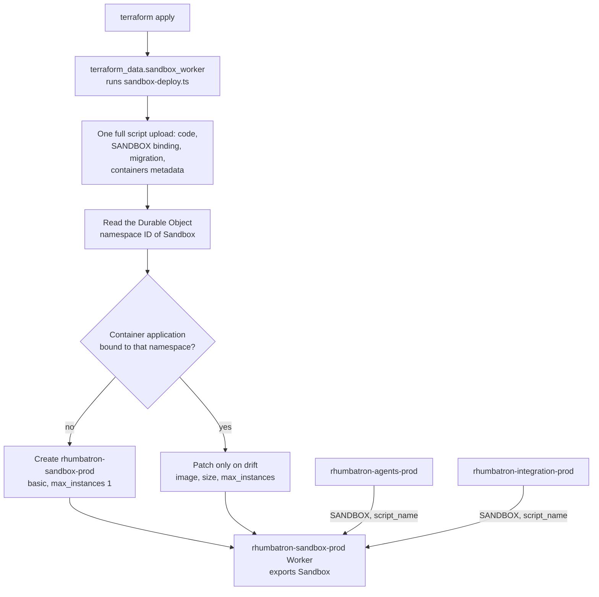

# ADR 0012: Host the Sandbox class in its own Worker, deployed in one upload

## Context

A Durable Object class gets a container only when the upload that creates the class also carries the
container metadata (`containers: [{ name, class_name }]`). Wrangler does this on a first deploy.
Version uploads (`cloudflare_worker_version`) cannot carry migrations (ADR 0005). The agents
Worker therefore cannot hold both its own classes and the container-enabled `Sandbox` class.
Provider 5.27 has no container application resource.

## Decision

- `rhumbatron-sandbox-prod` is a separate Worker (`workers/sandbox`) that only exports the SDK's
  `Sandbox` class. An adapter (`scripts/sandbox-deploy.ts`, `terraform_data.sandbox_worker`) deploys
  it with one full upload: code, the `SANDBOX` binding, the class migration, and
  `containers: [{ name, class_name }]`. It then creates the container application, bound by
  Durable Object namespace ID.
- The adapter reads the live migration tag. A first upload creates `v1` with the `Sandbox` class.
  Every other upload keeps the live tag. If the application points at an older namespace, the adapter
  recreates it against the current one. It patches the application only on drift (image, size,
  `max_instances`).
- `terraform_data.sandbox_worker_teardown` runs the destroy mode and deletes the Worker and the
  application. Only the Worker and application names key it, so a bundle or size change never deletes
  the live Worker.
- The agents Worker and the integration Worker bind `SANDBOX` cross-script (`script_name`). The
  integration Worker uses it for Candidate composition and checks in the same Project Sandbox.
  Agents deploys never touch the container.
- A first-party container application resource, or a `containers` attribute on a Worker version
  resource that supports migrations, would replace the adapter.

## Diagram

One `terraform apply` of `envs/prod` (`scripts/sandbox-deploy.ts`, deploy mode).

