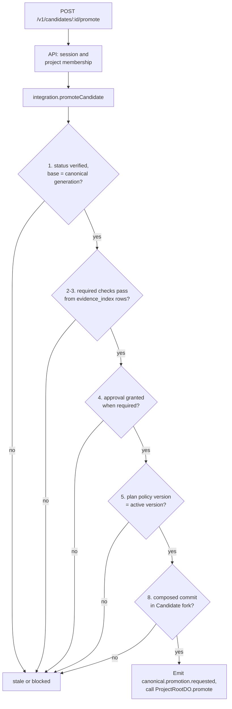
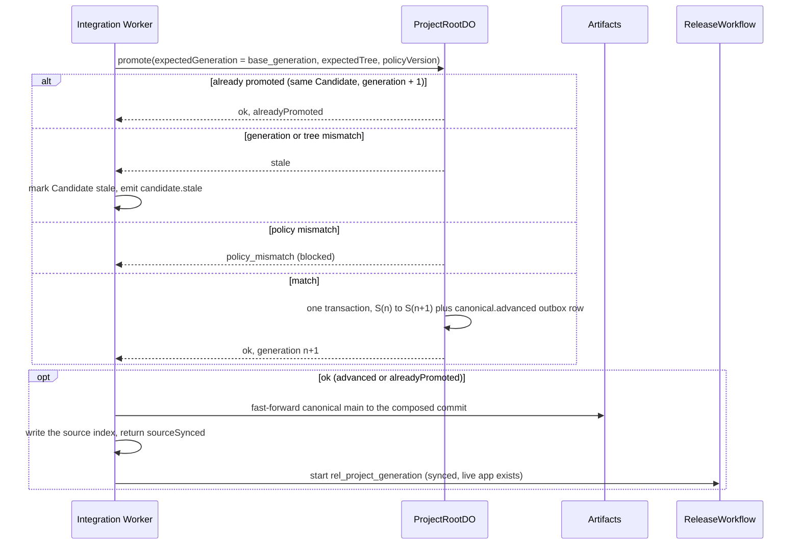

# ADR 0013: Split promotion preconditions between the integration Worker and ProjectRootDO

## Context

AGENTS.md section 36 lists eight preconditions before one atomic `S<n> -> S<n+1>` transition.
Most of them read data that ProjectRootDO does not own: Candidate status, the Verification Plan,
and Evidence live in D1; approvals are D1 rows; the Candidate commit lives in an Artifacts fork.
ProjectRootDO owns only canonical generation, tree, ref, and the active policy version. A Durable
Object that reads D1 inside its transaction cannot make those reads atomic with its own state.
D1 reads would also make the hottest correctness boundary depend on a second database.

## Decision

Two steps, in this order, for `POST /v1/candidates/:candidateId/promote`:

1. **Integration Worker (`promoteCandidate` RPC).** The API authenticates the user, checks project
   membership, and calls the integration Worker over the `INTEGRATION` service binding. The
   integration Worker has no public route. It reads authoritative rows and checks, with the pure
   function `checkPromotion` (`packages/evidence/src/promotion.ts`):
   - rule 1: Candidate status is `verified`;
   - rules 2 and 3: `gateRequiredChecks` gates the required checks again from `evidence_index`
     rows. It never trusts the cached `score_json` gate. Only `checked_supported` plus `pass`
     satisfies a check (section 34.4.1);
   - rule 4: when the plan or the policy risk tiers require it, a `granted` approval exists for the
     exact composed tree; a `rejected` approval always blocks;
   - rule 5 (early): the plan's policy version equals the active version;
   - rule 8: the composed commit still exists in the Candidate fork with the recorded tree.
   It then builds and Zod-validates a section 36 `PromotionRequest` and emits
   `canonical.promotion.requested`.
2. **ProjectRootDO (`promote`).** It decides on its own state, in one SQLite transaction:
   rule 5 (authoritative policy version), rule 6 (expected generation = current), rule 7 (expected
   tree = current, when the Candidate recorded its `base_tree`). It writes the new generation and
   the `canonical.advanced` outbox row together. The event records `requiredEvidenceIds` and
   `approvalId` for audit.

The expected generation is always the Candidate's `base_generation`; the browser cannot choose
it. The idempotency key is Candidate ID plus expected generation (section 60): a retry returns
`alreadyPromoted`. A generation or tree mismatch marks the Candidate `stale` and emits
`candidate.stale`; there is no blind retry (section 42.9).

### Approvals

`POST /v1/changes/:changeId/approve` records one decision per Candidate in `approvals`
(migration 0008). The approver is the authenticated member from the session, never from the
request body. Only a verified, gated Candidate can be decided; the first decision is final, and an
identical repeat returns the stored row. A rejection also sets the Candidate to `rejected`. The
policy is deterministic (`approvalRequired`, `checkApprovalDecision`); no model takes part.
`approval.requested` is emitted when a gated Candidate is verified. `approval.granted` or
`approval.rejected` is emitted when a decision is recorded.

### Canonical source after promotion

ProjectRootDO is the authority, so the canonical Artifacts repo moves after the compare-and-swap,
not before. The integration Worker fetches the Candidate fork with isomorphic-git into memory and
pushes the composed commit to the canonical repo's `main` as a fast-forward only (no force push;
receive-pack also checks the old value). It then writes `source/<project>/<tree>/index.json`.
Agents and the verification workflow use that index to resolve the canonical commit, so the
integration Worker writes it only after `main` moves. The new canonical ref is
`artifacts://<project>@<commit>`.

If the sync fails, the generation has still advanced. The response says `sourceSynced: false`;
promoting again repairs it, because the retry is `alreadyPromoted` and re-runs the sync. Until
then, a new Candidate's verification waits on its first step (bounded retries) instead of
composing on a commit that `main` does not hold yet. No Sandbox time is used for the sync.

### Re-wake after promotion

On `canonical.advanced`, the Causal Router marks every other in-flight Candidate of the Project
with an older base as `stale` (one D1 batch, deterministic). It also marks the promoted Candidate
`promoted`. This repairs the D1 mirror if the integration Worker stopped between the
compare-and-swap and its own write. The Causal Router already wakes the agents of active Tasks on
that event.

## Consequences

- The DO trusts its caller for rules 1 to 4 and 8. Only Workers with a `PROJECT_ROOT` binding can
  call it, and only the integration Worker calls `promote`.
- A precondition can change between the check and the compare-and-swap (for example a new
  Evidence row). Evidence IDs are stable per check, and a Candidate's Evidence is written only by
  its own verification workflow, which has finished once the Candidate is `verified`.
- The API Worker holds the `INTEGRATION` service binding (Terraform `api_worker`).
- An approver can also be the Change author. Only the Project owner can approve (ADR 0023).
- The rules in ProjectRootDO are the pure function `decidePromotion`
  (`workers/coordinator/src/promotion-cas.ts`). The order is: already promoted, generation, tree,
  then policy version.
- After the canonical `main` sync succeeds, promotion starts `ReleaseWorkflow` for a Project that
  has a live app (ADR 0020). A release never fails or reverses a promotion.
- Auto-promotion: after the gate, the verification workflow calls the pure function
  `autoPromoteDecision` (`autoPromoteRiskTiers`). Then it calls `promoteCandidate` with trigger
  `auto` and actor `system:auto-promotion`. That is the same path and the same preconditions as a
  manual promote. A plan or policy tier that needs approval is never automatic. An unknown risk
  tier is never automatic either.
- Promotion writes the Change statuses `promoting`, then `releasing` or `completed`.

## Diagram

Preconditions in the integration Worker (`checkPromotion`). It returns every block at once.

Compare-and-swap and source sync.

