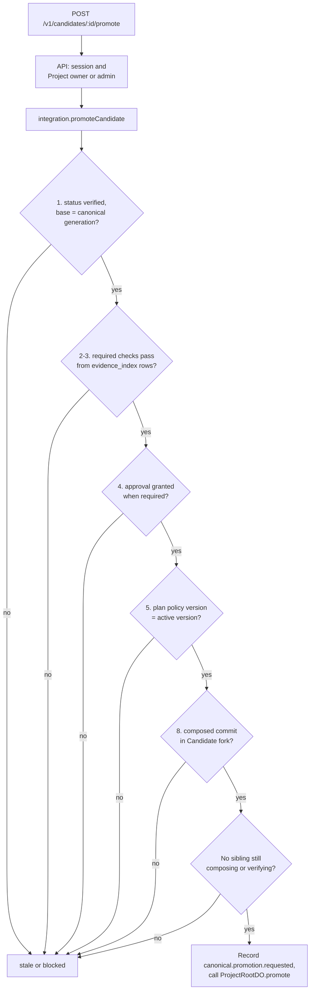
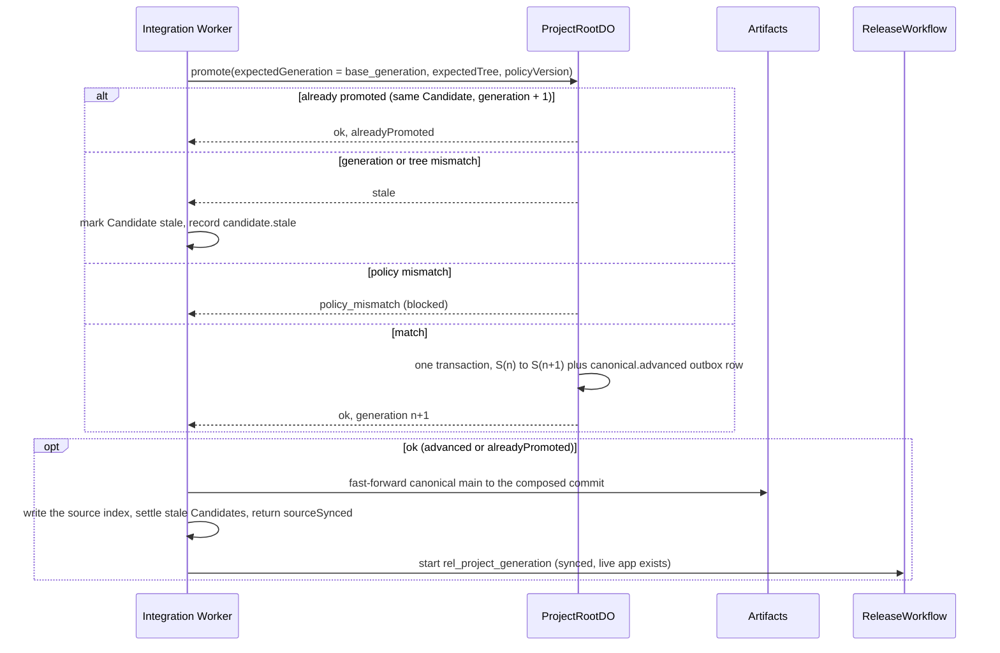

# ADR 0013: Split promotion preconditions between the integration Worker and ProjectRootDO

## Context

Promotion is one atomic `S<n> -> S<n+1>` transition. Eight preconditions must be true before it:

1. The Candidate status is `verified`.
2. The required Evidence exists.
3. The required Evidence has the pass state.
4. The required human approval exists.
5. The policy version is valid.
6. The current Canonical Generation equals the expected generation.
7. The current canonical tree equals the expected tree, when the tree check is on.
8. The Candidate Artifact still exists.

Most of these preconditions read data that ProjectRootDO does not own. Candidate status, the
Verification Plan, Evidence, and approvals are D1 rows. The Candidate commit is in an Artifacts
fork. ProjectRootDO owns only the Canonical Generation, tree, ref, and active policy version. A
Durable Object that reads D1 inside its transaction cannot make those reads atomic with its own
state. D1 reads also make the most important correctness boundary depend on a second database.

## Decision

Rhumbatron checks the preconditions for `POST /v1/candidates/:candidateId/promote` in two steps,
in this order.

1. Integration Worker (`promoteCandidate` RPC). The API authenticates the user, checks that
   the user is a Project owner or admin (ADR 0028), and calls the integration Worker over the
   `INTEGRATION` service binding. The integration Worker has no public route. It reads the
   authoritative rows and checks them with the pure function `checkPromotion`
   (`packages/evidence/src/promotion.ts`):
   - rule 1: the Candidate status is `verified`, and its base is the current generation;
   - rules 2 and 3: `gateRequiredChecks` gates the required checks again from the `evidence_index`
     rows. It never trusts the cached `score_json` gate. Only `checked_supported` plus `pass`
     satisfies a check;
   - rule 4: when the plan or the policy risk tiers require it, a `granted` approval exists for
     the exact composed tree. A `rejected` approval always blocks;
   - rule 5 (early): the policy version of the plan equals the active version;
   - rule 8: the composed commit is in the Candidate fork with the recorded tree;
   - selection: no sibling Candidate is still composing or verifying (`selection_pending`,
     ADR 0026).

   `checkPromotion` returns every block at once. Then the Worker builds and Zod-validates a
   `PromotionRequest` and records `canonical.promotion.requested`.
2. ProjectRootDO (`promote`). It decides on its own state in one SQLite transaction. It
   checks rule 5 (authoritative policy version), rule 6 (expected generation = current), and rule 7
   (expected tree = current, when the Candidate recorded its `base_tree`). It writes the next
   generation and the `canonical.advanced` outbox row together. The Event records
   `requiredEvidenceIds` and `approvalId` for audit.

The expected generation is always the `base_generation` of the Candidate. The browser cannot
choose it. The idempotency key is the Candidate ID plus the expected generation. A
retry returns `alreadyPromoted`. A generation or tree mismatch marks the Candidate `stale` and
records `candidate.stale`. Rhumbatron does not retry a stale promotion blind.

### Approvals

`POST /v1/changes/:changeId/approve` records one decision per Candidate in `approvals`
(migration 0008). The approver is the authenticated Project owner or admin from the session. The
request body never names the approver. Only a verified Candidate that needs approval can get a
decision. The first decision is final, and an identical repeat returns the stored row. A rejection also sets the Candidate to
`rejected`. The policy is deterministic (`approvalRequired`, `checkApprovalDecision`). No model
takes part. The integration Worker records `approval.requested` for a verified Candidate that
needs approval. That Candidate has no siblings, or it is the winner of a selection (ADR 0026).
The Event has `reason` (one sentence, also the Candidate status reason, from `approvalReason` or
`policyHoldReason`) and `trigger` (`policy` or `acceptance`). `approval.granted` or
`approval.rejected` is recorded with the decision.

### Canonical source after promotion

ProjectRootDO is the authority, so the canonical Artifacts repository moves after the
compare-and-swap. The integration Worker fetches the Candidate fork with isomorphic-git into memory.
It pushes the composed commit to `main` of the canonical repository as a fast-forward only (no
force push; receive-pack also checks the old value). Then it writes
`source/<project>/<tree>/index.json`. Agents and the verification workflow use that index to find
the canonical commit, so the integration Worker writes it only after `main` moves. The canonical
ref is `artifacts://<project>@<commit>`.

If the sync fails, the generation stays advanced, and the response has `sourceSynced: false`.
To repair it, promote again. The retry is `alreadyPromoted` and runs the sync again. Until the sync
succeeds, the first step of a Candidate verification waits (bounded retries). It does not compose
on a commit that `main` does not have. The sync uses no Sandbox time.

### Stale Candidates after promotion

- On `canonical.advanced`, the Causal Router marks every other in-flight Candidate of the Project
  on an older base as `stale` (one D1 batch, deterministic). It marks the promoted Candidate
  `promoted`. This repairs the D1 mirror if the integration Worker stopped between the
  compare-and-swap and its own write. A Change in `awaiting_approval` with no verified Candidate
  goes back to `verifying`.
- The Causal Router then sends `candidates.recompose` on `rhumbatron-integration`. The promotion
  path also runs the same settle step (`settleStaleBehind`). Each stale Candidate of an open Change
  gets a recomposed Candidate on the current generation, a blocked status, or nothing when its Change
  is closed (ADR 0020, "Stale recomposition"). The order of the two paths does not matter.
- The Causal Router wakes the agents of active Tasks on `canonical.advanced`.

## Consequences

- The Durable Object trusts its caller for rules 1 to 4 and 8. Only Workers with a `PROJECT_ROOT`
  binding can call it, and only the integration Worker calls `promote`.
- A precondition can change between the check and the compare-and-swap (for example, a new
  Evidence row). Evidence IDs are stable per check. Only the verification workflow of a Candidate
  writes its Evidence, and that workflow is finished when the Candidate is `verified`.
- The API Worker has the `INTEGRATION` service binding (Terraform `api_worker`).
- The approver can also be the author of the Change. Only the Project owner and admins can
  approve (ADR 0028).
- The rules in ProjectRootDO are the pure function `decidePromotion`
  (`workers/coordinator/src/promotion-cas.ts`). The order is: already promoted, generation, tree,
  then policy version.
- After the canonical `main` sync succeeds, promotion starts `ReleaseWorkflow` for a Project that
  has a live app (ADR 0020). A release never fails or reverses a promotion.
- Auto-promotion: after the gate and the selection, the verification workflow calls the pure
  function `autoPromoteDecision` (`autoPromoteRiskTiers`). Then it calls `promoteCandidate` with
  trigger `auto` and actor `system:auto-promotion`. This is the same path, with the same
  preconditions, as a manual promotion. The default policy `policy-1` lists `low` and `medium` as
  automatic and gates `high` and `critical`. A plan gate (`humanApprovalRequired`, for example an
  authorization change) or a gated policy tier is never automatic. An unknown risk tier is never
  automatic. An acceptance shortfall is never automatic (ADR 0026).
- A Candidate that does not promote automatically waits for a person. `holdForPerson` adds the
  plan gate when the plan has none. The Change is `awaiting_approval`, and `approval.requested`
  states the reason. The inbox tells the owner, the admins, and the requester
  (`approval_required` or `promotion_ready`). The Change page has the Ship action in the header
  and under Needs attention. Ship calls the same `POST /v1/candidates/:candidateId/promote`, so
  every precondition above applies.
- Promotion sets the Change status to `promoting`, then to `releasing` or `completed`.

## Diagram

Preconditions in the integration Worker (`checkPromotion`).

Compare-and-swap and source sync.

