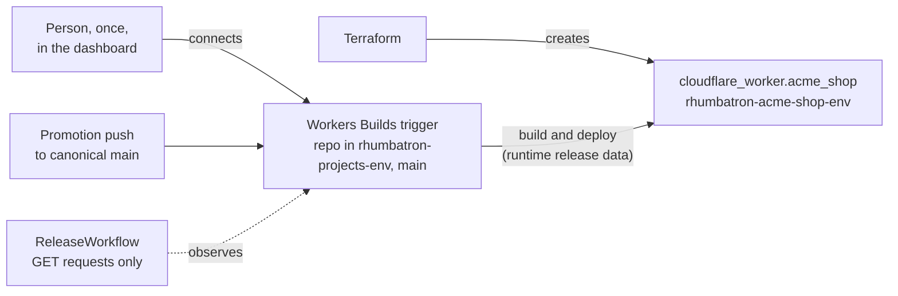

# ADR 0014: Workers Builds connection to an Artifacts repo is a one-time dashboard step

Status: accepted (2026-10-09). ADR 0018 implements the release workflow. ADR 0018 planned to
replace the dashboard step with `cf builds workers create`, but that did not work, so the
dashboard step below still applies (Update 2026-10-10).

## Context

The release path (AGENTS.md sections 21.3 and 37, P11-07/08) is: promotion fast-forwards the
canonical Artifacts repo's `main`, and Workers Builds builds and deploys it. The user chose this
path over a direct script upload, which would need an account-wide Workers Scripts Edit secret at
runtime.

Section 11.4 says to manage control-plane objects with Terraform, and through an API adapter when
the provider lacks a resource. Here neither is possible:

- Cloudflare provider 5.27 has no Workers Builds resources.
- The Builds API (`PUT /builds/repos/connections`) documents provider types `github`, `gitlab`,
  `gitlab_internal`, and `origin`. Artifacts is not documented, and the request body is not specified.
- There is no API to create a build token. The account's existing build tokens belong to other
  projects.
- Wrangler 4.149.0 has `wrangler artifacts` but no Builds commands.

## Decision

- Terraform creates the release target Worker (`cloudflare_worker.acme_shop`, `rhumbatron-acme-shop-<env>`)
  and nothing else for it. Workers Builds owns that Worker's versions and deployments, which are
  runtime release data (section 2.1), so Terraform does not manage them and sees no drift.
- The Acme Shop fixture carries `src/worker.ts` and `wrangler.jsonc` (name `rhumbatron-acme-shop-<env>`).
- A person connects the Worker to the demo Project's Artifacts repo once in the dashboard:
  Worker → Settings → Builds → Connect → Artifacts namespace `rhumbatron-projects-<env>` → repo,
  production branch `main`, deploy command `npx wrangler@4.149.0 deploy`, with a new build token
  dedicated to this Worker.
- After that, Rhumbatron reads triggers and builds through the Builds API with a user-scoped token
  (`rhumbatron-cloudflare-builds-token`, Workers Builds Configuration Edit, Workers Scripts Read,
  Artifacts Read), and starts builds only through pushes to `main`.

## Consequences

- One documented exception to "no dashboard changes". Record the connection's trigger UUID in
  `docs/operations/` after it exists.
- A new demo Project needs the same one-time step. The hackathon demo uses one Project.
- Replace this with Terraform (or an adapter) when the provider or API documents Artifacts
  connections.
- Cost: Workers Builds Free includes 3,000 build minutes per month and one concurrent build.
  Builds run only on promotion.

## Update (2026-10-10)

- The Builds API rejects a connection request body with provider type `cloudflare_artifacts` as
  invalid (error 12065). So neither the `cf` CLI (ADR 0018) nor a Terraform adapter can make the
  connection. The one-time dashboard step in this ADR is still the only path.
- No Workers Builds trigger exists yet for `rhumbatron-acme-shop-dev` or
  `rhumbatron-acme-shop-prod`. Until a person makes the connection, a release fails at once with
  "connection missing" (ADR 0018, step 2).
- The runtime token that ADR 0018 uses has Workers Builds Configuration Edit and Workers Scripts
  Read. Artifacts Read is not used.

## Diagram

Who owns what on the release path.

