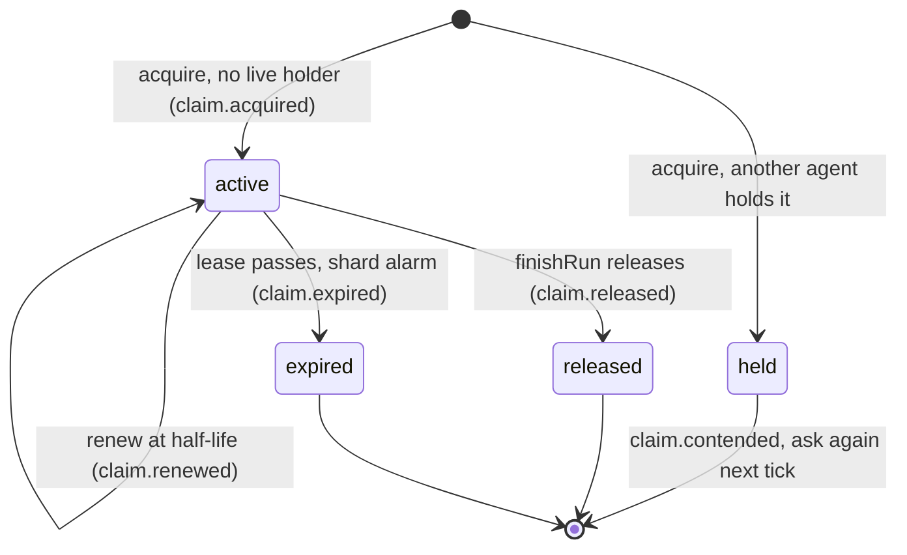

# ADR 0015: Advisory Claims for agent runs

## Context

ResourceShardDO implements Claims as renewable leases. Each Project and semantic resource has at
most one active Claim. The shard writes `claim.*` events in the same transaction as the lease
change. The shard alarm expires a Claim. Conflict detection needs a signal
that two agents work on one resource at the same time.

A blocking lock does not fit the product. Rhumbatron runs parallel agents on one resource, and it
can fork two Candidates that implement one resource in two ways. A lock that
makes agents wait serializes the work that must diverge and then converge with Evidence.

## Decision

Claims are advisory leases for agent runs.

1. **Acquire at run start.** `AgentDO.start` asks the shard that owns each resource
   (`shardKey(projectId, resource)`) for a Claim on every semantic resource of the Task, qualified
   as `project:<slug>:<resource>`, at most 8 per run. The lease is 120 s. `intentHash` carries the
   ID of the Intent that the run declares (`int_<run>`).
2. **Renew at half-life on existing timers.** The one-minute run check (`checkRun`) and model-call
   boundaries (`beforeModelCall`) tick the renewal. A tick makes a request only when a lease is at
   half-life (60 s, with 10 s slack for a check that fires a little early). The renewal adds no
   timer and no loop. The run check is an interval schedule (`scheduleEvery(60)`). Each fire counts
   against the AgentDO daily alarm cap (ADR 0019).
3. **Release at run end.** `finishRun` releases every Claim of the run for success, failure,
   cancel, and timeout. Release is idempotent on both sides. The run only logs a failed release,
   and the lease then expires.
4. **Contention never blocks.** When another agent holds a live Claim, the shard returns `held`
   and writes `claim.contended` to its outbox in the same transaction as the decision. The event ID
   is stable per holder Claim, contender, and Change, so a contender that asks again on each tick
   does not repeat it. The run continues without the lease, keeps the holder as a signal, and asks
   again at its next tick (15 s later at the earliest). It gets the lease after the holder releases
   it or the lease expires.
5. **Contention feeds conflict detection.** The run sends its contentions with its Intent to the
   Change shard (`declareIntent(input, contentions)`, same transaction). `detectionInputs` returns
   the Change's Intents and contentions in one request. The detector adds a soft
   `resource_overlap` signal for a contended pair, so the pair is at least `suspected`. Only typed
   Intent fields can make a conflict `confirmed` or fork Candidates.
6. **Expiry is the safety net.** An agent that stops does not renew. The shard alarm marks the
   Claim `expired` and writes `claim.expired`. Only the owner can renew or release a Claim.
   An acquire by the agent that already holds the live Claim renews it (`claim.renewed`).

## Consequences

- The Claims feed shows real `claim.acquired`, `claim.renewed`, `claim.released`, and
  `claim.expired` facts for every run.
- `claim.contended` is an Event type. The Claims feed API and its D1 partial index list it with the
  four lifecycle types, so the Claims feed shows contention too.
- Contention with an agent of another Change stays an event and a `claim_contention` metric. It
  does not enter that Change's conflict pass, because the other Intent is not compared there.
- Parallel Tasks of one Change that share a resource produce a `suspected` conflict, also when
  both Intents only add. This signal never forks Candidates by itself.
- Cost per run with R resources and a run of T minutes: about R acquire requests, R per minute for
  renewal, and R release requests to ResourceShardDO, plus the shard alarms that publish the
  outbox. That is about 2R(T + 2) Durable Object requests and the same number of feed rows in D1
  (`project_events`) through the projector. For R = 2 and T = 5, this is about 28 requests and 28
  rows, far below the free daily limits.

## Why not blocking Claims

- A blocking Claim serializes parallel agents and prevents the two-Candidate fork. Rhumbatron
  forks Candidates and lets Evidence decide.
- A blocking lock held by a stopped agent stalls a Change for up to one lease. An advisory lease
  only loses a signal for that time.
- Claim ownership needs strong consistency. Source needs no exclusive write access. Ownership is
  strongly consistent, because one shard transaction keeps one active Claim per resource. Per-run
  Artifact forks isolate source. Promotion safety comes from compare-and-swap with executable
  Evidence (ADR 0013).

## Diagram

One Claim row in ResourceShardDO (`status` is `active`, `released`, or `expired`).

`held` is not a stored status. It is the result that a contender gets. The run continues without
the lease.
