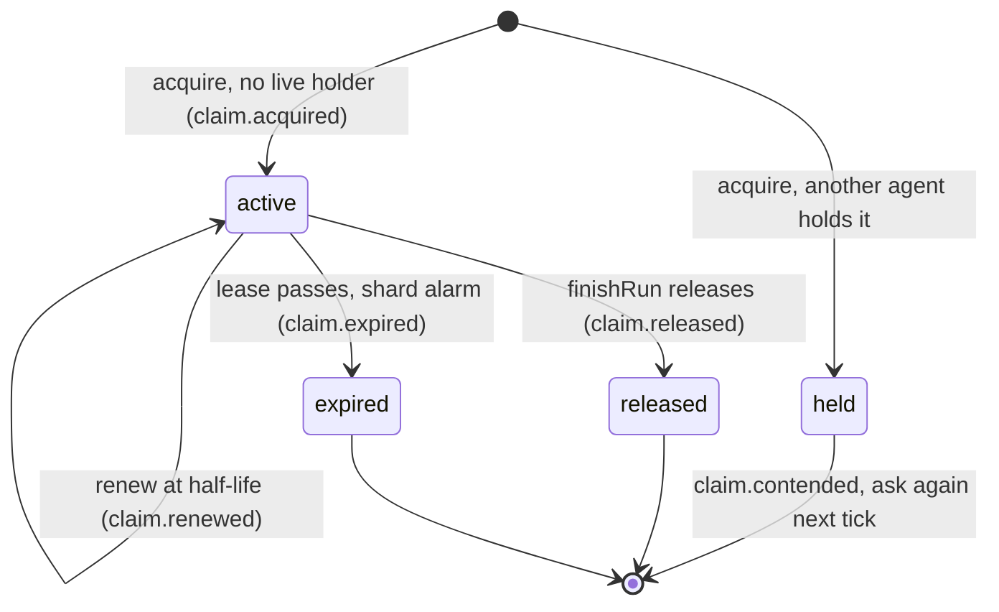

# ADR 0015: Advisory Claims for agent runs

- Status: Accepted
- Date: 2026-10-09
- Decider: Opus planner (coordinator)

## Context

ResourceShardDO implements Claims as renewable leases (AGENTS.md section 13.2): one active Claim
per Project and semantic resource, `claim.*` events in the same transaction as the lease change
(section 18), and expiry through the shard alarm (section 42.3). Until now only tests called
`acquireClaim`. Agent runs never took a Claim, so the Claims feed and the Claim packets in the
agent activity view were always empty. Conflict detection also had no signal that two agents
worked on one resource at the same time.

A blocking lock does not fit the product. Parallel agents on one resource, and two Candidate
futures that implement the same resource two ways, are the point of the demo (sections 4 and
32.4). Git-style "wait for the lock" would serialize exactly the work that Rhumbatron must let
diverge and then converge with evidence.

## Decision

Claims are advisory leases for agent runs.

1. **Acquire at run start.** `AgentDO.start` asks the shard that owns each resource
   (`shardKey(projectId, resource)`) for a Claim on every semantic resource of the Task, qualified
   as `project:<slug>:<resource>`, at most 8 per run. The lease is 120 s. `intentHash` carries the
   Intent ID the run will declare (`int_<run>`).
2. **Renew at half-life on existing timers.** The one-minute run check (`checkRun`) and model-call
   boundaries (`beforeModelCall`) tick the renewal. A tick makes a request only when a lease is at
   half-life (60 s, with 10 s slack for a check that fires a little early). There is no new timer
   and no loop.
3. **Release at run end.** `finishRun` releases every Claim of the run for success, failure,
   cancel, and timeout. Release is idempotent on both sides. The run only logs a failed release.
   The lease expires on its own.
4. **Contention never blocks.** When another agent holds a live Claim, the shard returns `held`
   and writes `claim.contended` to its outbox in the same transaction as the decision. The event ID
   is stable per holder Claim, contender, and Change, so a contender that asks again on each tick
   does not repeat it. The run continues without the lease, keeps the holder as a signal, and asks
   again at its next tick. It gets the lease after the holder releases it or the lease expires.
5. **Contention feeds conflict detection.** The run sends its contentions with its Intent to the
   Change shard (`declareIntent(input, contentions)`, same transaction). `detectionInputs` returns
   the Change's Intents and contentions in one request. The detector adds a soft
   `resource_overlap` signal for a contended pair, so the pair is at least `suspected`. Only typed
   Intent fields can make a conflict `confirmed` or fork Candidates.
6. **Expiry stays the safety net.** An agent that dies stops renewing; the shard alarm marks the
   Claim `expired` and writes `claim.expired`. Only the owner can renew or release a Claim.

## Consequences

- The Claims feed shows real `claim.acquired`, `claim.renewed`, `claim.released`, and
  `claim.expired` facts for every run.
- `claim.contended` is a new Event type. The Claims feed API and its D1 partial index list only the
  four lifecycle types, so contention shows in the Change event feed but not in the Claims feed
  until those are extended (a new migration).
- Contention with an agent of another Change stays an event and a `claim_contention` metric. It
  does not enter that Change's conflict pass, because the other Intent is not compared there.
- Parallel Tasks of one Change that share a resource now produce a `suspected` conflict even when
  both Intents only add. That is the intended signal; it never forks Candidates by itself.
- Cost per run with R resources and a run of T minutes: about R acquire requests, R per minute for
  renewal, and R release requests to ResourceShardDO, plus the shard alarms that publish the
  outbox. That is about 2R(T + 2) Durable Object requests and the same number of feed rows in D1
  (`project_events`) through the projector. For R = 2 and T = 5 this is about 28 requests and 28
  rows, far below the free daily limits (section 7.3).

## Why not blocking Claims

- A blocking Claim would serialize parallel agents and prevent the two-Candidate fork that the
  demo needs. Section 32.3 says to fork and let evidence decide instead of forcing consensus.
- A held lock on a crashed agent would stall a Change for up to one lease. An advisory lease only
  loses a signal for that time.
- Section 59 asks for strong consistency of Claim ownership, not for exclusive write access to
  source. Ownership stays strongly consistent: one active Claim per resource in one shard
  transaction. Per-run Artifact forks already isolate source. Promotion safety comes from
  compare-and-swap with executable evidence (section 36), not from Claims.

## Update (2026-10-10)

- Migration 0014 adds `claim.contended` to the Claims feed query and its D1 partial index. The
  Claims feed now shows contention too.
- The one-minute run check is an interval schedule (`scheduleEvery(60)`, ADR 0019 update). It is
  still the main renewal tick, and each fire counts against the AgentDO daily alarm cap.
- An acquire by the agent that already holds the live Claim renews it (`claim.renewed`).

## Diagram

One Claim row in ResourceShardDO (`status` is `active`, `released`, or `expired`).

`held` is not a stored status. It is the result that a contender gets; the run continues without
the lease.
