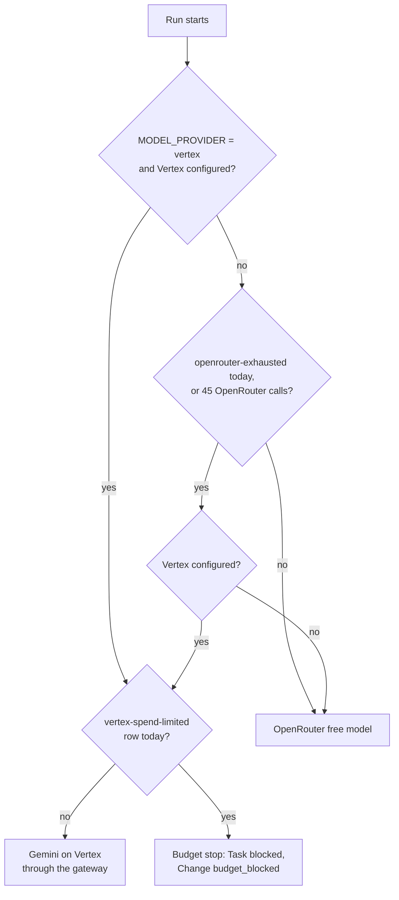

# ADR 0016: Gemini on Vertex AI as the agents' daily overflow

- Status: Accepted
- Date: 2026-10-09
- Decider: Project owner

## Context

Agents (ADR 0009) used only OpenRouter free models. OpenRouter allows about 50 free requests per
day, and our agent cap was 40 calls per day, so one demo Change could not finish in a day. The
owner approved Gemini on Vertex AI, billed to GCP credits, as overflow. ADR 0007 already set up
Vertex as a capped backup for the Root Planner, with an AI Gateway spend limit of $9 per 30 days
on the `google-vertex-ai` provider.

## Decision

- The agents Worker gets the `VERTEX_SERVICE_ACCOUNT` `secret_text` binding (Terraform, dev).
- Each tier has two Pi models: `tier-<t>` (OpenRouter, $0) and `tier-<t>-vertex` (Gemini through
  the gateway compat endpoint, `google-vertex-ai/<TIER_VERTEX_MODEL>`). Vertex models carry
  VERTEX_PRICES, so Pi records real cost. Run cost, the Change budget, and the Costs page see it.
- The AgentDO picks the provider once, when a run starts. OpenRouter is used unless today's
  OpenRouter is used up: a D1 `usage_counters` row `openrouter-exhausted` for the UTC day (set
  on an OpenRouter 429 or quota error), or our own `openrouter-calls` counter at 45.
- An OpenRouter rate limit during a run fails the run as `rate_limited`. The same-tier retry
  (section 42.8) then starts on Vertex. No provider switch happens inside a run.
- Caps: 45 OpenRouter calls per day; 400 agent calls per day on all providers. The gateway spend
  limit is the hard money ceiling.
- A Vertex 429 from the gateway spend limit is `spend_limited`. The gateway documents only the
  status, so a Vertex 429 that is not Google's `RESOURCE_EXHAUSTED` or the gateway request rate
  limit counts as the spend limit. It is a budget stop: no retry, the Task is `blocked`, and the
  Change is `budget_blocked` with a reason that names the $9 per 30 days Gemini cap. A
  `vertex-spend-limited` row for the day stops later runs before they call a model.
- Gemini 3 rejects a replayed tool call without its thought signature. pi-ai does not round-trip
  `extra_content`, so the provider keeps signatures per tool call id and sends Google's documented
  bypass value when one is lost.
- The Decision Receipt records `provider` and the reason; the Agents page marks Gemini attempts.

## Cost

Gemini 3.8 Flash costs $0.75 per million input tokens and $3.75 per million output tokens. A
sonnet run of 16 calls with about 15,000 input and 1,000 output tokens per call costs about $0.24.
The $9 cap allows about 35 such runs per 30 days.

## Consequences

- Agent spend is no longer always $0. Cost budgets per run and per Change now apply to real spend.
- Prompts reach Google on overflow runs. Send only demo fixture code, as for free models.

## Update (2026-10-10)

- The `VERTEX_SERVICE_ACCOUNT` binding is on the agents and integration Workers in dev and prod.
- `MODEL_PROVIDER` selects the mode. Dev uses `vertex`: every call goes to Gemini from the first
  call. Prod uses `openrouter`: free models first, with Gemini as overflow (ADR 0017).
- The gateway cap is per environment: dev $40 and prod $10 per 30 days (ADR 0017). Budget-stop
  text reads the cap from `VERTEX_SPEND_LIMIT_USD`; $9 is only the code fallback.
- Tier models (`TIER_VERTEX_MODEL`): haiku uses `google/gemini-3.5-flash-lite`; sonnet and opus use
  `google/gemini-3.8-flash`.

## Diagram

Provider choice at run start (`selectProvider`, `packages/model-router/src/provider.ts`).

Every call also takes one of the 400 agent calls per UTC day on all providers.
