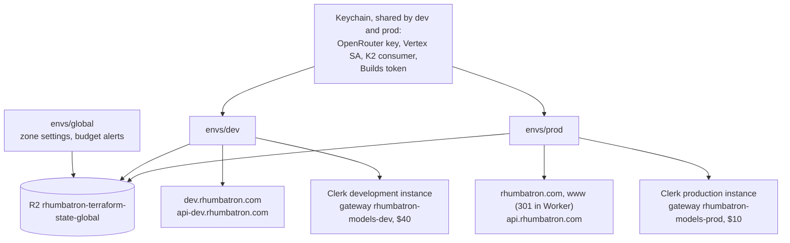

# ADR 0017: Prod environment

- Status: Accepted 2026-10-09 (decisions below). Applied, with the apex cutover done and the Clerk
  production instance in use (Update 2026-10-10)
- Date: 2026-10-09
- Decider: Project owner

## Context

AGENTS.md section 10 adds `prod` after the first end-to-end Change works. Prod must use separate
Terraform state, `-prod` names, and the production hostnames. The owner approved replacing the
current `rhumbatron.com` site when prod goes live.

The Cloudflare account is on Workers Paid for other projects. Rhumbatron must stay inside the free
and included limits (AGENTS.md section 7.3, rule 50). Prod adds a second copy of every
environment-scoped resource, so every account-wide limit now has two Rhumbatron consumers.

## Decision

### Layout

- `infrastructure/terraform/envs/prod` mirrors `envs/dev` resource for resource. State key:
  `prod/terraform.tfstate` in `rhumbatron-terraform-state-global`.
- Dev stays inline. A shared environment module would move every dev address (`module.x.*`), and
  dev state must not change. Keep the two `main.tf` files in step by hand. Today prod omits what
  dev also omits (indexer Worker, Vectorize; ADR 0003). Add them to prod when dev adds them.
- Bundles are environment-neutral. `bun run cf:bundle` serves both roots; environment config
  travels in bindings.
- `bun run tf prod …` loads prod credentials from the Keychain. Scripts: `tf:plan:prod`,
  `tf:apply:prod`, `tf:drift:prod`, `smoke:prod` (public checks only).

### Hostnames

| Host | Target |
|---|---|
| `rhumbatron.com` | `rhumbatron-web-prod` custom domain, after the cutover (`attach_apex`) |
| `api.rhumbatron.com` | `rhumbatron-api-prod` custom domain |
| `www.rhumbatron.com` | 301 to `https://rhumbatron.com` (envs/global: placeholder `AAAA 100::` + Single Redirect) |

The redirect is in `envs/global` because the zone's `http_request_dynamic_redirect` entrypoint is a
zone-wide singleton.

### Switches (`envs/prod/main.tf`)

| Switch | Default | Meaning |
|---|---|---|
| `paused` | `false` | `true` removes the cron sweep and sets Sandbox `max_instances = 0`. Data stays. |
| `bootstrap` | `true` | First apply only. Omits the coordinator `EVENT_ROUTER` binding (cycle) and uploads the first Durable Object migrations (`new_tag = v1` with classes). Set `false` after the first apply: migrations become the steady `v1 -> v1`. |
| `attach_apex` | `false` | Adds the apex custom domain to the web Worker. Set `true` only after the cutover below. |

### Prod-only settings

- `model_provider` defaults to `openrouter` (dev keeps `vertex`).
- `CLERK_ALLOW_MISSING_AZP = "false"`. `CLERK_AUTHORIZED_PARTIES` comes from
  `var.clerk_authorized_parties` (default `["https://rhumbatron.com"]`; it must include that origin
  and list only `https` origins).
- `FIXTURES_ENABLED = "true"` on the API Worker (dev and prod): the Wishlist design-conflict fixture
  routes answer, so the section 55 demo runs on prod. Without the binding the routes still answer
  in `dev` and `local` only.
- `VITE_CLERK_PUBLISHABLE_KEY` is a `plain_text` binding on the prod web Worker. The build inlines
  the development key, but Clerk's `getEnvVariable` reads `process.env` first, and `nodejs_compat`
  (compatibility date 2026-10-08) fills `process.env` from bindings. So one bundle serves both
  environments.
- **Temporary: prod uses the Clerk development instance** until a production instance exists.
  `bun run tf prod` loads the dev secret key (`rhumbatron-clerk-secret-key-dev`) and the dev
  publishable key that the web build inlines (`VITE_CLERK_PUBLISHABLE_KEY` in `apps/web/.env.local`;
  public). The variable accepts `pk_test_` and `pk_live_`; the Terraform check
  `clerk_production_instance` prints a warning on every prod plan while the key is `pk_test_`.
  Development instances show a "Development mode" badge and have lower limits. This is
  acceptable for the hackathon. To switch, create the production instance for `rhumbatron.com`.
  Store its keys as `rhumbatron-clerk-secret-key-prod` and `rhumbatron-clerk-publishable-key-prod`.
  Point the prod Clerk entries in `scripts/tf.ts` at them (Keychain for both), and set
  `clerk_dns_records`.
- Clerk DNS records: `var.clerk_dns_records` (label -> CNAME target, DNS only). Empty until the
  production instance exists; Clerk shows the five records when the domain is added.

### AI Gateway: separate gateway

Prod gets `rhumbatron-models-prod`. Reasons:

- A destroy or pause of dev must never change prod.
- Logs, the request rate limit, and the spend cap stay per environment.
- The account has one gateway today (`rhumbatron-models-dev`); two is far below the account limit.
  Each stores at most 10,000 logs.

A shared dev gateway would give one real Vertex cap, but prod would then depend on a resource in
dev state. A move of the gateway to `envs/global` would move a dev address. This ADR rejects
both options.

Caps (decided 2026-10-09): dev $40 and prod $10 per 30 days (`vertex_spend_limit_usd` in each
root), about $50 in total. Both gateways bill the same GCP project through the same service
account. Each Worker that writes budget-stop or Costs page text reads its gateway's cap from the
`VERTEX_SPEND_LIMIT_USD` binding (code fallback: $9).

### K2

- Prod uses 8 streams `rhumbatron_events_NN_prod`, 7-day retention, the same 4 subscriptions.
- Plan time: `data.external.k2_inventory` (read-only `scripts/k2-read.ts`, `mode = inventory`)
  lists every stream on the account. A precondition on `terraform_data.k2_streams` fails the plan
  if the other streams plus prod's 8 exceed 20.
- Apply time: `scripts/k2-sync.ts` refuses to create anything when existing plus missing streams
  exceed 20.
- Measured on 2026-10-09 (prod plan): 8 other streams (dev) + 8 prod = 16 of 20. Four remain for
  other projects.

### Credentials (ADR 0004 pattern, Keychain, never in Git)

Decided 2026-10-09: no new tokens. Prod reuses dev's items.

| Variable | Source for prod | Note |
|---|---|---|
| `TF_VAR_clerk_secret_key` | Keychain `rhumbatron-clerk-secret-key-dev` | Clerk dev instance, temporary |
| `TF_VAR_clerk_publishable_key` | `VITE_CLERK_PUBLISHABLE_KEY` in `apps/web/.env.local` (public, Git-ignored) | Clerk dev instance, temporary |
| `TF_VAR_k2_consumer_token` | Keychain `rhumbatron-k2-consumer-token-dev` | Account-scoped, K2 Consume only |
| `TF_VAR_openrouter_api_key` | Keychain `rhumbatron-openrouter-api-key` | Shared with dev |
| `TF_VAR_vertex_service_account` | Keychain `rhumbatron-vertex-sa-dev` | One GCP project; caps per gateway |

A rotation of one of these dev items now also changes prod. Apply both roots after a rotation.

## Cost: what prod adds

Idle means no Change is running.

| Product | Limit used | Prod adds | Notes |
|---|---|---|---|
| Workers requests | 100,000/day (free figure) | ~1,440/day idle (1-minute cron sweep) + traffic | Dev adds the same. ~3,000/day idle together. |
| Durable Objects | 100,000 req/day | sweep and nudges only when events exist | SQLite backend. |
| D1 | 10 databases; 5 M reads, 100 k writes/day | 1 database (3 of 10 on the account) | Reads and writes are account-wide; idle prod writes almost nothing. |
| R2 | 10 GB-month, 1 M Class A/month | 1 bucket | Prod keeps `evidence/` with no expiry and `events/` 365 days. Watch storage. |
| KV | — | 1 namespace | Not read in a hot path yet. |
| Queues | 10,000 ops/day | 6 queues, 3 consumers | 0 ops idle; ~3 ops per woken Task. |
| K2 | 20 streams, 10 GB | 8 streams | 16 of 20. Billing disabled in beta. |
| Workflows | 3,000 steps/day | 2 workflows | ~7 steps per Change, 10–14 per Candidate. Shared with dev. |
| Sandbox / Containers | 25 GiB-h memory, 375 vCPU-min, 200 GB-h disk / month | 1 app, `basic`, `max_instances = 1`, 5 h/month meter in prod D1 | `SANDBOX_MONTHLY_SECONDS = 18000` in each environment: dev 5 h + prod 5 h = the approved 10 h (HOM-192). |
| Browser Run | 10 min/day (free figure) | 250 s/day guard in prod D1 | `BROWSER_DAILY_SECONDS = 250` in each environment: 500 s/day together, under 600 s/day. |
| Workers AI | 10,000 Neurons/day | Clef-flash cap 200 calls/day in prod D1 | Doubles the worst case. |
| AI Gateway | free core features | 1 gateway, 10,000 stored logs | Vertex cap per gateway: prod $10, dev $40 per 30 days (~$50 total). |
| Analytics Engine | 100,000 points/day | dataset `rhumbatron_metrics_prod` | Shared limit. |
| Workers Logs | 200,000 events/day | 100 % sampling on 7 Workers | Cron alone is ~1,440 events/day. |
| Artifacts | 10,000 ops/month, 1 GB-month | namespace `rhumbatron-projects-prod` | Account-wide allowance shared with dev. |
| Workers Builds | 3,000 min/month | `rhumbatron-acme-shop-prod` | Needs its own one-time dashboard connection (ADR 0014). |

## Cutover of the current `rhumbatron.com` site

Observed on 2026-10-09 (read-only):

- `rhumbatron.com` resolves to Cloudflare proxy addresses (104.21.15.9, 172.67.160.251,
  2606:4700:3033::6815:f09, 2606:4700:3037::ac43:a0fb): a proxied record. It serves a static
  "Rhumbatron Robotics, coming soon" page.
- No Worker custom domain on the account uses the apex (only `dev.rhumbatron.com` and
  `api-dev.rhumbatron.com`), and no non-dev Rhumbatron Worker script exists.
- The monitor token cannot read DNS records, zone Worker routes, or Pages projects, so the record
  IDs and origin were not read. An earlier inspection found a proxied `A` record at the apex, a
  Google site-verification `TXT` record, and SSL mode Flexible.
- `www`, `api`, `clerk`, and `accounts` have no records. The zone has no `MX` record.

Steps. Each step is a Terraform plan, read, then apply of the saved plan.

1. Later, not a gate (prod starts on the Clerk dev instance). Create the Clerk production instance
   for `rhumbatron.com` and store its keys in the Keychain. Put its CNAMEs in the
   `clerk_dns_records` default in `envs/prod/variables.tf`. The targets are not secret, and Git
   ignores `terraform.tfvars` and `*.auto.tfvars`, so a committed default keeps the plan
   reproducible.
2. Decided 2026-10-09 (below). No Keychain items to create.
3. Run `bun run cf:bundle` and `bun run tf:plan:prod`. Read the plan, then run
   `bun run tf:apply:prod` (bootstrap = true, attach_apex = false). Set `bootstrap = false`, plan,
   and apply again. `tf:drift:prod` must be clean. Check `https://api.rhumbatron.com/health`.
4. Apply `envs/global` for the `www` redirect (independent of the cutover).
5. Find the legacy apex record IDs (read-only: dashboard DNS page or `cf` CLI). Also confirm that
   no zone Worker route or Pages custom domain holds `rhumbatron.com`. If one does, handle it the
   same way with its resource type.
6. In `envs/global`, add a `cloudflare_dns_record.legacy_apex` resource that matches the record,
   with an `import` block (`<zone_id>/<record_id>`). The plan must show import only. Apply.
7. Remove that resource and its import block from `envs/global`. The plan must show one destroy.
   Apply. The apex now has no record, so the old site is offline until step 8. Keep the Google
   verification `TXT` record.
8. Set `attach_apex = true` in `envs/prod`. Plan, apply. The custom domain creates the apex record
   and its certificate. Prepare this plan before step 7 to keep the gap to minutes.
9. In `envs/global`, add `ssl = "strict"` to `zone_settings` (Workers are the only origins now).
   Plan, apply.
10. `bun run smoke:prod`. Check that `www.rhumbatron.com` returns 301 to the apex. Sign in once.

Rollback is a new transition: set `attach_apex = false`, apply, and recreate the legacy record
in `envs/global` from the values recorded in step 6.

## Decisions (2026-10-09)

The owner decided to apply prod before the hackathon, with no new spend.

1. **Vertex spend.** One GCP project and service account. Gateway caps: dev $40, prod $10 per
   30 days (about $50 in total). `VERTEX_SPEND_LIMIT_USD` mirrors each cap to the agents and API
   Workers for budget-stop and Costs page text.
2. **OpenRouter quota.** Accepted as shared: dev and prod share the key's per-minute and per-day
   limits, so the second environment may overflow to Vertex sooner. The Vertex caps bound the cost.
3. **Sandbox hours.** Split the approved 10 h/month: `SANDBOX_MONTHLY_SECONDS = 18000` (5 h) in
   each environment (agents and integration Workers; the API shows it on the Costs page). Code
   fallback without the binding: 36,000.
4. **Browser Run.** Split the 500 s/day guard: `BROWSER_DAILY_SECONDS = 250` in each environment
   (integration Worker). Code fallback without the binding: 500.
5. **Demo code paths.** `FIXTURES_ENABLED = "true"` in dev and prod enables the Wishlist fixture
   routes. Open item: the Acme Shop fixture's `wrangler.jsonc` still names
   `rhumbatron-acme-shop-dev`. A prod release of the demo app needs that name to become
   environment-aware, or the release step of the demo runs on dev.
6. **Credentials.** Prod reuses dev's Keychain items and the Clerk dev instance (Credentials above).

## Consequences

- Prod is a second consumer of every account-wide limit. The cost table must be checked again when
  either environment adds a resource.
- The first prod apply is the first fresh apply of this configuration (dev grew one change at a
  time). The `bootstrap` switch covers the one known cycle.
- `bun run tf:drift` still covers global and dev. Run `tf:drift:prod` after each prod apply.

## Update (2026-10-10)

- Prod is applied. `envs/prod/main.tf` has `bootstrap = false` and `attach_apex = true`.
  `https://rhumbatron.com` serves the prod web Worker.
- Cutover: the legacy apex record was a CNAME to an old Pages project, not the proxied `A` record
  that an earlier read reported. It was imported into `envs/global` and then removed. `envs/global`
  now sets `ssl = "strict"`.
- `www`: the zone redirect (placeholder `AAAA 100::` plus Single Redirect) was not kept.
  `www.rhumbatron.com` is a second custom domain of the prod web Worker, and the Worker returns 301
  to the apex (`apps/web/src/server.ts`). `envs/global` has no redirect ruleset.
- Clerk: prod uses the Clerk production instance. `scripts/tf.ts` loads the Keychain items
  `rhumbatron-clerk-secret-key-prod` and `rhumbatron-clerk-publishable-key-prod`. The five DNS-only
  CNAMEs (`clerk`, `accounts`, `clkmail`, `clk._domainkey`, `clk2._domainkey`) are the default of
  `var.clerk_dns_records` in `envs/prod/variables.tf`. Google sign-in is disabled: the instance
  has email and password only. The "Temporary: prod uses the Clerk development instance" item and
  the two Clerk rows of the Credentials table no longer apply.
- Prod now has the indexer Worker and the Vectorize index `rhumbatron-memory-prod`, as dev does.
- Prod also loads `TF_VAR_builds_api_token` from `rhumbatron-cloudflare-builds-token` (ADR 0018).
- `bun run tf:drift` still covers global and dev only. Run `bun run tf:drift:prod` for prod.

## Diagram

Terraform roots, hostnames, and shared credentials.

