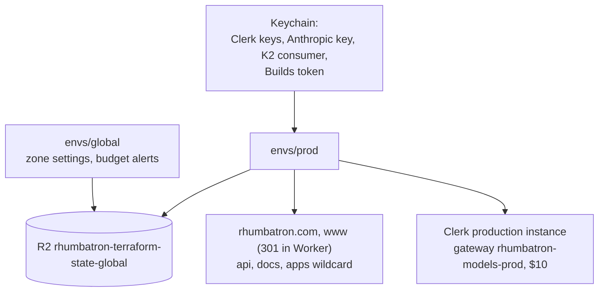

# ADR 0017: Prod environment

## Context

AGENTS.md section 10 defines `prod` with separate Terraform state, `-prod` names, and the
production hostnames. ADR 0024 makes prod the only remote environment. The Cloudflare account is on
Workers Paid for other projects. Rhumbatron stays inside the free and included limits (AGENTS.md
section 7.3, rule 50), and every account-wide limit is shared with those projects.

## Decision

### Layout

- `infrastructure/terraform/envs/prod` owns every environment-scoped resource. State key:
  `prod/terraform.tfstate` in `rhumbatron-terraform-state-global`.
- `infrastructure/terraform/envs/global` owns the zone-wide and account-wide singletons: zone TLS
  settings (`ssl = "strict"`, minimum TLS 1.2) and the billing budget alerts (ADR 0019).
- Bundles do not depend on the environment. `bun run cf:bundle` writes them. Environment config
  travels in bindings.
- `bun run tf prod ...` loads prod credentials from the Keychain. Scripts: `tf:plan:prod`,
  `tf:apply:prod`, `tf:drift:prod`, and `smoke:prod` (public checks only). `bun run tf:drift`
  checks both roots.

### Hostnames

| Host | Target |
|---|---|
| `rhumbatron.com` | `rhumbatron-web-prod` custom domain |
| `www.rhumbatron.com` | `rhumbatron-web-prod` custom domain. The Worker returns 301 to the apex (`apps/web/src/server.ts`). |
| `api.rhumbatron.com` | `rhumbatron-api-prod` custom domain |
| `docs.rhumbatron.com` | `rhumbatron-docs-prod` custom domain (assets-only Worker) |
| `<label>.rhumbatron.com` | `rhumbatron-apps-prod` through a wildcard route (ADR 0020) |
| `clerk`, `accounts`, `clkmail`, `clk._domainkey`, `clk2._domainkey` | DNS-only CNAMEs for the Clerk production instance (`var.clerk_dns_records`) |

### Switches (`envs/prod/main.tf`)

| Switch | Value | Meaning |
|---|---|---|
| `paused` | `false` | `true` removes the cron sweep and sets Sandbox `max_instances = 0`. Data stays. |
| `bootstrap` | `false` | `true` is for a fresh root only. It omits the coordinator `EVENT_ROUTER` binding (cycle) and uploads the first Durable Object migrations (`new_tag = v1` with classes). `false` gives the steady `v1 -> v1`. |
| `attach_apex` | `true` | Adds the apex and `www` custom domains to the web Worker. |

### Prod settings

- `MODEL_PROVIDER` is `anthropic`. `ALLOW_OPUS` comes from `var.allow_opus` (default `false`).
  The monthly Anthropic budget is `var.anthropic_monthly_budget_usd` (default $10). ADR 0021.
- `CLERK_ALLOW_MISSING_AZP` is `"false"`. `CLERK_AUTHORIZED_PARTIES` comes from
  `var.clerk_authorized_parties` (default `["https://rhumbatron.com"]`). It must include that origin
  and list only `https` origins.
- `FIXTURES_ENABLED` is `"true"` on the API Worker. The Wishlist design-conflict fixture routes
  answer, so the AGENTS.md section 55 demo runs on prod. Without the binding the routes answer in
  `local` only.
- `VITE_CLERK_PUBLISHABLE_KEY` is a `plain_text` binding on the web Worker (ADR 0002).
- `SANDBOX_MONTHLY_SECONDS` is 54,000 (15 hours). `BROWSER_DAILY_SECONDS` is 250.
- `rhumbatron-acme-shop-prod` is the Worker for the Workers Builds release path (ADR 0018). Terraform
  creates the Worker. Workers Builds owns its versions.

### AI Gateway

`rhumbatron-models-prod` holds the logs (at most 10,000), the request rate limit (20 per minute), and
the Anthropic spend limit ($10 per 30 days). The code meter is the stop that Rhumbatron relies on
(ADR 0021).

### K2

Prod has 8 streams `rhumbatron_events_NN_prod`, 7-day retention, and 4 subscriptions (ADR 0006).
A plan-time precondition and the apply-time check in `k2-sync.ts` refuse more than 20 streams on
the account.

### Credentials

All come from the Keychain through `scripts/tf.ts` and never enter Git (ADR 0004).

| Variable | Keychain item |
|---|---|
| `TF_VAR_clerk_secret_key` | `rhumbatron-clerk-secret-key-prod` |
| `TF_VAR_clerk_publishable_key` | `rhumbatron-clerk-publishable-key-prod` |
| `TF_VAR_k2_consumer_token` | `rhumbatron-k2-consumer-token-dev` |
| `TF_VAR_anthropic_api_key` | `rhumbatron-anthropic-api-key` |
| `TF_VAR_anthropic_workspace_id` | `rhumbatron-anthropic-workspace-id` |
| `TF_VAR_builds_api_token` | `rhumbatron-cloudflare-builds-token` |

## Cost

Idle means no Change is running. Prod shares each account-wide limit with other projects. Check
this table when a resource, binding, or code path changes.

| Product | Limit used | Prod uses | Notes |
|---|---|---|---|
| Workers requests | 100,000/day (free figure) | ~1,440/day idle (1-minute cron sweep) + traffic | |
| Durable Objects | 100,000 req/day | sweep and nudges only when events exist | SQLite backend. |
| D1 | 10 databases; 5 M reads, 100 k writes/day | 1 database | Idle prod writes almost nothing. |
| R2 | 10 GB-month, 1 M Class A/month | 1 evidence bucket | `evidence/` has no expiry. `events/` expires after 365 days. `app-previews/` expires after 7 days. |
| KV | | 1 namespace | Not read in a hot path. |
| Queues | 10,000 ops/day | 6 queues, 6 consumers | 0 ops idle; ~3 ops per woken Task. |
| K2 | 20 streams, 10 GB | 8 streams | Billing disabled in beta. |
| Workflows | 3,000 steps/day | 3 workflows | ~7 steps per Change, 10 to 14 per Candidate, ~8 per release. |
| Sandbox / Containers | 25 GiB-h memory, 375 vCPU-min, 200 GB-h disk / month | 1 app, `basic`, `max_instances = 1`, 15 h/month meter | |
| Browser Run | 10 min/day (free figure) | 250 s/day guard | |
| Workers AI | 10,000 Neurons/day | Clef-flash cap 200 calls/day; embeddings (ADR 0003) | |
| AI Gateway | free core features | 1 gateway, 10,000 stored logs | |
| Analytics Engine | 100,000 points/day | dataset `rhumbatron_metrics_prod` | |
| Workers Logs | 200,000 events/day | 100 % sampling on all Workers | Cron alone is ~1,440 events/day. |
| Artifacts | 10,000 ops/month, 1 GB-month | namespace `rhumbatron-projects-prod` | |
| Workers Builds | 3,000 min/month | `rhumbatron-acme-shop-prod` | Needs a one-time dashboard connection (ADR 0018). |

## Consequences

- Prod is the only consumer of the Rhumbatron share of each limit.
- A fresh root needs two applies (`bootstrap`).
- Run `tf:drift:prod` after each prod apply.

## Diagram

Terraform roots and hostnames.

