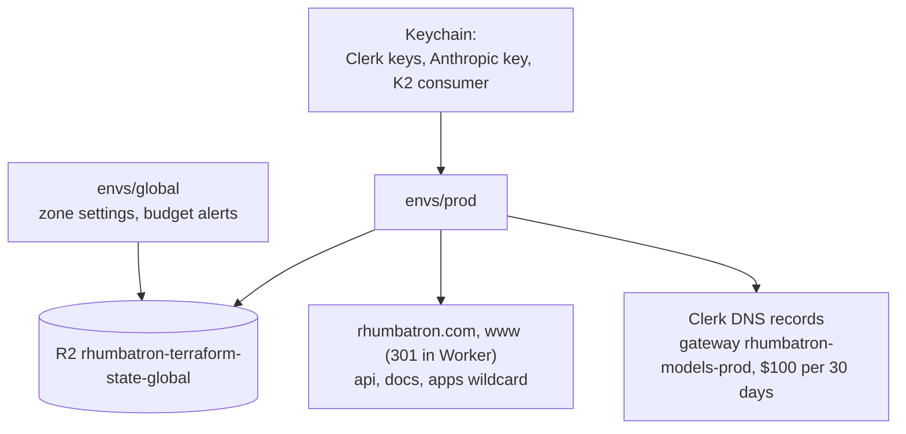

# ADR 0017: Prod environment

## Context

The `prod` environment has its own Terraform state, `-prod` resource names, and the production
hostnames. Prod is the only remote environment (ADR 0024). The Cloudflare account is on Workers
Paid for other projects. Rhumbatron stays inside the free and included limits. Rhumbatron shares
each account-wide limit with those projects.

## Decision

### Layout

- `infrastructure/terraform/envs/prod` owns each environment-scoped resource. State key:
  `prod/terraform.tfstate` in `rhumbatron-terraform-state-global`.
- `infrastructure/terraform/envs/global` owns the zone-wide and account-wide singletons: the zone
  settings (`ssl = "strict"`, minimum TLS 1.2, TLS 1.3, always HTTPS, automatic HTTPS rewrites)
  and the billing budget alerts (ADR 0019).
- Bundles do not depend on the environment. `bun run cf:bundle` writes them. Bindings carry the
  environment config.
- `bun run tf prod ...` loads the prod credentials from the Keychain (ADR 0004). The scripts are
  `tf:plan:prod`, `tf:apply:prod`, `tf:drift:prod`, and `smoke:prod` (public checks only).
  `bun run tf:drift` checks both roots.

### Hostnames

| Host | Target |
|---|---|
| `rhumbatron.com` | `rhumbatron-web-prod` custom domain |
| `www.rhumbatron.com` | `rhumbatron-web-prod` custom domain. The Worker returns 301 to the apex (`apps/web/src/server.ts`). |
| `api.rhumbatron.com` | `rhumbatron-api-prod` custom domain |
| `docs.rhumbatron.com` | `rhumbatron-docs-prod` custom domain (assets-only Worker, `envs/prod/docs.tf`) |
| `<label>.rhumbatron.com` | `rhumbatron-apps-prod` through a wildcard route (ADR 0020) |
| `clerk`, `accounts`, `clkmail`, `clk._domainkey`, `clk2._domainkey` | DNS-only CNAMEs for the Clerk production instance (`var.clerk_dns_records`) |

### Switches (`envs/prod/main.tf`)

| Switch | Value | Meaning |
|---|---|---|
| `paused` | `false` | `true` removes the cron sweep and sets Sandbox `max_instances = 0`. Data stays. |
| `bootstrap` | `false` | `true` is for a fresh root only. It omits the coordinator `EVENT_ROUTER` binding (cycle) and uploads the first Durable Object migrations (`new_tag = v1` with classes). `false` gives the steady `v1 -> v1`. |
| `attach_apex` | `true` | Adds the apex and `www` custom domains to the web Worker. |

### Prod settings

- Models: Anthropic only. `ALLOW_OPUS` comes from `var.allow_opus` (default
  `false`). The monthly Anthropic budget is `var.anthropic_monthly_budget_usd` (default $100,
  maximum $100). The AI Gateway `rhumbatron-models-prod` uses the same budget as its spend limit.
  See ADR 0021.
- Clerk: `CLERK_ALLOW_MISSING_AZP` is `"false"`. `CLERK_AUTHORIZED_PARTIES` comes from
  `var.clerk_authorized_parties` (default `["https://rhumbatron.com"]`). The list must include that
  origin and contain only `https` origins. See ADR 0002.
- The release failure injection route answers on prod for the Project owner or an admin
  (ADR 0020).
- Caps: `SANDBOX_MONTHLY_SECONDS` is 72,000 (20 hours). `BROWSER_DAILY_SECONDS` is 960. Each is
  80 % of the Workers Paid included allowance.
- K2: 8 streams, 7-day retention, 4 subscriptions per stream (ADR 0006).

## Cost

Idle means that no Change runs. Check this table when a resource, binding, or code path changes.

| Product | Limit used | Prod uses | Notes |
|---|---|---|---|
| Workers requests | 100,000/day (free figure) | about 1,440/day idle (1-minute cron sweep) plus traffic | |
| Durable Objects | 100,000 requests/day | outbox alarms and nudges only when events exist | SQLite backend. |
| D1 | 10 databases; 5 M rows read, 100 k rows written per day | 1 database | Idle prod writes almost nothing. |
| R2 | 10 GB-month, 1 M Class A per month | 1 evidence bucket | `evidence/` has no expiry. `events/` expires after 365 days. `tmp/` and `app-previews/` expire after 7 days. |
| KV | 100,000 reads, 1,000 writes per day | 1 namespace | Project policy snapshot, 5-minute TTL. Tens of reads and writes per day. |
| Queues | 10,000 operations/day | 6 queues, 6 consumers | 0 operations idle; about 3 per woken Task. |
| K2 | 20 streams, 10 GB | 8 streams | Billing is not enabled in the beta. |
| Workflows | 3,000 steps/day | 3 workflows | About 11 steps per Change plus 3 per earlier open request; about 15 per Candidate plus 1 per check; 6 to 9 per release. |
| Sandbox / Containers | 25 GiB-h memory, 375 vCPU-min, 200 GB-h disk per month | 1 application, `basic`, `max_instances = 1`, 20 h/month meter | |
| Browser Run | 10 browser hours per month | 960 s/day guard | |
| Workers AI | 10,000 Neurons/day | Clef-flash cap 200 calls/day; embeddings (ADR 0003, ADR 0025) | |
| AI Gateway | free core features | 1 gateway, 10,000 stored logs | |
| Analytics Engine | 100,000 points/day | dataset `rhumbatron_metrics_prod` | |
| Workers Logs | 200,000 events/day | 100 % head sampling on all Workers | The cron alone writes about 1,440 events/day. |
| Artifacts | 10,000 operations per month, 1 GB-month | namespace `rhumbatron-projects-prod` | |

## Consequences

- Prod is the only consumer of the Rhumbatron share of each limit.
- A fresh root needs two applies (`bootstrap`).
- Run `tf:drift:prod` after each prod apply.

## Diagram

Terraform roots and hostnames.

